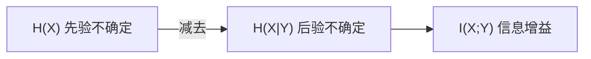

# 平均互信息量I(X;Y)

## 平均互信息量：从“收到的话”里能挤出多少“真信息”

通信的本质，是在一堆不确定里减少不确定。Alice 说了一句话，Bob 听到之后，他心里对 Alice 想表达的意思“有底了多少”？这个“有底了多少”，就是互信息要衡量的东西。

### 它是什么

平均互信息 $I(X;Y)$ 定义为：

$$I(X;Y) = H(X) - H(X|Y)$$

其中 $H(X)$ 是 Alice 语言符号集 $X$ 的先验熵，表示 Bob 在没听之前对 Alice 说什么有多不确定；$H(X|Y)$ 是条件熵，表示 Bob 听到 $Y$ 之后仍残留的不确定。两者一减，就是==“听到 Y 之后，关于 X 的不确定度减少了多少”==。

### 为什么需要它

在《安全通论》的“红客”语境里，攻防双方的语言、信号、探测行为都可以抽象成随机变量。红客要判断：蓝方发出的某个信号，到底让我对它的真实意图多了解了几分？如果 $I(X;Y)$ 很小，说明这个信道“白听了”；如果很大，说明信号质量高，值得信任。它是评估==观测价值==的核心标尺。

### 怎么做：以题为例

题目给的条件：

| 量 | 值 |
|---|---|
| $P(X=0)$ | $1/2$ |
| $P(X=1)$ | $1/2$ |
| $P(Y=1 \mid X=0)$ | $1/4$ |
| $P(Y=0 \mid X=1)$ | $1/8$ |

**第一步：补全转移概率。**

$$P(Y=0 \mid X=0) = 3/4,\qquad P(Y=1 \mid X=1) = 7/8$$

**第二步：算 $P(Y=0)$。** 用全概率公式：

$$P(Y=0) = \frac34 \cdot \frac12 + \frac18 \cdot \frac12 = \frac{7}{16}$$

**第三步：算后验概率。** 用贝叶斯公式：

$$P(X=0 \mid Y=0) = \frac{6}{7}, \qquad P(X=1 \mid Y=0) = \frac{1}{7}$$

**第四步：算信息增益。** 先验熵 $H(X)=1$ bit（等概）。后验熵：

$$H(X \mid Y=0) = -\left( \frac67 \log_2 \frac67 + \frac17 \log_2 \frac17 \right) \approx 0.591 \text{ bit}$$

所以：

$$I(X; Y=0) = H(X) - H(X \mid Y=0) \approx 1 - 0.591 = \boxed{0.409 \text{ bit}}$$

> [!IMPORTANT]
> 题目问的是“收到 $y=0$ 之后提供的关于 $X$ 的平均条件互信息”，本质上就是==这一个具体观测值带来的熵减量==，不是整个 $I(X;Y)$ 对 $Y$ 的期望。

### 和相近概念的区别

| 概念 | 记号 | 含义 | 是否是随机变量的函数 |
|---|---:|---|---|
| 平均互信息 | $I(X;Y)$ | 对所有 $y$ 加权平均的熵减 | 否（标量） |
| 点互信息 | $i(x;y)$ | 单个 $(x,y)$ 的 $\log \frac{P(x,y)}{P(x)P(y)}$ | 是 |
| 条件互信息 | $I(X;Y \mid Z)$ | 已知 $Z$ 后，$X$ 与 $Y$ 的熵减 | 否（标量） |

> [!WARNING]
> 常见坑：把“收到 $y=0$ 后的互信息”直接当成 $I(X;Y)$ 算。后者要求对 $P(Y)$ 加权平均，前者只固定在一个观测值上。题目若写“平均条件互信息 $I(X;y=0)$”，按熵减理解最稳妥。

### 记忆口诀

> [!TIP]
> **“先验减后验，就是互信息；固定一个 y，算那一次的增益。”**
