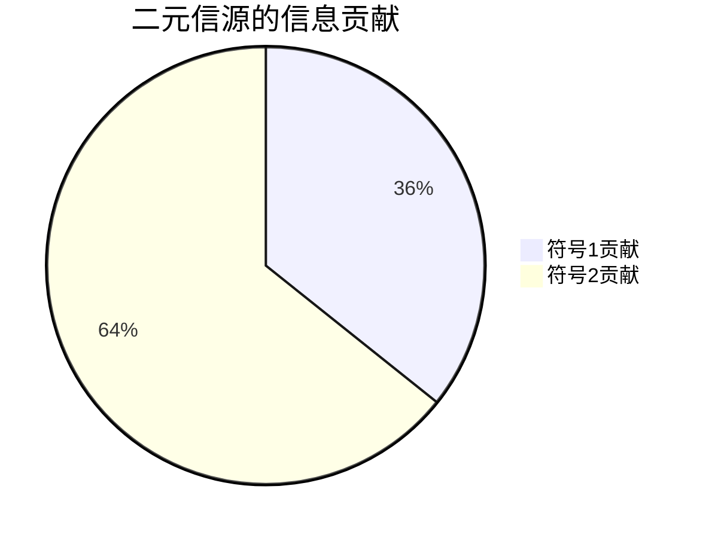

# 平均自信息量H(X)

## 它是什么

平均自信息量 $H(X)$ 用来衡量随机变量 $X$ 的==不确定程度==。在《安全通论》中，它描述一个信源输出某条消息时，该消息本身所包含的信息量。

若离散符号 $x_i$ 的概率为 $p(x_i)$，则其自信息量为：

$$
I(x_i)=\log_2\frac{1}{p(x_i)}=-\log_2 p(x_i)
$$

$log_2$ 的单位是比特（bit）。概率越小，消息越少见，发生后带来的信息量越大。

## 为什么要用平均值

单条消息的自信息量不能反映整个信源的不确定性。例如，同一密码系统有时输出常见字符，有时输出罕见字符；只看某次输出，无法判断整体信息量有多大。

因此，对所有可能符号的自信息量按出现概率取平均：

$$
H(X)=\sum_i p(x_i)I(x_i)
=-\sum_i p(x_i)\log_2 p(x_i)
$$

于是，$H(X)$ 表示：==在该信源下，随机取出一条消息平均能获得多少比特的信息。==

## 怎么计算

计算时通常按以下顺序：

1. 列出各符号及其概率 $p(x_i)$；
2. 求每个符号的自信息量 $-\log_2 p(x_i)$；
3. 用概率加权并求和。

例如，某信源有两个符号，概率分别为 $0.8$ 和 $0.2$：

$$
\begin{aligned}
H(X)
&=0.8\times(-\log_2 0.8)+0.2\times(-\log_2 0.2)\\
&\approx 0.8\times0.322+0.2\times2.322\\
&\approx 0.722\ \text{bit/符号}
\end{aligned}
$$

所以，一条消息的平均信息量约为 $0.722$ 比特。

## 与相近概念的区别

| 概念 | 关注对象 | 含义 |
|---|---|---|
| 自信息量 $I(x_i)$ | 某一条确定消息 | 该消息出现时携带的信息量 |
| 平均自信息量 $H(X)$ | 整个随机变量 | 各消息自信息量的概率平均 |
| 条件熵 $H(X\|Y)$ | 已知 $Y$ 后 | 剩余的不确定性 |
| 信源编码定理 | 无损编码 | 对独立同分布信源，熵是平均码长下界 |
| 密码系统安全性 | 密钥与密文 | 理想密码应使密文看不出明文结构 |

> [!IMPORTANT]
> $H(X)$ 不是“消息出现的概率”，也不是“消息长度”。它衡量的是信源输出消息时的平均不确定性。

## 常见坑

> [!WARNING]
> 不要把公式中的负号漏掉：$\log_2 p(x_i)\le 0$，所以自信息量与熵都需要相应的负号。

- 概率必须用小数表示，不能直接写 $80\%$ 代入对数。
- 若题目使用 $\log_2$，结果单位是 bit；若使用自然对数，单位是 nat。
- 概率之和应为 $1$。
- 当所有符号等概率时，熵达到最大值 $H(X)=\log_2 M$，其中 $M$ 为符号数；只有一个符号时，$H(X)=0$。

> [!TIP]
> 快速判断：分布越均匀，$H(X)$ 越大；分布越集中，$H(X)$ 越小。

图中两个扇区分别是 $p_i[-\log_2p_i]$。虽然第二个符号概率更小，但其自信息量更大，对总熵的贡献反而更多。
