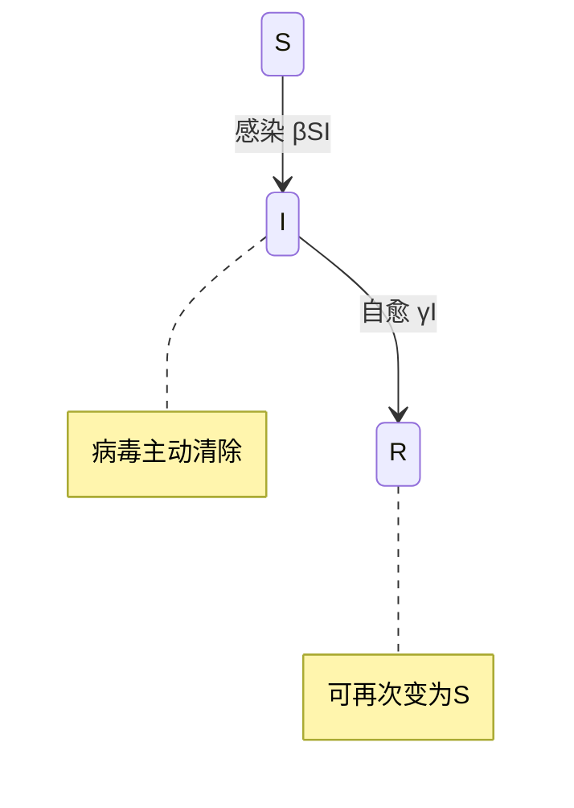

# 康复型病毒的动力学分析

## 什么是康复型病毒

在《安全通论》的病毒动力学框架中，我们通常将主机抽象为易感者($S$)、感染者($I$)和移除者($R$)。那么，如果一台被感染的主机能够==自动清除病毒并恢复健康状态==，它属于哪一类？

这就是**康复型病毒（Recovering Virus）**。与破坏型或永久驻留型病毒不同，这类病毒感染宿主后具有明确的“生命周期”，在完成传播或触发特定条件后，会主动删除自身代码或修复受损文件，使主机从 $I$ 状态回归 $S$ 或进入免疫态 $R$。典型例子包括某些早期良性蠕虫（如 Welchia）及具有自愈机制的实验性木马变种。

> [!IMPORTANT]
> 康复型病毒的核心特征是==感染状态的暂时性==。其动力学行为更接近标准 SIR 模型中的“恢复”过程，而非永久占用资源。

## 为什么需要分析它的动力学

既然病毒会“自我消失”，为何还要研究？因为康复不等于无害。在达到峰值前，它依然消耗网络带宽与系统资源；且其“康复”机制可能被恶意利用作为伪装。通过动力学建模，我们可以预测感染峰值时间、评估其对网络的瞬时冲击，并区分其与免疫型病毒的竞争差异。

## 动力学建模方法

康复型病毒遵循经典 SIR 模型框架，但需强调恢复率 $\gamma$ 的内生性：

$$
\begin{cases}
\frac{dS}{dt} = -\beta SI \\
\frac{dI}{dt} = \beta SI - \gamma I \\
\frac{dR}{dt} = \gamma I
\end{cases}
$$

其中 $\beta$ 为感染率，$\gamma$ 为==自主恢复率==（由病毒自身逻辑决定，非外部杀毒软件干预）。

> [!TIP]
> 解题关键：康复型病毒的 $\gamma$ 是==模型内参数==，而普通病毒的清除通常视为外部干预项。计算稳态时，若无新输入，$I(t) \to 0$。

## 与免疫型病毒的区别

考试中常要求对比二者，以下是核心差异：

| 维度 | 康复型病毒 | 免疫型病毒 |
| :--- | :--- | :--- |
| **核心行为** | 自我清除/修复 | 排斥/清除其他病毒 |
| **稳态趋势** | $I \to 0$（无新传入时） | $I \to$ 稳定正值或共存态 |
| **交互对象** | 仅与宿主交互 | 主动与其他病毒交互 |
| **模型扩展** | 标准 SIR/SIS | 需增加竞争抑制交叉项 |
| **典型实例** | Welchia 蠕虫 | Worm.Sasser |

> [!WARNING]
> 切勿混淆“康复”与“免疫”。康复指==自身退出==，免疫指==阻止他者==。免疫型病毒模型必须引入额外变量表示竞争强度。

## 常见误区与算例

> [!CAUTION]
> 误以为康复型病毒不会造成大规模传播。实际上若 $\beta > \gamma$，仍会在短期内爆发，只是衰减更快。

**例题验证**：设某康复型病毒 $\beta=0.5$, $\gamma=0.3$，初始 $S(0)=999, I(0)=1$。求感染峰值时刻 $t_{max}$ 的近似条件。

由 $\frac{dI}{dt}=0$ 得峰值条件 $S^* = \gamma / \beta = 0.6$。代入 $S$ 方程积分可得 $t_{max} \approx \frac{\ln(S(0)/S^*)}{\beta - \gamma} \approx \frac{\ln(1665)}{0.2} \approx 37.1$ 单位时间。该结果说明即使能自愈，感染规模仍取决于 $\beta/\gamma$ 比值，==比值越大，峰值越高、到达越快==。
