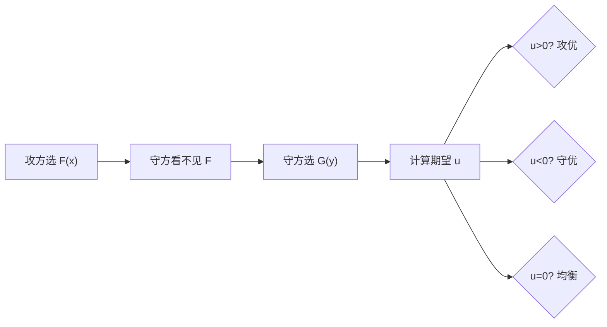

# 单挑盲对抗中攻守双方的实力对比

## 单挑盲对抗中的攻守实力对比

在单挑盲对抗中，攻方（黑客）和守方（红客）彼此不知道对方的精确策略，只能依据概率分布来决策。研究实力对比，核心是回答一个问题：**当双方都采用最优策略时，谁能赢？赢多少？**

先看一个熟悉的场景：石头剪刀布。若你知道对手偏好出石头，你会多出布；对手也会反向调整。最终双方都会走向一种“谁都无法单方面改进”的均衡。盲对抗的本质相同，只不过策略空间是连续的攻防强度。

### 为什么需要“御极限”

攻方要选择攻击强度 $x$，守方要选择防御强度 $y$。若攻方投入过多而守方防御恰好薄弱，攻击得手；若守方防御过度而攻方绕开，则资源浪费。双方都在猜对方。

由于彼此看不见，任何一方都无法针对性地压制对方，只能保证一个**期望意义下的最优结果**。对守方而言，这个最坏情况下仍能保证的防御效果，就称为==御极限==。

> [!IMPORTANT]
> 御极限不是“某一次防御能挡下多少攻击”，而是在盲对抗、双方都最优时，==守方在期望意义上能保证的最大防御水平==。

### 实力对比如何刻画

设攻方的混合策略为 $F(x)$，即攻击强度不超过 $x$ 的概率；守方的混合策略为 $G(y)$。当攻方强度 $x$ 与守方强度 $y$ 相遇时，用效用函数 $u(x,y)$ 表示攻方的收益（守方为 $-u$ 或对应损失）。

在盲对抗中，双方只能优化期望：

- 攻方选 $F$ 使 $\min_{y}\int u(x,y)\,dF(x)$ 最大；
- 守方选 $G$ 使 $\max_{x}\int u(x,y)\,dG(y)$ 最小。

若存在 $(F^*,G^*)$ 使双方都无法通过单方面改变而改善，则达到均衡。此时期望攻防效用 $v$ 同时是攻方的下界和守方的上界：

$$
v=\max_{F}\min_{y}\int u\,dF
=\min_{G}\max_{x}\int u\,dG
$$

这个 $v$ 就是攻防实力对比的**数值刻画**。$v>0$ 表示攻方占优，$v<0$ 表示守方占优。

### 一个算得清的例子

设攻防强度 $x,y\in[0,1]$，效用函数为

$$
u(x,y)=x-y
$$

即攻方强度越大越有利，守方强度越大越不利。直接看感觉是“攻强守弱”。

但注意：双方可以随机化。攻方若总出 $x=1$，守方知道后总出 $y=1$，攻方收益为 $0$；攻方若总出 $x=0$，收益为 $-y\le 0$。

实际上双方的最优混合策略都是对称分布，最后

$$
v=\int_0^1\int_0^1(x-y)\,dx\,dy
=\int_0^1 x\,dx-\int_0^1 y\,dy
=\frac12-\frac12=0
$$

> [!TIP]
> 这个例子说明：**表面上的强度优势 ≠ 盲对抗中的实力优势**。守方通过随机化防御位置，可以完全抵消攻方的线性强度优势。

### 和“非盲对抗”的区别

| 对比项 | 盲对抗 | 非盲对抗 |
|---|---|---|
| 信息 | 双方互不知策略 | 一方或双方可见 |
| 策略 | 必须随机化 | 可针对性固定 |
| 结果 | 期望均衡值 $v$ | 确定最优值 |
| 守方极限 | 御极限 | 精确封堵 |

> [!WARNING]
> 常见错误是**用单一确定策略去算实力对比**。盲对抗中若守方固定防御点，攻方一旦探知即可绕过，御极限会大幅下降。随机化不是“碰运气”，而是盲对抗下唯一能保证期望结果的手段。

### 小结

单挑盲对抗中，攻守实力对比不是比谁的招式更强，而是比**谁的混合策略在期望意义上更稳**。守方的御极限由均衡值 $v$ 的下界决定：无论攻方怎么变，期望损失都不超过某个界。考试中遇到“御极限是什么”，答出三层即可：==盲对抗假设、双方最优混合策略、守方期望最坏结果的上界==。
