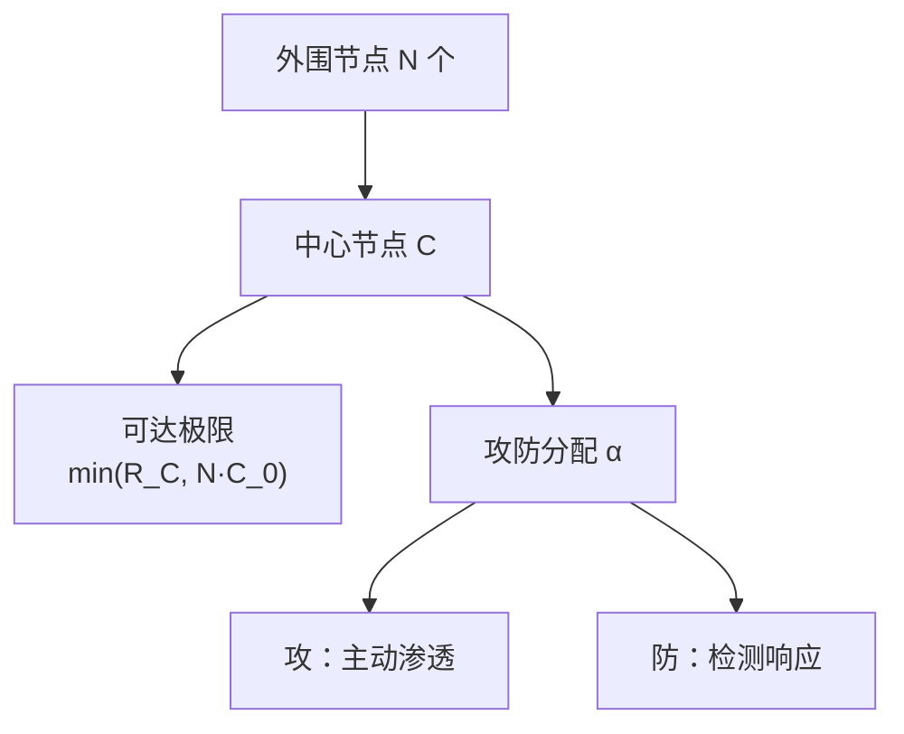

# 攻防一体星状网可达极限

## 攻防一体星状网可达极限

**它是什么**：在星状网络中，中心节点同时承担"攻"（主动发起）与"防"（被动响应）双重角色，当网络规模、链路容量与攻防策略达到特定约束时，网络整体性能（吞吐量、延迟、生存性）所能达到的**理论上限**。

**为什么需要**：星状网是现实中最普遍的拓扑（蜂窝网、Wi-Fi、SDN 星型控制等），理解其极限能帮我们在设计阶段就预判瓶颈，避免盲目扩容。

## 极限的推导思路

考虑 $N$ 个外围节点经中心节点 $C$ 通信。设：

- 单链路容量：$C_0$
- 中心节点处理速率：$R_C$
- 攻防资源分配比例：$\alpha$（攻）与 $1-\alpha$（防）

> [!IMPORTANT]
> 星状网可达极限由**中心节点处理能力** $R_C$ 与**外围链路总容量** $N \cdot C_0$ 的较小值决定，即：
> $$L = \min\left(R_C,\; N \cdot C_0\right)$$

当 $\alpha$ 偏离最优值 $\alpha^*$ 时，实际极限下降。最优分配满足边际收益相等：

$$\frac{\partial U_{\text{攻}}}{\partial \alpha} = \frac{\partial U_{\text{防}}}{\partial (1-\alpha)}$$

## 与相近概念的区别

| 概念 | 关注点 | 极限来源 |
|:---|:---|:---|
| 星状网可达极限 | 中心节点瓶颈 | 处理能力/链路容量 |
| 网状网可达极限 | 路径多样性 | 路由算法/跳数 |
| 攻防一体极限 | 资源分配权衡 | 攻防收益曲线 |

> [!WARNING]
> 常见误区：认为增加外围节点数 $N$ 总能提升网络能力。实际上当 $N \cdot C_0 > R_C$ 时，中心节点成为**绝对瓶颈**，继续增加 $N$ 反而降低单节点可用带宽。

## 算例

设 $N=10$，$C_0=100\,\text{Mbps}$，$R_C=800\,\text{Mbps}$，攻防收益函数分别为 $U_{\text{攻}}=2\alpha\sqrt{N}$，$U_{\text{防}}=3(1-\alpha)\ln N$。

求可达极限及最优 $\alpha$。

**解**：

网络容量上限：
$$L = \min(800,\; 10 \times 100) = 800\,\text{Mbps}$$

求最优分配：
$$\frac{\partial U_{\text{攻}}}{\partial \alpha} = 2\sqrt{10} \approx 6.32$$
$$\frac{\partial U_{\text{防}}}{\partial (1-\alpha)} = 3\ln 10 \approx 6.91$$

令二者相等（此处直接比较边际系数，因均为线性）：

$$\alpha^* = \frac{6.91}{6.32+6.91} \approx 0.522$$

故最优攻防分配为**攻 52.2%、防 47.8%**，此时网络可达极限保持 $800\,\text{Mbps}$，任何偏离都会使有效极限下降。

> [!TIP]
> 解题口诀：先算 $\min$ 定上限，再令边际相等求 $\alpha^*$，最后验证 $N \cdot C_0$ 是否越界。
