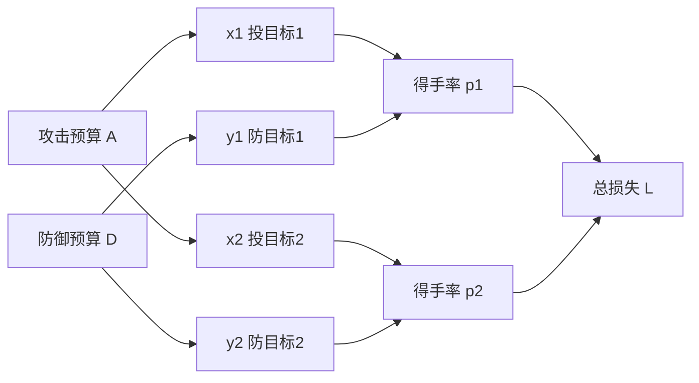

# 攻防一体的“经济学”模型
先想一个问题：如果防御者把某一类攻击全部“物理隔离”了，攻击者是不是就再也没办法了？直觉上好像是的；但安全对抗的宏观经济视角告诉我们：==攻击者的总预算不会消失，只会转移==。这正是攻防一体“经济学”模型要刻画的核心。

### 它是什么

第 10 章此前讨论的模型，往往单独描述“攻击方策略分布”或“防御方策略分布”。攻防一体的“经济学”模型则把双方放在同一个约束下看：

- 攻击者有一个预算 $A$，可以用在 $n$ 类攻击手段上；
- 防御者有一个预算 $D$，可以用在 $n$ 类防御手段上；
- 攻防双方都追求“收益最大 / 损失最小”，且会因对方的投入变化而调整自己的投入。

形式上，可以把攻防双方的投入分别记为向量

$$
x=(x_1,x_2,\dots,x_n),\qquad y=(y_1,y_2,\dots,y_n),
$$

满足

$$
\sum_{i=1}^{n}x_i=A,\qquad \sum_{i=1}^{n}y_i=D.
$$

攻击者对第 $i$ 类目标的“得手率”不仅取决于自己的投入 $x_i$，也取决于防御者的投入 $y_i$，例如可写为

$$
p_i=\frac{x_i}{x_i+y_i}
$$

或更一般的函数 $p_i(x_i,y_i)$。防御者的损失则与 $p_i$ 及资产价值 $v_i$ 相关：

$$
L=\sum_{i=1}^{n}v_i\,p_i(x_i,y_i).
$$

攻击者希望最大化类似 $L$ 的收益，防御者希望最小化 $L$。双方在预算约束下同时决策，得到的均衡就是==攻防一体的经济学均衡==。

### 为什么需要

如果只看单方最优，会出现一个明显漏洞：防御者把所有资源都投在高价值目标上，攻击者就可能转向低价值但防御薄弱的目标，造成“防住了 A，丢了 B”。经济学模型的价值在于把这种**替代效应**和**预算约束**显式写出来，用来解释：

- 为什么安全投入不能只堆在一个点；
- 为什么攻击会从强防御目标向弱防御目标“漂移”；
- 为什么防御方要做全局预算分配，而不是逐点“哪个最痛就补哪个”。

### 怎么做

以一个简单两目标模型为例。

**假设**：目标 1 价值 $v_1=100$，目标 2 价值 $v_2=50$；攻击者总预算 $A=60$，防御者总预算 $D=60$；得手率取

$$
p_i=\frac{x_i}{x_i+y_i}.
$$

攻击者的问题是：在 $x_1+x_2=60$ 下最大化

$$
R=100\cdot\frac{x_1}{x_1+y_1}+50\cdot\frac{x_2}{x_2+y_2}.
$$

防御者的问题是：在 $y_1+y_2=60$ 下最小化同一个 $R$。

对攻击者求一阶条件，可得到两个目标的边际收益相等：

$$
\frac{100y_1}{(x_1+y_1)^2}
=
\frac{50y_2}{(x_2+y_2)^2}.
$$

对防御者求一阶条件，同理得到边际损失相等的关系。在对称情形下联立求解，常常得到形如

$$
\frac{x_i}{y_i}=\sqrt{\frac{v_i}{\lambda}}
$$

的规律：==攻击者和防御者都会向高价值目标投入更多，但不会把低价值目标完全放弃==。

### 和相近概念的区别

| 概念 | 核心问题 | 关键变量 |
|---|---|---|
| 单方攻击模型 | 攻击者如何分配预算才能最大破坏 | 只有 $x_i$ |
| 单方防御模型 | 防御者如何分配预算才能最小损失 | 只有 $y_i$ |
| 攻防一体经济学模型 | 双方预算互相制约下的均衡 | $x_i$ 与 $y_i$ 同时决定 |

> [!IMPORTANT]
> 本模型的核心不是“谁赢谁输”，而是==均衡存在==：当双方都无法通过单方面调整预算获得更好结果时，系统达到一种相对稳定状态。

### 常见的坑

> [!WARNING]
> 不要以为“防御投入越多，得手率一定线性下降”。在 $p_i=\frac{x_i}{x_i+y_i}$ 形式下，防御的边际效果递减；当 $y_i$ 已经远大于 $x_i$ 时，继续加防御的收益很小。

> [!CAUTION]
> 不要只比较“高价值目标”和“低价值目标”的绝对收益。攻击者比较的是**单位预算的边际收益**，而不是“打 100 分的比打 50 分的更划算”。如果高价值目标防御极强，攻击者很快会转移到低价值目标。

### 一个算对了的例子

仍用上面的两目标情形。假设经联立求解得到均衡为：

$$
y_1=40,\quad y_2=20,\quad x_1=40,\quad x_2=20.
$$

验证总预算：

$$
x_1+x_2=40+20=60,\qquad y_1+y_2=40+20=60.
$$

此时得手率：

$$
p_1=\frac{40}{40+40}=0.5,\qquad
p_2=\frac{20}{20+20}=0.5.
$$

总损失：

$$
L=100\times 0.5+50\times 0.5=75.
$$

如果防御者错误地把 60 全部投到目标 1，即 $y_1=60,y_2=0$，攻击者会把全部预算投到无人防守的目标 2：$x_2=60$，总损失反而变为

$$
L=100\times 0 + 50\times \frac{60}{60+0}=50
$$

……看起来损失不大？但这是因为目标 2 价值只有 50。若目标 2 价值也是 100，则损失会飙到 100。==均衡分配的意义不是“每个点都赢”，而是避免极端倾斜带来的系统性暴露。==

> [!TIP]
> 考试中遇到“求攻防预算分配”的题，先写约束条件 $\sum x_i=A,\ \sum y_i=D$，再写双方目标函数，最后求一阶条件。不要一上来就猜“按价值比例分配”——只有 $p_i$ 取特定形式时，比例分配才成立。
