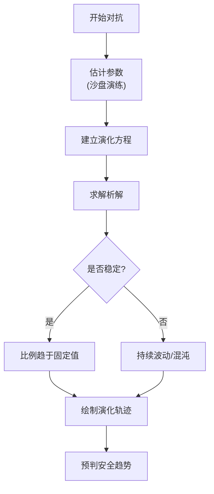

# 攻防的演化模型与轨迹

## 什么是攻防演化模型

在《安全通论》第12章中，我们不再将红客与黑客的对抗视为静态博弈，而是引入==进化论思想==与==协同学==。该模型的核心假设是：攻防双方均受==经济目标==驱动（即追求利益最大化或损失最小化）。

> [!IMPORTANT]
> 核心定义：攻防演化模型是利用微分方程描述攻击投资 $E(t)$ 与防守投资 $R(t)$ 随时间动态变化的数学框架，旨在揭示两者比例趋于稳定的规律。

为什么需要它？因为安全对抗是动态的。若无法量化，就无法预测趋势。通过建立模型，我们可以计算出系统在长时间运行后，攻防投入比例是否会收敛到一个固定值，从而把握整体安全态势。

## 模型构建与轨迹分析

模型基于以下逻辑：
1.  **变量定义**：设 $E_0(t)$ 为攻击方平均投资，$R_0(t)$ 为防守方平均投资。
2.  **动力学方程**：利用协同学成果，建立关于 $E$ 和 $R$ 的微分方程组。
3.  **稳定性分析**：求解方程的解析解，分析其稳定性。

> [!TIP]
> 即使未知具体参数，也可预先绘制多组参数下的==轨迹曲线图==，实战中通过比对实际数据与曲线形态，快速定位当前所处的对抗阶段。

## 常见误区与辨析

许多同学对“经济目标”这一前提存疑，认为黑客追求正义或破坏快感，与钱无关。

| 维度 | 传统道德视角 | 安全通论量化视角 |
| :--- | :--- | :--- |
| **驱动力** | 正义、好奇、恶意 | ==可量化的经济指标== |
| **研究方法** | 定性描述、案例分析 | 微分方程、稳定性分析 |
| **目标** | 输赢、面子 | 投入产出比最优 |

> [!WARNING]
> 切勿纠结于道德辩护。==只有转化为经济指标，才能进行数学建模与量化研究==。这是本门课程进行科学分析的前提，而非对动机的道德评判。

## 算例演示：轨迹预测

**场景**：某信息系统在沙盘演练中，测得攻防相互作用系数为 $\alpha, \beta$，自身衰减系数为 $\delta_E, \delta_R$。

**步骤**：
1.  代入演化方程：
    $$
    \begin{cases} 
    \frac{dE}{dt} = f(E, R; \alpha, \delta_E) \\ 
    \frac{dR}{dt} = g(E, R; \beta, \delta_R) 
    \end{cases}
    $$
2.  令 $\frac{dE}{dt}=0, \frac{dR}{dt}=0$，求得平衡点 $(E^*, R^*)$。
3.  分析雅可比矩阵特征值，确认该平衡点是==稳定节点==。

**结论**：无论初始投入如何，长期来看，攻击与防守的投资比例将稳定在 $E^*/R^*$。管理者可据此调整预算，避免过度防御或防御不足。
