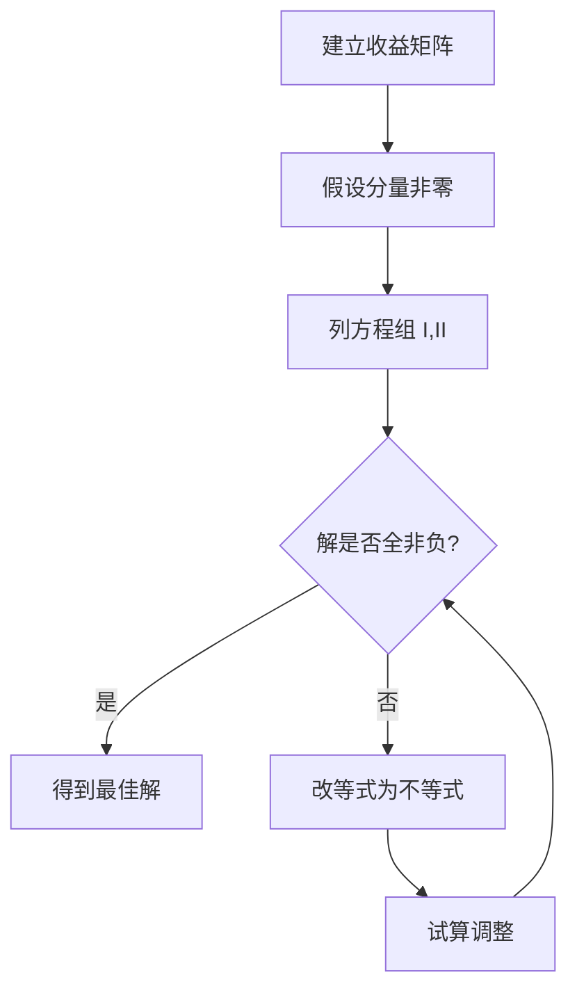

# 最佳攻防策略的计算

## 什么是最佳攻防策略的计算

在沙盘演练中，当攻防双方都绝对理智且以自身利益最大化为目标时，我们需要找到一组稳定的策略组合 $(x^*, y^*)$。这组策略就是==最佳攻防对策解==。简单来说，就是攻击方选 $x^*$、防守方选 $y^*$ 时，任何一方单方面改变策略都无法获得更高收益。

> [!IMPORTANT]
> 核心定义：若方程组（I）和（II）存在非负解 $x^*$ 和 $y^*$，则 $(x^*, y^*)$ 即为最佳攻防对策解。它是博弈达到纳什均衡的数学表达。

为什么不能只靠直觉？因为网络安全攻防往往是零和或非零和博弈，单纯追求“最强防护”或“最猛攻击”会导致资源浪费或被对手预判。计算出的最佳策略能保证在对手最优应对下，己方期望效用最大化，最终趋向理性共赢。

## 计算方法与局限

教材给出的经典方法是求解线性方程组。假设 $x^*$ 和 $y^*$ 的所有分量均不为零，将博弈收益矩阵转化为等式方程组（I）和（II）联立求解。

> [!WARNING]
> 此方法有显著局限性：它事先假设所有策略概率 $>0$。若实际最优解中某些分量为 0（即该策略根本不被采用），方程组将无非负解。后续的“试算求解”无固定规程，依赖经验，计算复杂度随策略数激增。

## 与相近概念的区别

| 概念 | 适用场景 | 策略特征 | 计算依据 |
| :--- | :--- | :--- | :--- |
| 最佳纯策略 | 鞍点存在时 | 确定性选择单一行动 | $\max \min = \min \max$ |
| 最佳混合策略 | 无鞍点时 | 按概率分布随机化行动 | 方程组/线性规划 |
| Stackelberg均衡 | 主从博弈 | 防守方先动，攻击方后动 | 反应函数逆向归纳 |

> [!NOTE]
> 考题中“攻守双方理智前提下的最佳纯策略”，特指收益矩阵存在鞍点的情况。若无鞍点，则必须转向混合策略计算，此时不存在确定的纯策略解。

## 算对的关键示例

考虑一个简化攻防矩阵，攻击方策略 $A_1, A_2$，防守方 $D_1, D_2$，收益（攻击方视角）为：
$$
\begin{bmatrix}
3 & -1 \\
-2 & 4
\end{bmatrix}
$$
该矩阵无鞍点（$\max(-2,-1)=-1 \neq \min(3,4)=3$），需计算混合策略。设攻击方以概率 $p$ 选 $A_1$，防守方以 $q$ 选 $D_1$。令攻击方期望收益对 $q$ 无差异：$3p + (-2)(1-p) = (-1)p + 4(1-p)$，解得 $p=0.6$。同理令防守方期望损失对 $p$ 无差异，解得 $q=0.5$。验证 $p,q \in [0,1]$，故最佳攻防对策解为 $( (0.6, 0.4), (0.5, 0.5) )$。

> [!TIP]
> 解题口诀：先查鞍点定纯策，无鞍再设概率变量；等式联立求非负，负值出现转不等式试算。务必验证解的非负性与归一性。
