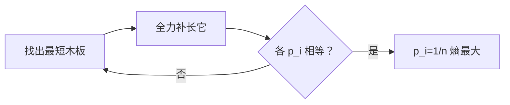

# 最佳红客（防御者最优策略）

## 为什么需要"最佳"红客

红客的任务是防御网络系统，但系统的安全漏洞可能有很多处，防御资源总是有限的。那么自然要问：把资源花在哪里，才能让整个系统最安全？这就是"最佳红客"要回答的问题。

先回忆安全熵的视角：设系统有 $n$ 个用户（或 $n$ 类安全需求），攻击者选中第 $i$ 个用户作为突破口的概率为 $p_i$。红客防御得越均匀，攻击者越"摸不准"从哪里下手，系统就越安全。用信息论的语言，==系统的安全程度由安全熵度量，而熵在分布最均匀时达到最大==。

## 什么是最佳红客

> [!IMPORTANT]
> 最佳红客的标准：他能够保护网络系统，使得各个 $p_i = 1/n$ 都相同，此时系统的安全熵达到最大值 $\log n$。

也就是说，最佳红客防御后的系统，对攻击者来说就像掷一枚均匀的 $n$ 面骰子——每个用户被攻破的可能性完全一样，不确定性（熵）最大：

$$H_{\max} = -\sum_{i=1}^{n} \frac{1}{n}\log\frac{1}{n} = \log n$$

任何分布不均匀（某些用户 $p_i > 1/n$，另一些 $< 1/n$）都会使熵小于 $\log n$，意味着攻击者更容易锁定薄弱环节。

## 怎么做：木桶原理式防御

满足条件（4.6）式的最佳红客，其实只全力以赴地保护一个用户，或者说一类安全价值观完全相同的用户，此类用户的安全价值观由相应的概率分布刻画。

形象地说，把系统想象成木桶，每个用户是一块木板，$p_i$ 越大代表木板越"短"（越容易被攻破）：

- 最佳红客只需要 ==补长安全系统的那根最短木板==；
- 补完后再找新的最短木板继续补；
- 直到所有木板"长度"相同，即 $p_1 = p_2 = \cdots = p_n = 1/n$。

## 与相近概念的区别

| 概念 | 关注点 | 与安全熵的关系 |
| --- | --- | --- |
| 一般红客 | 修补漏洞、抵御攻击 | 不一定使熵最大 |
| 最佳红客 | 均匀化各 $p_i$ | 使 $H=\log n$ 达最大 |
| 攻击者（黑客） | 找 $p_i$ 最大处突破 | 希望熵越小越好 |

## 常见的坑

> [!WARNING]
> 不要以为最佳红客是"平均分配防御预算"。平均的是防御后的效果（各 $p_i$ 相等），而不是投入的资源。薄弱处要多补，坚固处可以不补。

> [!CAUTION]
> 不要只补一根最短的木板就停手。补平一根后必须继续找新的最短木板，直到全部相等，否则熵仍未达到最大。

## 一个算对的例子

**例**：某系统有 $n=4$ 个用户，初始被攻破概率为 $(0.5,\ 0.25,\ 0.125,\ 0.125)$。最佳红客防御后应达到什么状态？此时安全熵是多少？

**解**：按最佳红客标准，补长最短木板直至各概率相等：

$$p_1=p_2=p_3=p_4=\frac{1}{4}$$

此时安全熵达到最大值：

$$H = -\sum_{i=1}^{4}\frac{1}{4}\log\frac{1}{4} = \log 4 = 2 \text{（比特）}$$

而防御前的熵 $H_0 = -(0.5\log 0.5 + 0.25\log 0.25 + 2\times 0.125\log 0.125) = 1.75$ 比特 $< 2$ 比特，验证了均匀化后安全性确实提高。

> [!TIP]
> 答题抓两点：① 最佳红客使 $p_i=1/n$；② 安全熵达最大值 $\log n$。看到"最均匀""熵最大"就是它了。
