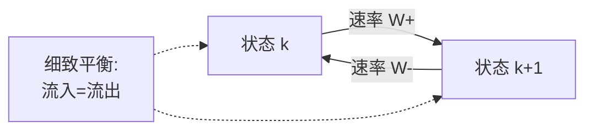

# 民意主方程的定态解

# 民意主方程的定态解

## 它是什么与为什么需要

在《安全通论》第16章中，民意的演化被视为一个随机过程。**民意主方程**描述了系统处于某一状态（如支持率为 $k$）的概率 $P_k(t)$ 随时间变化的规律。

然而，动态方程求解复杂且随时间波动。**定态解**（Stationary Solution）关注的是当时间 $t \to \infty$ 时，系统达到的稳定分布 $P_k^{st}$。此时概率不再随时间变化，即 $\frac{dP_k}{dt} = 0$。

> [!IMPORTANT]
> ==核心结论==：定态解揭示了舆论在长期演化后的**最终格局**，是判断舆情是否可控、是否存在极端极化风险的关键依据。

## 怎么做：细致平衡原理

求解定态解通常不直接解微分方程组，而是利用**细致平衡条件**（Detailed Balance）。假设民意只在相邻状态间转移（如支持者增加或减少1人），则流入某状态的概率流等于流出的概率流。

设 $W_{k \to k+1}$ 为从状态 $k$ 转移到 $k+1$ 的速率，$W_{k+1 \to k}$ 为反向速率。定态下满足：
$$ P_k^{st} W_{k \to k+1} = P_{k+1}^{st} W_{k+1 \to k} $$

由此可得递推关系：
$$ P_{k+1}^{st} = P_k^{st} \frac{W_{k \to k+1}}{W_{k+1 \to k}} $$

通过迭代，可将所有 $P_k^{st}$ 用 $P_0^{st}$ 表示，最后利用归一化条件 $\sum P_k^{st} = 1$ 求出常数。

## 常见误区与辨析

许多同学容易混淆“定态”与“平衡态”，或忽略边界条件。

| 概念 | 含义 | 关键特征 |
| :--- | :--- | :--- |
| **定态解** | 概率分布不随时间变 | $\frac{dP}{dt}=0$，可能有概率流循环 |
| **平衡态** | 无净概率流 | 满足细致平衡，是定态的特例 |
| **瞬态解** | 演化过程中的分布 | 随时间剧烈变化，难解析求解 |

> [!WARNING]
> ==易错坑==：在计算归一化常数时，切勿遗漏 $k=0$ 或 $k=N$ 的边界项。若转移速率在某处为零，需单独讨论截断情况。

## 算例演示

**题目**：假设某议题只有“支持”与“反对”两种声音，总人数 $N=2$。设从反对转支持的速率为 $\alpha$，从支持转反对的速率为 $\beta$。求定态下恰有1人支持的概率 $P_1^{st}$。

**解析**：
状态空间为 $k \in \{0, 1, 2\}$（支持人数）。
转移速率：
- $0 \to 1$: $W_{0\to1} = 2\alpha$ (2个反对者均可转)
- $1 \to 0$: $W_{1\to0} = 1\beta$ (1个支持者可转)
- $1 \to 2$: $W_{1\to2} = 1\alpha$
- $2 \to 1$: $W_{2\to1} = 2\beta$

利用细致平衡：
1. $P_0^{st} (2\alpha) = P_1^{st} (\beta) \implies P_1^{st} = \frac{2\alpha}{\beta} P_0^{st}$
2. $P_1^{st} (\alpha) = P_2^{st} (2\beta) \implies P_2^{st} = \frac{\alpha}{2\beta} P_1^{st} = \frac{\alpha^2}{\beta^2} P_0^{st}$

归一化 $\sum P_k = 1$：
$$ P_0^{st} \left( 1 + \frac{2\alpha}{\beta} + \frac{\alpha^2}{\beta^2} \right) = 1 $$
解得 $P_0^{st}$ 后代入即可求得 $P_1^{st}$。若 $\alpha=\beta$，则 $P_1^{st} = 2/4 = 0.5$。

> [!TIP]
> 记忆技巧：先写递推比，再求归一化。分子是“进”，分母是“出”。
