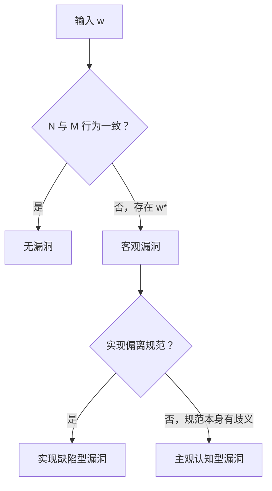

# 漏洞的主观和客观描述

## 漏洞是什么：先想清楚这个问题

在讲"主观/客观"之前，先问自己一个问题：**漏洞是系统自带的属性，还是人赋予系统的判断？**

考虑一个场景：某台服务器上跑着一段十年没人碰过的旧代码，里面有一处逻辑错误。十年来没有任何攻击者发现它，系统也从未因此出故障。——这段代码里"有漏洞"吗？

再考虑另一个场景：某系统按设计规范运行，但黑客利用规范本身允许的合法操作组合，完成了管理员不希望发生的事（比如用正常的查询接口拼出了敏感数据）。——这算漏洞吗？

这两个场景正是"主观描述"和"客观描述"的分水岭。

## 从图灵机的角度看漏洞

把信息系统抽象成一台图灵机 $M$，它的形式化规范（设计文档、安全策略）定义了"合法行为"的集合。系统的实际实现是另一台图灵机 $N$。

$$M = (Q_M, \Sigma, \delta_M, q_0, F_M), \quad N = (Q_N, \Sigma, \delta_N, q_0, F_N)$$

- **情况 1**：对所有输入 $w$，$N$ 与 $M$ 的行为完全一致（接受/拒绝相同，状态转移等价）。此时 $N$ 没有偏离规范，==不存在可被指认的漏洞==。
- **情况 2**：存在某个输入 $w^*$，使得 $N$ 进入了 $M$ 不会进入的非法状态（或 $N$ 不停机而 $M$ 会停机）。此时 $N$ 与 $M$ 不再等价，**严格且客观地说，黑客发现并成功利用了某个漏洞**。

## 客观描述：实现与规范的偏离

客观描述的核心是**可实现、可验证的偏差**：给定具体输入 $w^*$，能复现 $N$ 与 $M$ 的不同行为，就能客观断言漏洞存在。缓冲区溢出就是典型例子——规范说数组长度是 64 字节，实现却允许写入第 65 字节，这是 $\delta_N$ 与 $\delta_M$ 在特定输入下的可观测差异。

## 主观描述：安全是主观的

> [!IMPORTANT]
> 课件原话："由于安全是主观的，所以情况 2 又可以再细分。"

客观偏差只是必要条件，**是否构成"漏洞"还取决于观察者的安全意图**。同一个程序行为：

| 场景 | 行为 | 管理员视角 | 黑客视角 |
|------|------|------------|----------|
| 调试接口未鉴权 | 可读取配置 | 疏忽，是漏洞 | 攻击入口，是漏洞 |
| 匿名 FTP 上传 | 可写文件 | 故意开放，不是漏洞 | 可利用，是漏洞 |
| 密码找回逻辑 | 可枚举用户名 | 设计如此，不是漏洞 | 信息泄露，是漏洞 |

也就是说，**漏洞 = 客观存在的实现偏差（或特性）∩ 主观认定的安全损害**。没有主观安全目标，偏差只是"特性"（feature），不是漏洞。

## 与相近概念的区别

| 概念 | 判定标准 | 主客观 |
|------|----------|--------|
| Bug（缺陷） | 偏离功能规范 | 纯客观 |
| 漏洞（Vulnerability） | 可被利用造成安全损害 | 主客观结合 |
| 风险（Risk） | 漏洞 × 威胁 × 资产价值 | 主观评估 |

一个 Bug 如果不涉及安全（比如界面按钮颜色不对），就不是漏洞；反过来，一个完全符合代码逻辑的行为（比如默认密码 `admin`），若被用于未授权访问，安全团队会认定它是漏洞——尽管从程序正确性看它"没写错"。

## 常见的坑

> [!WARNING]
> 答题时只写"漏洞就是系统的缺陷/弱点"会被扣分。必须体现两个层次：**客观层是图灵机 $N$ 与 $M$ 的不一致，主观层是安全意图的认定**。

> [!CAUTION]
> 不要把"主观"理解成"随意"。主观描述不是凭空猜测，而是基于安全策略对客观偏差进行的价值判断。

## 例题解析

**题目**：列举 3 个以上的常见系统漏洞，从图灵机的角度阐述何为系统漏洞。（8 分）

**参考答案**：

1. **常见漏洞举例**（3 分，答出 3 个即可）：缓冲区溢出、SQL 注入、跨站脚本（XSS）、权限提升、默认口令/弱认证、路径遍历。

2. **图灵机角度阐述**（5 分）：
   - 将系统形式化为图灵机 $N$，其设计规范为图灵机 $M$；
   - 漏洞是：存在输入 $w^*$，使得 $N(w^*)$ 与 $M(w^*)$ 的行为不一致——$N$ 进入了 $M$ 不允许的非法状态或异常停机；
   - 从可计算性理论看，判定"任意程序是否存在这样的 $w^*$"等价于停机问题的变体，是**不可判定的**，这解释了为什么漏洞无法被静态分析彻底穷举；
   - 但"是否算漏洞"还需结合安全意图主观判断：同一偏差，若未被利用或未违背安全策略，可能仅被视为特性而非漏洞。

> [!TIP]
> 记忆口诀：**"客观看偏差，主观看意图；图灵不等价，安全来定级。"**
