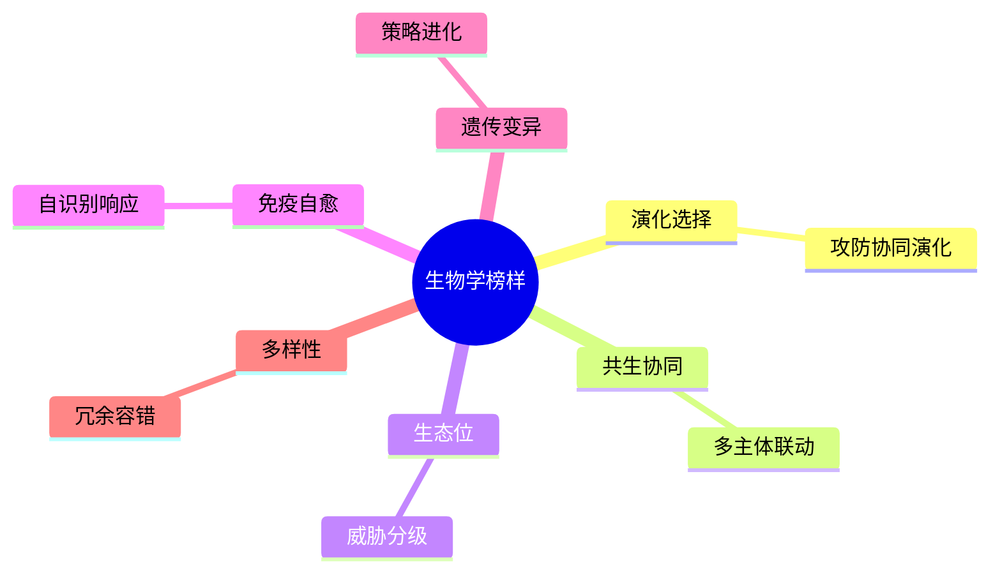

# 生物学榜样（生态学类比基础）

## 生物学榜样（生态学类比基础）

网络安全问题长期"打补丁"式防御，越堵漏洞越多。能不能换个思路？**生物圈**在几十亿年的演化中形成了稳定、自适应、协同共生的体系，它给我们提供了改造网络安全的==生物学榜样（生态学类比）==。本节是"网络安全生态学"整章的理论根基：把生态系统的思想与机制映射到网络空间，构建具有自适应、自演化能力的网络安全体系。

> [!IMPORTANT]
> 核心命题：将网络安全系统类比为**生态系统**，用生态学的演化、共生、免疫、协同等机制来设计网络安全新范式。

## 为什么需要生物学榜样

想一想：为什么一片原始森林没有管理员，却能长期稳定运行？因为它靠的是**种群竞争、食物链、共生、协同演化、自我修复**这套生态机制，而不是中央管控。网络空间当前的"人管机器、人堵漏洞"模式显然做不到这一点。因此，把生态学的成功经验搬过来，就是"网络安全生态学"的方法论起点。

## 生物学榜样的核心映射

生态学的关键机制与网络安全概念的对应关系如下表：

| 生态学机制 | 网络安全类比 | 关键作用 |
|---|---|---|
| 演化 / 自然选择 | 攻防协同演化 | 防御随威胁自适应进化 |
| 共生 / 协同 | 多主体联动防御 | 跨域协同、互利共生 |
| 食物链 / 生态位 | 威胁分级与角色分工 | 每个主体有"生态位" |
| 免疫系统 | 入侵检测与自愈 | 自识别、自响应、自修复 |
| 遗传 / 变异 | 策略进化与攻击变异 | 双向演化、动态博弈 |
| 多样性 | 冗余与容错 | 降低单点崩溃风险 |

## 怎么做：从类比到建模

借鉴生物学榜样构建网络安全生态，一般沿三条路径展开：

- **概念对齐**：把"资产、威胁、防御主体"分别映射为"物种、捕食者、共生体"，形成统一语义。
- **机制复刻**：将演化动力学、种群竞争（如 Lotka–Volterra 模型）引入攻防建模：
  $$\begin{cases}\dfrac{d x}{d t}=\alpha x-\beta x y\\[6pt]\dfrac{d y}{d t}=\delta x y-\gamma y\end{cases}$$
  其中 $x$ 为防御方种群规模，$y$ 为攻击方种群规模，$\alpha,\beta,\delta,\gamma$ 为演化系数。
- **系统设计**：借鉴免疫系统的"识别—响应—记忆—自愈"闭环，实现内生安全。

> [!TIP]
> 记忆口诀：**"演、共、位、疫、传、多"**——演化、共生、生态位、免疫、遗传变异、多样性，六要素构成生物学榜样的"生态工具箱"。

## 与相近概念的区别

| 概念 | 关注点 | 是否用生物机制 |
|---|---|---|
| 传统安全（攻防对抗） | 单点漏洞、边界防御 | 否 |
| 风险管理 | 风险评估与处置 | 否，量化为主 |
| 生物学榜样 / 生态学类比 | 体系化、自适应演化 | ==是==，方法论基础 |
| 网络安全生态学 | 完整生态体系构建 | 是，工程化落地 |

也就是说，==生物学榜样是"类比+方法论"，网络安全生态学是其"工程化体系"==。

## 常见的坑

> [!WARNING]
> - **类比 ≠ 等价**：生物系统与网络系统存在本质差异（如恶意智能体可主动设计攻击），不能机械照搬公式。
> - **忽略协同演化**：攻防是双向演化的，只考虑防御方演化会严重低估威胁。
> - **混淆"榜样"与"生态"**：生物学榜样是出发点，不是最终体系。

> [!CAUTION]
> 把"生物学榜样"直接当作某种具体算法或协议去考，是最容易丢分的误区——它本质是==生态学类比的基础与方法论==。

## 一个对上号的例子

**题目**：某防御体系引入"免疫机制"，能识别已知攻击、对未知攻击产生响应并留下"记忆"，下次快速处置。该设计借鉴了生物学榜样中的哪一机制？对应生态学中的什么？

**解**：识别—响应—记忆—自愈闭环，对应生物体的==免疫系统==；属于生态学类比中的"免疫自愈"机制，作用是实现网络安全的自适应与自修复。这正是生物学榜样在网络安全生态学中的典型应用。
