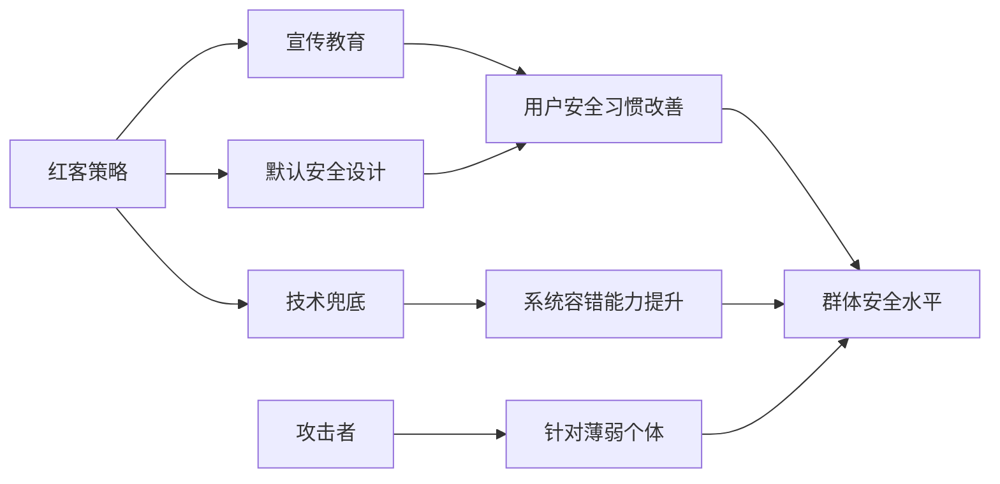

# “用户+红客”生态学

## “用户+红客”生态学

在网络安全对抗中，单看攻击者与防御者的博弈容易忽略一类重要角色：==普通用户==。用户既不是专业黑客，也不直接参与防御，但用户的安全习惯却直接改变攻防双方的力量对比。把用户群体和红客群体放到同一个生态系统中考察，就是“用户+红客”生态学要解决的问题。

### 为什么需要把“用户”拉进来

传统安全模型里，防御方只需管好系统本身：打补丁、设防火墙、写入侵检测规则。但这个前提是用户不会“拖后腿”。现实中：

- 用户点击钓鱼邮件，直接让精心配置的边界防御形同虚设；
- 用户使用弱口令，让加密与认证机制失去意义；
- 用户拒绝更新，让已知漏洞长期暴露。

红客即使技术再强，也无法替每一个用户做每一次决策。因此，==安全水平不取决于最强一环，而取决于用户群体的整体行为分布==。

[!IMPORTANT]
> “用户+红客”生态学的核心观点：用户本身是网络安全系统的一部分，红客的目标不是“管住”用户，而是**改变用户行为的生态参数**，使群体安全状态向良性方向演化。

### 怎么建模：从个体到群体

单个用户的行为是不可预测的，但群体行为呈现统计规律。可以把用户按安全习惯分成不同类型，例如：

| 用户类型 | 行为特征 | 对系统安全的贡献 |
|---|---|---|
| 安全敏感型 | 主动更新、谨慎点击、使用强口令 | 正向 |
| 普通随性型 | 偶尔注意，但容易被诱导 | 中性偏负 |
| 高危习惯型 | 反复使用弱口令、点击任意链接 | 负向 |

红客的策略不只是技术加固，还包括：

- **宣传教育**：把一部分普通型转变为敏感型；
- **默认安全设计**：让不安全的选择变得困难，如强制双因素认证；
- **拦截与兜底**：即使用户犯错，系统仍能检测并阻断攻击。

用生态学的语言说：红客在调节==用户群体的“安全免疫力”==，攻击者则在持续寻找免疫力最薄弱的个体。

### 和相近概念的区别

“用户+红客”生态学容易与几个相关概念混淆：

| 概念 | 关注对象 | 核心问题 |
|---|---|---|
| 攻防博弈 | 攻击者 vs 防御者 | 双方策略均衡 |
| 用户+红客生态学 | 用户群体 + 红客策略 | 群体行为如何影响整体安全 |
| 安全可用性 | 用户与安全界面的关系 | 安全措施是否易于使用 |

区别在于：攻防博弈通常假设防御者能完全执行策略，而“用户+红客”生态学承认==防御策略必须经过用户行为的“折射”才能生效==。

### 一个算对了的例子

假设某高校网络中有 1000 名用户。红客团队评估发现：

- 初始状态：安全敏感型用户 20%，普通型 50%，高危型 30%。
- 攻击者每轮成功攻击一个高危型用户的概率为 $0.8$，普通型为 $0.2$，敏感型为 $0.05$。

红客开展一次安全宣传教育后：

- 20% 的高危型转化为普通型；
- 30% 的普通型转化为敏感型。

计算宣教前后的**单轮预期被攻破的用户数**。

**宣教前：**

$$
E_{\text{前}} = 1000 \times (0.2 \times 0.05 + 0.5 \times 0.2 + 0.3 \times 0.8)
$$

$$
= 1000 \times (0.01 + 0.10 + 0.24) = 1000 \times 0.35 = 350
$$

**宣教后用户构成：**

- 敏感型：$20\% + 50\% \times 30\% = 20\% + 15\% = 35\%$
- 普通型：$50\% \times 70\% + 30\% \times 20\% = 35\% + 6\% = 41\%$
- 高危型：$30\% \times 80\% = 24\%$

**宣教后单轮预期被攻破数：**

$$
E_{\text{后}} = 1000 \times (0.35 \times 0.05 + 0.41 \times 0.2 + 0.24 \times 0.8)
$$

$$
= 1000 \times (0.0175 + 0.082 + 0.192) = 1000 \times 0.2915 = 291.5
$$

[!TIP]
> 一次宣教行动使预期受损用户数从 350 降到约 292，降幅约 **16.7%**。这就是红客通过调节用户群体结构带来的生态安全收益——不需要技术系统做任何改动。

### 常见的坑

[!WARNING]
> 最常见错误是**把用户当成“外部威胁”对待**，只靠技术拦截和事后追责。这种做法不能根本改变群体行为分布，安全水平会长期停滞。

[!CAUTION]
> 也不要走向另一极端：认为“只要教育用户就够了”。用户行为受疲劳、习惯、环境等影响，总会存在回退。红客策略必须==教育、默认安全、技术兜底三者叠加==，才能形成稳定生态。
