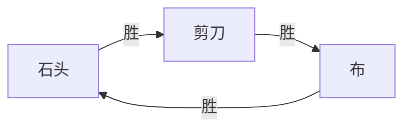
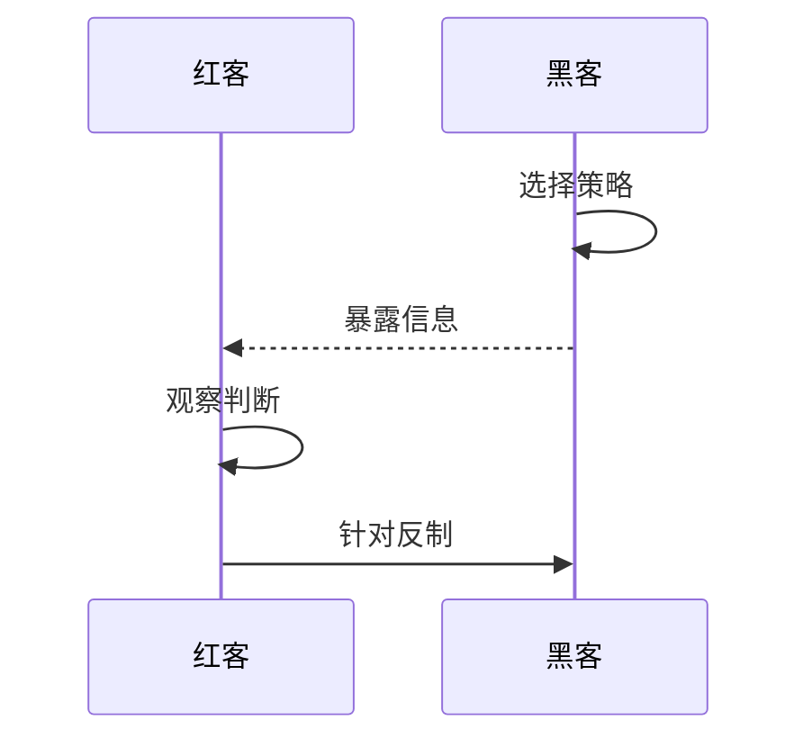

# 单挑非盲对抗极限之“石头剪刀布”

## 问题背景：什么是对抗极限

在“红客与黑客单挑”的设定中，双方能力、资源和信息条件被尽量简化，以便研究攻防对抗的本质规律。所谓==对抗极限==，可以理解为：在给定规则下，一方通过策略选择能够取得的最佳对抗效果，以及双方最终可能形成的稳定状态。

“石头剪刀布”用于说明**非盲对抗**中的特殊情况：双方不仅进行策略博弈，而且能够观察、判断甚至针对对方的选择。此时，对抗结果不再只取决于“出什么招”，还取决于“谁先确定、谁后观察、谁能据此调整”。

## 为什么用“石头剪刀布”描述攻防

石头、剪刀、布构成循环克制关系：

它没有绝对最强的策略：石头能胜剪刀，却会输给布；布能胜石头，却会输给剪刀。这对应网络安全中的一个重要事实：==攻击手段与防御手段通常具有条件性，不存在脱离场景的万能优势==。

例如，某种防御措施可以阻断特定攻击，但攻击者改变路径、协议或载荷后，原防御可能失效；防御者再根据新特征调整规则，又可能重新取得优势。因此，单挑对抗常表现为持续的“观察—调整—反制”。

## 非盲对抗的关键：信息与出招顺序

普通“石头剪刀布”通常要求双方同时出招，任何一方都不知道对方本次选择。而非盲对抗强调：一方可能获得对方策略或行动的信息，并据此作出针对性选择。

若红客能够可靠观察黑客的选择，并在规则允许的时间内完成反制，那么红客可以选择克制该策略的手段；反之，若黑客能够观察红客防御后再攻击，优势就可能转向黑客。

因此，决定极限的核心不是简单的“谁技术更强”，而是：

| 条件 | 对对抗结果的影响 |
|---|---|
| 信息是否真实、完整 | 决定能否正确识别对方策略 |
| 观察是否及时 | 过时信息可能无法支持有效反制 |
| 是否允许调整策略 | 看见对方却不能改变行动，信息价值有限 |
| 双方是否都能观察 | 可能形成反复针对，而非单方必胜 |
| 反制成本是否可承受 | 理论可反制不等于实际可实施 |

> [!IMPORTANT]
> 非盲对抗的关键结论是：==后获得有效信息且能够据此行动的一方，通常具有针对性优势==。这里的“后”不是单纯的时间先后，而是指在对方策略已基本确定后，仍能完成有效决策。

## 一个算对的例子

设双方各有三种策略，收益规则为：胜得 $1$ 分，负得 $-1$ 分，平局得 $0$ 分。

若双方同时出招，红客出石头、黑客出剪刀，则红客收益为：

$$
u_R=1,\qquad u_H=-1
$$

若改为非盲条件：黑客先固定选择剪刀，红客能够准确观察并随后出招，则红客会选择石头，仍得到：

$$
u_R=1,\qquad u_H=-1
$$

但如果黑客知道红客已经固定选择石头，并且还能改为布，则结果反转为：

$$
u_R=-1,\qquad u_H=1
$$

这个例子说明，同样的策略集合和计分规则，仅改变信息条件与调整顺序，胜负就可能改变。

## 与盲对抗、混合策略的区别

| 对比项 | 盲对抗 | 非盲对抗 |
|---|---|---|
| 对方本次策略 | 不可直接观察 | 可部分或全部观察 |
| 主要依据 | 概率、经验、先验判断 | 对方暴露的信息 |
| 典型方法 | 随机化、混合策略 | 识别后针对性反制 |
| 理想化重点 | 不让对方利用固定规律 | 争夺信息与行动优势 |

在标准同时出招的“石头剪刀布”中，若双方都以 $1/3$ 概率随机选择三种策略，任何一方都无法通过单纯改变概率稳定提高期望收益，期望收益为 $0$。但这不能直接套到非盲对抗：一旦一方能观察并针对对方，本次对抗就不再只是原来的随机博弈。

> [!WARNING]
> 不要把“非盲”理解为“知道对方所有秘密”，也不要把“后出招必胜”当成无条件结论。若信息错误、观察过晚、无法调整或反制成本过高，后行动者仍可能失败。

## 常见误区与记忆方法

- **误区一：存在永远最强的攻防策略。**循环克制说明优势依赖对方选择和应用条件。
- **误区二：信息越多就必然获胜。**信息还必须真实、及时，并且能够转化为行动。
- **误区三：非盲对抗等于随机选择失效。**随机化仍可用于降低可预测性，但不能消除已经发生的有效观察。
- **误区四：只比较技术，不比较成本。**实际攻防还受时间、资源和部署条件限制。

> [!TIP]
> 记忆主线：**先看谁能观察，再看谁能调整，最后看反制是否来得及、付得起。**答题时围绕“循环克制—信息优势—针对反制—条件限制”展开即可。
