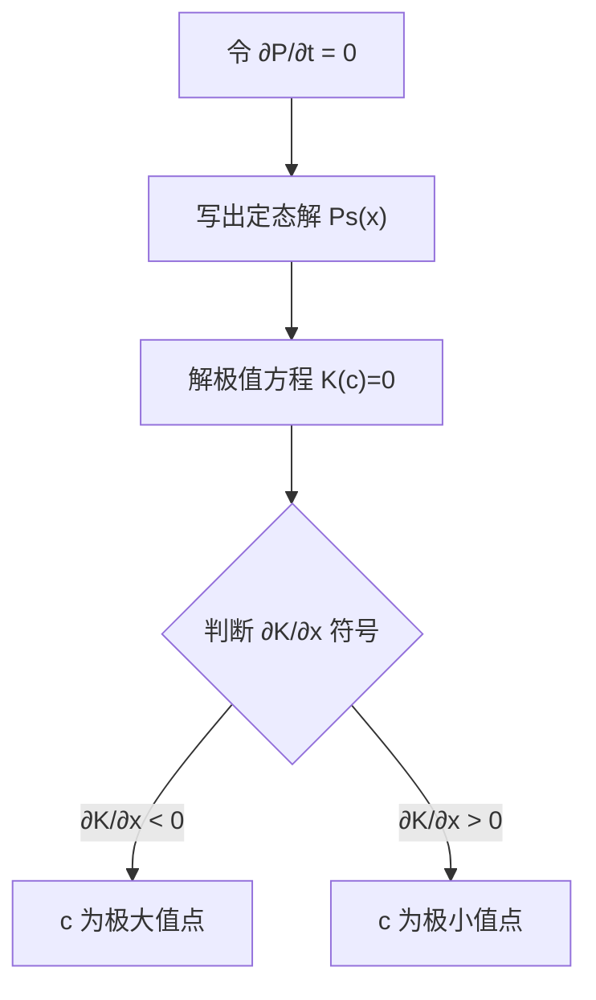

# 民意福克-普朗克方程的定态解

## 民意福克-普朗克方程的定态解

### 它是什么

民意福克-普朗克方程描述民意分布 $P(x,t)$ 随时间的演化，而定态解 $P_s(x)$ 就是演化达到稳定后不再随时间变化的分布，即令 $\partial P/\partial t=0$ 得到的解。由课件公式（16.16）便可知，民意福克-普朗克方程的定态解及极值方程为：

$$
P_s(x) \propto \exp\left[\int^x \frac{K(x')}{D(x')}dx'\right], \qquad K(c)=0
$$

其中 $K(x)$ 是漂移项（意见趋向力），$D(x)$ 是扩散项（随机扰动强度）。==定态解的形状由漂移项与扩散项的比值决定，极值点恰在 $K(c)=0$ 处==。

### 为什么需要它

演化方程给出的是动态过程，但我们更关心"民意最终会稳定成什么样"。定态解直接回答：长期看民意分布集中在哪些意见值上、是单峰还是双峰，从而判断社会是否走向共识或分裂。

### 怎么判断极大还是极小

对极值方程 $K(c)=0$ 解出的候选点 $c$，用二阶导数判别：

- 当 $c$ 为极大值点时，$0 > \partial K(x)/\partial x\big|_{x=c}$
- 当 $c$ 为极小值点时，$0 < \partial K(x)/\partial x\big|_{x=c}$

> [!IMPORTANT]
> 定态解的极值条件不是 $\partial P/\partial x=0$ 直接求解，而是转化为 $K(c)=0$，再用 $\partial K/\partial x$ 的符号定极大极小。

### 与相近概念的区别

| 概念 | 含义 | 关键方程 |
|---|---|---|
| 福克-普朗克方程 | 描述分布随时间演化 | $\partial P/\partial t$ 含漂移扩散项 |
| 定态解 | 不随时间变的稳定分布 | $\partial P/\partial t=0$ |
| 极值方程 | 定态解取峰谷的位置条件 | $K(c)=0$ |

### 常见的坑

> [!WARNING]
> 判别极大极小时，符号方向容易记反：$\partial K/\partial x<0$ 对应极大值点，$\partial K/\partial x>0$ 对应极小值点。不要与直接对 $P_s(x)$ 求二阶导的直觉混淆。

### 算例

设某民意模型中 $K(x)=-x$（意见被拉向中点），$D(x)=1$。则定态解

$$
P_s(x)\propto \exp\left[\int^x (-x')dx'\right]=\exp\left(-\frac{x^2}{2}\right)
$$

极值方程 $K(c)=-c=0$ 给出 $c=0$；又 $\partial K/\partial x=-1<0$，故 $c=0$ 为极大值点，民意最终呈单峰共识分布，==峰位于意见值 $x=0$ 处==。
