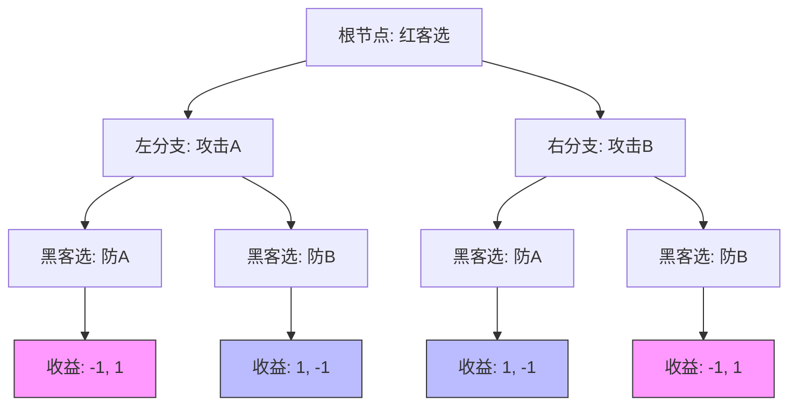

# 单挑非盲对抗极限之“童趣游戏”

## 什么是“童趣游戏”

在《安全通论》红客与黑客的单挑对抗模型中，“童趣游戏”并非指真正的儿童娱乐，而是对**完全信息、非盲、零和博弈**的一种形象化比喻。它描述了攻防双方在信息完全透明（非盲）、且轮流行动（单挑）的极限状态下，如何通过最优策略寻找纳什均衡的过程。

> [!IMPORTANT]
> ==核心定义==：童趣游戏是**单挑非盲对抗**的理想化模型，双方均知晓对方所有可能的动作及收益矩阵，且无随机性干扰。

## 为什么需要研究它

现实中的网络攻防往往充满不确定性（盲对抗），但“童趣游戏”提供了理论上限。通过研究这种极限情况，我们可以：
1. 确定攻防能力的**理论边界**。
2. 理解在信息完全披露时，**先手优势**或**后手优势**如何决定胜负。
3. 为复杂盲对抗提供简化基准，若在此模型下无法防御，则在现实中更无可能。

## 怎么做：博弈树与逆向归纳

求解童趣游戏的核心方法是**逆向归纳法**（Backward Induction）。从博弈的最后一步倒推，确定每一步的最优选择。

[!TIP]
> **解题技巧**：在画博弈树时，始终站在当前决策者的角度，选择使其收益最大化的分支。对于零和博弈，一方最大化即另一方最小化。

## 与相近概念的区别

| 特性 | 童趣游戏 (单挑非盲) | 盲对抗 (现实常态) | 混合策略博弈 |
| :--- | :--- | :--- | :--- |
| **信息透明度** | 完全信息 | 不完全/不对称 | 完全信息 |
| **行动可见性** | 轮流行动，可见 | 并行或隐藏 | 同时行动 |
| **确定性** | 纯策略主导 | 概率/随机性高 | 需计算期望 |
| **求解难度** | 低 (逆向归纳) | 极高 | 中 (线性规划) |

## 常见的坑

> [!WARNING]
> **易错点**：混淆“非盲”与“同时行动”。童趣游戏强调**轮流**且**可见**，而非同时出招。若同时出招，则属于静态博弈，需使用混合策略纳什均衡求解，而非简单的逆向归纳。

## 算对了的例子

假设红客（R）有两种攻击方式 $r_1, r_2$，黑客（H）有两种防御方式 $h_1, h_2$。收益矩阵如下（R的收益，H的收益为相反数）：

*   若 R 选 $r_1$，H 选 $h_1$：R 得 2；H 选 $h_2$：R 得 0。
*   若 R 选 $r_2$，H 选 $h_1$：R 得 1；H 选 $h_2$：R 得 3。

**分析过程**：
1.  若 R 先手选 $r_1$，H 作为理性人，会比较 $h_1$ (R得2, H得-2) 和 $h_2$ (R得0, H得0)。H 会选择 $h_2$ 使自身损失最小（即 R 得 0）。
2.  若 R 先手选 $r_2$，H 会比较 $h_1$ (R得1, H得-1) 和 $h_2$ (R得3, H得-3)。H 会选择 $h_1$ 使自身损失最小（即 R 得 1）。
3.  R 预判到上述结果，会在 $r_1$ (最终得0) 和 $r_2$ (最终得1) 中选择。
4.  ==核心结论==：R 会选择 $r_2$，最终博弈结果为 R 得 1，H 得 -1。
