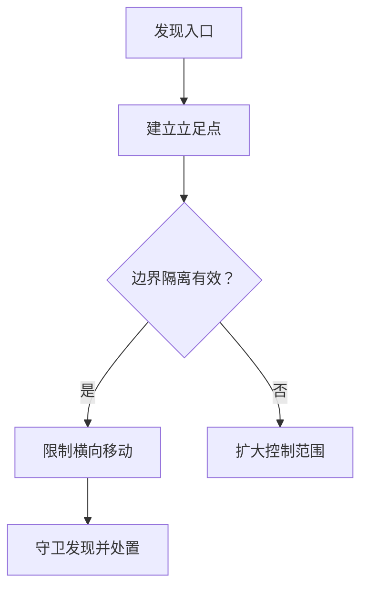

# 单挑盲对抗下红客守卫能力极限

## 概念与边界

“单挑盲对抗下红客守卫能力极限”讨论的是：在攻击者与防守者无法直接取得对方信息、只能根据有限反馈行动的对抗中，红客一方最多能获得多大的隐蔽访问或控制能力，以及守卫一方能够把风险限制到什么程度。

这里的“红客”并非泛指所有黑客，而是强调以技术突破系统、绕过防护并获取目标能力为目的的攻击者；“守卫”则代表防守方通过权限控制、隔离、监测和处置限制攻击者活动。

> [!IMPORTANT]
> 核心结论：能力极限不是固定漏洞数量，而是由信息条件、对抗轮次和防守反馈共同决定的上界。

## 为什么需要研究它

盲对抗中，攻击者看不到守卫的实时配置，守卫也未必能立即识别隐蔽通道。若双方都不能充分观察对方，就不能简单地认为“红客一定赢”或“守卫一定安全”。研究极限的目的，是明确：

- 隐蔽访问能否长期维持；
- 攻击者能否跨越权限边界；
- 守卫能否实现有效隔离和恢复；
- 双方各自还缺少哪些信息。

图中每次行动都只产生有限反馈，因此对抗呈现反复试探、调整和反制的过程。

## 如何分析

通常先建立双方的==能力边界==：

1. **红客侧**：初始权限、可利用入口、可调用工具、隐蔽通信条件。
2. **守卫侧**：认证强度、网络隔离、最小权限、日志覆盖、响应速度。
3. **反馈条件**：攻击者能否看到失败原因，守卫能否发现异常载荷或通信。
4. **可达状态**：从初始状态出发，红客最多可能进入哪些状态。

若守卫实行最小权限、网络分区和强认证，那么即使红客取得局部 foothold，也难以横向移动，能力上限主要受“已被授权的局部资源”约束；若所有系统共享高权限凭据且缺乏监测，红客一旦突破边界，就可能接近全域控制。

## 与相近概念的区别

| 概念 | 关注重点 | 与本知识点的关系 |
|---|---|---|
| 网络安全模型 | 描述主体、对象、威胁与保障关系 | 提供分析框架 |
| 零日漏洞利用 | 某个未知漏洞的攻防过程 | 可能成为突破入口 |
| 攻防博弈 | 双方策略、信息和收益 | 强调盲对抗下的策略边界 |
| 渗透测试 | 在授权范围内验证风险 | 往往拥有更充分的反馈 |
| 守卫能力极限 | 防守方能够限制风险的理论上界 | 是本知识点的重要组成 |

盲对抗不等于完全没有反馈，而是双方获得的信息不足以形成完整态势图。渗透测试通常能获得扫描结果、调试信息或明确响应，其可见性通常高于盲对抗。

## 常见坑

> [!WARNING]
> 不要把“暂时未被发现”当作“守卫没有能力”；也不要把理论上的可达状态当作已经实现的攻击结果。

- **混淆能力与成功率**：极限高不代表每种路径都容易实施。
- **忽略间接反馈**：响应时间、流量变化、账号告警都可能泄露信息。
- **只算初始漏洞**：进入一台主机后，权限提升和横向移动同样重要。
- **忽视恢复成本**：即使最终隔离成功，凭据泄露和持久化后门也可能使损失持续。
- **机械套用结论**：网络分区、强认证和最小权限通常会压低红客能力上限，但具体效果仍取决于系统实现。

## 算对了的例子

假设红客已通过某入口进入一台终端，但该终端属于独立安全域，只能访问两个业务系统，没有域管理员凭据；安全域之间默认禁止互访，守卫还部署了命令审计和异常告警。

此时红客的能力上限应判为：**能够控制该终端并访问两个业务系统，但不能据此直接控制其他安全域**。即使红客进一步获得终端本地管理员权限，也不能突破网络隔离；其最远可达状态仍受两个业务系统及所在安全域约束。

> [!TIP]
> 解题时按“已知入口—获得权限—可访问资源—能否跨越隔离”顺推；==能力上限只取可达状态，不替攻击者补齐不存在的权限==。
