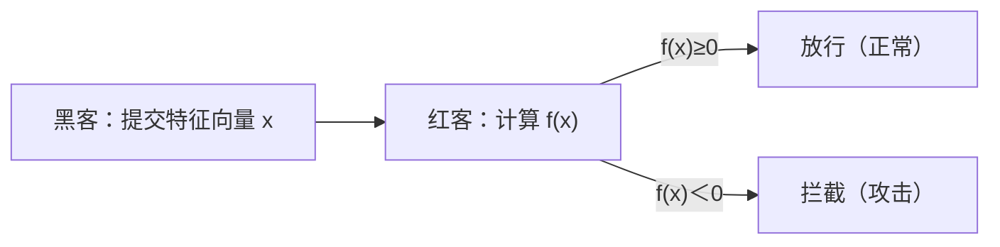

# 单挑非盲对抗极限之“劝酒令”线性可分“非盲对抗”

## “劝酒令”与线性可分非盲对抗

在单挑对抗中，如果攻守双方都知道对方的全部信息，这种对抗称为“非盲对抗”。本节以“劝酒令”为模型，讲解其中一种极限情况：==当攻击向量在特征空间中线性可分时，红客存在理论上必胜的防御策略==。

### 为什么需要这个模型

非盲对抗中，红客（防御方）能完整观测黑客（攻击方）的策略与行为。现实中的类比是：

- 已知攻击签名（特征向量）的入侵检测系统
- 清楚对手所有出招规则的拦截算法

要判断红客能否守住，核心问题变为：**能否在特征空间中找到一个“分界线”，将攻击样本与正常样本完美分隔**。

### 模型设定

劝酒令游戏规则简化为：

- 黑客（攻击方）每次给出一个 $n$ 维特征向量 $\mathbf{x}$，企图伪装成正常请求
- 红客（防御方）已知所有历史攻击与正常样本，需当场判断“放行”还是“拦截”

红客的策略是一个分类器，通常采用线性分类器：
$$
f(\mathbf{x}) = \mathbf{w}^T\mathbf{x} + b
$$
其中 $\mathbf{w}$ 为权重向量，$b$ 为偏置。当 $f(\mathbf{x}) \ge 0$ 放行，$f(\mathbf{x}) < 0$ 拦截。

### 线性可分的含义

若存在一组 $(\mathbf{w}, b)$，使所有攻击样本满足 $\mathbf{w}^T\mathbf{x} + b < 0$，所有正常样本满足 $\mathbf{w}^T\mathbf{x} + b \ge 0$，则称该对抗问题**线性可分**。

> [!IMPORTANT]
> 线性可分是红客必胜的充要条件：一旦可分，红客只需用该线性分类器即可达到 100% 检测率、0% 误报率。

### 怎么做：求解最优分界线

用支持向量机（SVM）求最大间隔分类器，即解：
$$
\min_{\mathbf{w}, b} \frac{1}{2} \|\mathbf{w}\|^2
$$
约束条件：对所有样本 $i$，有 $y_i(\mathbf{w}^T\mathbf{x}_i + b) \ge 1$，其中 $y_i = +1$（正常）或 $-1$（攻击）。

最大间隔保证了泛化能力，也让红客在最恶劣攻击下仍有最大缓冲区。

### 与“盲对抗”的区别

| 类型 | 红客可见信息 | 策略复杂度 | 极限表现 |
|------|------------|-----------|---------|
| 非盲对抗 | 攻防双方全部信息 | 低（线性分类即可） | 线性可分时必胜 |
| 盲对抗 | 仅自己信息，不知对手策略 | 高（需博弈均衡） | 可能无绝对胜算 |

> [!WARNING]
> 线性可分是非盲对抗的“理想天象”。现实中特征空间常非线性可分，此时需要核方法或深度网络，且红客不再拥有理论必胜保证。

### 易错点

- **混淆可分性假设**：直接假设数据线性可分去求解，然而真实分布可能有重叠（噪声、对抗样本），导致硬间隔 SVM 无解。
- **忽略偏置 $b$ 的几何意义**：超平面到原点的偏移决定了阈值，错误固定 $b=0$ 会丢失重要分类能力。

### 算例

假设二维平面上，正常样本：$(2,3)$、$(3,4)$；攻击样本：$(1,1)$、$(2,1)$。
训练线性 SVM 可得 $\mathbf{w} = (1,1)$，$b = -3$，分界线为 $x_1 + x_2 - 3 = 0$。

验证：

- 正常 $(2,3)$：$2+3-3 = 2 \ge 0$ → 放行 ✓
- 攻击 $(1,1)$：$1+1-3 = -1 < 0$ → 拦截 ✓

红客以该线性规则实现完美防御。

> [!TIP]
> 求解时若样本量小，可直接通过几何绘图找最大间隔直线；考题常要求手算二维情况，==记得检查支持向量上的等距条件==。
