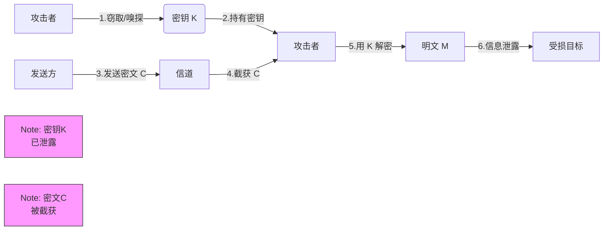

# 安全经络图的几点说明

## 安全经络图的核心逻辑

安全经络图是《安全通论》中用于可视化**攻击路径**与**防御薄弱点**的核心工具。它不仅仅是一张流程图，更是将抽象的“安全事件”映射为具体“节点”与“边”的逻辑模型。

为什么需要它？因为在复杂的系统中，单纯描述“密钥泄露”过于笼统。我们需要明确：攻击者从何处入手（入口），经过哪些中间状态（传播），最终造成何种破坏（出口）。这有助于我们精准定位防御缺口。

> [!IMPORTANT]
> ==核心定义==：安全经络图由**攻击源**、**脆弱性节点**、**攻击动作**及**损害目标**构成，展示了威胁沿系统“经络”传导的全过程。

## 绘图步骤与规范

绘制安全经络图时，请遵循“因果链”原则。以课件中的经典考题为例：**分组加密系统的加密密钥泄露**。

1.  **确定起点**：攻击者（Attacker）或泄露源。
2.  **识别关键节点**：密钥存储处、通信信道、解密模块。
3.  **连接动作**：获取密钥、截获密文、执行解密。
4.  **明确终点**：明文泄露或身份伪造。

> [!TIP]
> **解题技巧**：图中必须体现“密钥”与“密文”在攻击者手中的汇合，这是解密发生的必要条件。缺少任一环节，逻辑链条即断裂。

## 常见误区与辨析

许多同学容易混淆“安全经络图”与普通的“数据流图”。二者有本质区别：

| 特性 | 数据流图 (DFD) | 安全经络图 |
| :--- | :--- | :--- |
| **关注点** | 数据如何正常流动 | 威胁如何利用弱点流动 |
| **节点含义** | 处理过程/存储 | 脆弱点/攻击跳板 |
| **边的含义** | 数据传输 | 攻击行为/利用关系 |
| **目标** | 系统设计优化 | 风险评估与防御 |

> [!WARNING]
> **易错坑**：不要在经络图中画出正常的业务逻辑（如“用户登录成功”），除非该逻辑被滥用。重点应放在**异常路径**上。例如，密钥泄露事件中，重点不是“加密算法本身”，而是“密钥管理失效”这一经络断点。

## 实例解析：密钥泄露事件

回到考题：给出分组加密系统密钥泄露的安全经络图。

**错误画法**：仅画出 `攻击者 -> 获取密钥 -> 结束`。这忽略了密钥泄露后的实际危害，未形成完整的攻击闭环。

**正确思路**：
1.  攻击者通过侧信道或社会工程学==获取密钥 $K$==。
2.  攻击者在信道上==截获密文 $C$==。
3.  利用 $D_K(C) = M$ 计算出明文。
4.  导致==机密性丧失==。

> [!NOTE]
> 若题目涉及“重放攻击”，则经络图中需包含“记录旧消息”和“重新发送”两个关键节点，而非解密过程。务必根据题干指定的攻击类型调整经络走向。
