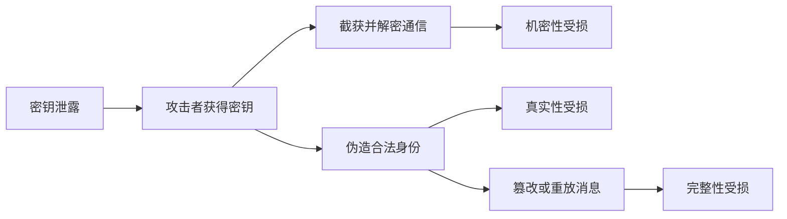

# 经络图的逻辑分解

## 什么是经络图的逻辑分解

安全经络图把“弱点—攻击路径—安全后果”画成一张有向图。所谓==逻辑分解==，就是把一个笼统的安全事件拆成若干**有因果先后、可逐条检查**的环节：先确定系统资产和安全目标，再找初始弱点，随后展开攻击者利用弱点所经过的条件、动作与中间状态，最后落到机密性、完整性或可用性的破坏。

它回答的不是“系统安不安全”，而是：**攻击为什么能够发生，又能在哪里被切断？**

## 为什么需要分解

只写“密钥泄露导致系统不安全”，既无法定位责任环节，也无法比较防护措施。分解后可以区分：

- **前提条件**：攻击者能接触密文、通信信道或密钥材料；
- **关键事件**：密钥被窃取、误发或因管理不当泄露；
- **攻击动作**：解密通信、伪造身份、篡改或重放消息；
- **安全后果**：机密性、真实性或完整性被破坏；
- **可阻断位置**：密钥保护、密钥轮换、消息认证、 freshness 校验等。

因此，经络图既用于分析攻击，也用于选择最靠近源头的防护点。

## 怎样进行逻辑分解

可按“资产—弱点—路径—后果—控制”五步作图：

1. 写出被保护的资产及对应安全目标；
2. 从给定事件出发，明确它是起点、条件还是结果；
3. 沿因果链补充必要节点，箭头表示“促成”而非简单的时间先后；
4. 检查每条路径是否闭合，即能否从弱点到达安全目标受损；
5. 在关键边上配置控制措施，并说明其阻断的是哪一步。

> [!IMPORTANT]
> 经络图的箭头必须表达==可解释的因果或促成关系==；每个中间节点都应能回答“上一步为何能导致这一步”。

## 与相近概念的区别

| 概念 | 关注重点 | 与经络图逻辑分解的区别 |
|---|---|---|
| 攻击树 | 攻击目标的多种实现方式 | 常用 AND/OR 分解目标；经络图更强调安全事件间的经络式因果联系 |
| 威胁建模 | 系统中有哪些威胁 | 偏识别与枚举；逻辑分解还要把威胁展开成路径 |
| 风险分析 | 可能性与损失 | 常需概率、影响和等级；经络图可先不定量 |
| 防护清单 | 应部署哪些措施 | 措施列表本身不说明攻击路径，需映射到具体节点或边 |

> [!NOTE]
> “密钥泄露”不必然等于“所有安全目标同时失效”。例如，仅有加密密钥泄露通常直接破坏机密性；能否伪造身份，还取决于该密钥是否同时用于认证，以及系统是否另有完整性保护。

## 常见误区

> [!WARNING]
> 不要把“中间人攻击、重放攻击”无条件画成密钥泄露的必然后果。它们是可能的利用方式，是否成立要看协议条件；重放攻击尤其需要消息认证、序列号、时间戳或随机数等机制的分析。

- 把攻击者、漏洞、攻击动作和安全后果混成同一层；
- 只画一条线，却不标出必要的截获、注入或信道控制能力；
- 把防护措施画成攻击路径的一部分，而不是对节点或边的阻断；
- 由“加密密钥泄露”直接推出“能够伪造任意身份”，忽略密钥用途；
- 把相关关系当因果关系，或画出没有到达安全后果的断头路径。

## 例题：分组加密系统的加密密钥泄露

题目要求给出该事件的安全经络图，可按下面这条主链作答：

**加密密钥泄露 $\rightarrow$ 攻击者获得密钥 $\rightarrow$ 截获密文并解密 $\rightarrow$ 明文暴露 $\rightarrow$ 通信机密性受损。**

若题目已说明密钥还参与身份认证，才可补充分支：

**获得密钥 $\rightarrow$ 伪造合法消息或身份 $\rightarrow$ 真实性、完整性受损。**

防护点对应写为：密钥安全存储与访问控制阻断“获得密钥”，密钥轮换与撤销限制泄露后的影响，独立的消息认证机制降低伪造风险。这样作图既覆盖题目给出的核心事件，又没有把未经说明的攻击条件当成既定事实。
