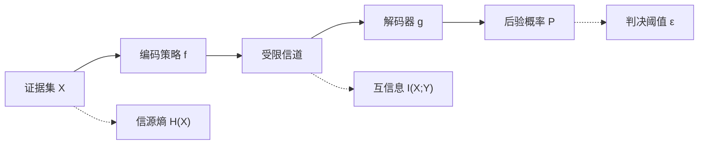

# 辩论式对话的数学理论

## 什么是法庭辩论式对话模型

在安全通论中，我们如何将“唇枪舌剑”的法庭辩论转化为可计算的数学对象？如果仅用自然语言描述，辩论是主观且模糊的；但若将其视为一个==信息对抗系统==，它就有了精确的边界。

从信息论角度定义，“法庭辩论式对话”是指：在信道容量受限、存在噪声与干扰的条件下，两个或多个智能体（控方与辩方）围绕同一命题，通过交替发送消息序列，试图使第三方（法官/陪审团）的后验概率收敛于己方目标状态的==有约束博弈过程==。

> [!IMPORTANT]
> 核心定义要素
> 该模型必须包含三个数学组件：信源（双方证据集）、信道（含噪声与带宽限制）、信宿（裁判者的认知状态）。缺失任一组件，都不能称为严格意义上的“辩论式对话数学模型”。

## 为什么需要这个模型

日常对话追求“说服”，而安全通论追求“可证伪性”与“安全性”。我们需要回答：在给定信道条件下，辩方是否有可能通过有限次交互，将裁判者对“有罪”的判断概率从 $P_0$ 降低到阈值 $\epsilon$ 以下？这直接决定了司法程序的==信息完备性==与==抗欺骗能力==。

## 如何构建数学模型

构建该模型需完成三步映射：

1.  **信源建模**：将双方掌握的证据视为随机变量 $X$，其不确定性由信源熵 $H(X)$ 度量。
2.  **信道约束**：法庭时间、注意力、规则构成信道容量 $C$。有效辩论要求传输速率 $R \leq C$，否则信息丢失导致误判。
3.  **目标函数**：设裁判者初始信念为 $P(H_0)$，经过 $n$ 轮交互后，更新为 $P(H_0|Y^n)$。辩论成功的充要条件是 $\exists n, P(H_0|Y^n) < \epsilon$ 或 $> 1-\epsilon$。

> [!TIP]
> 解题关键
> 答题时务必写出“后验概率收敛”这一动态过程，而非静态的信息量比较。这是区分普通通信模型与辩论模型的核心。

## 与协商式对话的区别

| 维度 | 法庭辩论式对话 | 协商式对话 |
| :--- | :--- | :--- |
| 目标函数 | 零和博弈，一方胜即另一方败 | 正和博弈，追求帕累托最优 |
| 信息流向 | 面向第三方信宿 | 双向对称 |
| 终止条件 | 达到判决阈值或资源耗尽 | 达成纳什均衡 |
| 信道假设 | 强对抗、高噪声 | 相对可信、低噪声 |

## 常见误区警示

> [!WARNING]
> 易错点辨析
> 切勿将“辩论”等同于“信息传输最大化”。在法庭场景中，==冗余信息==有时是必要的（如重复强调关键证据以对抗信道噪声），这与香农编码定理中“压缩至熵率”的最优性相悖。安全通论中的辩论模型允许甚至鼓励策略性冗余。

> [!CAUTION]
> 高危误区
> 忽略“第三方信宿”的存在。若模型中没有独立的裁判者作为信息接收端，则退化为点对点通信或对抗攻击，不再属于“辩论式对话”范畴。

## 真题示例解析

针对“从信息论角度如何定义法庭辩论式对话的数学模型”这道10分题，标准作答应包含：

-   明确主体：控方、辩方、裁判者三方结构；
-   引入信息论三要素：信源（证据）、信道（受限）、信宿（裁判认知）；
-   给出动态目标：通过后验概率更新实现信念收敛；
-   点明约束条件：信道容量限制与交互轮数有限性。

缺少“后验概率”或“第三方信宿”任一关键词，通常扣3-4分。记住：这不是语文题，而是==信息系统建模题==。
