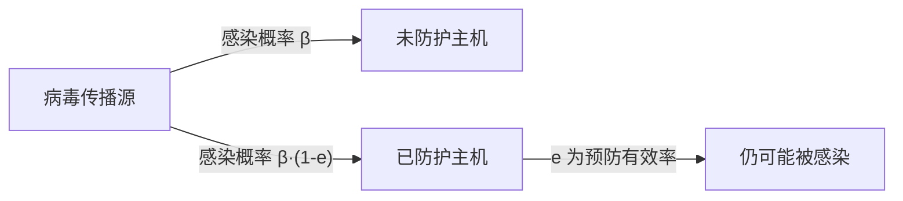

# 预防措施的效果分析
上一章讨论了“封堵查杀”能消灭多少病毒。但更聪明的思路是：**别让病毒感染成功**。预防措施就是干这个的。

问题：一台机器打了补丁、装了杀软、用户也不乱点，病毒就绝对进不来了吗？显然不是。那预防措施到底“好了多少”，这个“好”怎么算？

### 从“感染概率”入手

先用最直白的模型理解。假设没有预防措施时，一台机器在一次病毒传播事件中被感染的概率是 $p$。现在加了预防措施，这个概率降为 $\hat p$。自然的想法：

$$
预防效果 = p - \hat p
$$

或归一化：

$$
相对下降率 = \frac{p - \hat p}{p}
$$

但直接拿两个概率相减太粗糙。真实网络中，病毒能否传播不是单次事件，而取决于它能否击中**易感主机**。预防措施的真正作用，是**减少每台主机的易感概率**。

所以预防措施不会改变病毒的传播模式，只相当于把传播概率从 $\beta$ 压低为 $\beta(1-e)$。

> [!IMPORTANT]
> 在《安全通论》的传播模型里，预防措施的效果集中体现为：==将有效感染率 $\beta$ 降低为 $\beta(1-e)$==，其中 $e$ 是预防措施的“有效率”，$0<e<1$，$e=0$ 表示预防完全无用，$e=1$ 表示防护绝对成功（现实中做不到）。

### 对病毒爆发阈值的影响

计算机病毒在网络上能否爆发，有一个临界条件：当**有效传播率 $\beta$ 超过某个阈值 $\beta_c$** 时，病毒会持续传播；低于阈值，病毒就会自己死掉。这个 $\beta_c$ 取决于网络的拓扑结构：

$$
\beta_c = \frac{\langle k \rangle}{\langle k^2 \rangle - \langle k \rangle}
$$

其中 $\langle k \rangle$ 是平均度，$\langle k^2 \rangle$ 是度的二阶矩。

加预防措施后，有效传播率变成 $\beta(1-e)$，爆发条件从

$$
\beta > \beta_c
$$

变为

$$
\beta(1-e) > \beta_c
$$

移项得到关键结论：

$$
e < 1 - \frac{\beta_c}{\beta}
$$

> [!WARNING]
> 预防有效措施率必须超过临界值 $$e^* = 1 - \frac{\beta_c}{\beta}$$ 才能完全抑制病毒爆发。如果 $e$ 不到 $e^*$，病毒虽然变慢，但依然会“最终爆发”。

### 算对了的例子

设某网络中平均度 $\langle k\rangle=4$，二阶矩 $\langle k^2\rangle=20$，原始感染率 $\beta=0.3$。求预防有效率至少多大才能阻止病毒爆发。

解：

$$
\beta_c = \frac{4}{20-4} = \frac{4}{16} = 0.25
$$

要求 $\beta(1-e) \le 0.25$，即

$$
1-e \le \frac{0.25}{0.3} = 0.833
$$

$$
e \ge 1 - 0.833 = 0.167
$$

所以预防措施的有效率只要不低于 **16.7%**，病毒就无法爆发。这个结果和直觉相反：==不需要完美防护，只要把感染率压过阈值点，病毒就会自然消亡==。这正是“群体免疫”在网络安全里的对应版本。

### 和“杀毒效果”的区别

预防措施很容易和前面讲的封堵查杀混在一起，但它们是两个不同阶段的事：

| 对比项 | 预防措施 | 封堵查杀 |
|---|---|---|
| 作用阶段 | 感染前 | 感染后 |
| 数学影响 | 降低 $\beta$ | 增加清除率 $\gamma$ |
| 阈值条件 | $\beta(1-e) \le \beta_c$ | $\beta \le \gamma$ |
| 现实类比 | 防火墙、补丁、安全策略 | 杀软扫描、系统还原 |

> [!TIP]
> 判断题目问的是“预防”还是“查杀”，看它想改变的是**感染率符号 $\beta$** 还是**清除率符号 $\gamma$**。$\beta$ 的系数是“预防有效率 $e$”，$\gamma$ 对应“查杀能力”。

### 预防的极限：为何免疫是最终武器

计算机病毒的传播模型在数学上和生物传染病模型同构。最彻底的预防是**免疫**：把易感节点直接变成不可感染节点。当免疫比例达到

$$
1 - \frac{\beta_c}{\beta}
$$

时，病毒就会灭绝。这个值和前面推出的 $e^*$ 完全一致——免疫可以理解为 $e=1$ 的“超强预防”，而一般预防措施本质上就是“不完全免疫”。

所以预防措施的真实价值，不是保证每台机器都不中毒，而是**让整个网络脱离爆发区**。做题时只要把预防措施翻译成“感染率打折”，很多看起来复杂的题就只剩下解不等式了。
