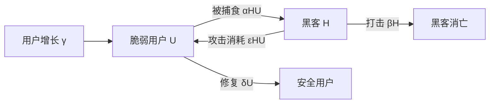

# “黑客+用户”生态学

## 为什么要把黑客和用户放在一起看

传统安全把用户当“需要保护的资产”、把黑客当“需要防御的对手”，但第 13 章换了个视角：**用户和黑客是同一个生态系统里的两个种群**，他们互相依赖、互相塑造，数量此消彼长。黑客靠用户的不安全行为获得“食物”（入侵机会），用户则根据黑客的攻击强度决定安全投入。单看任何一方，都无法解释网络安全形势的整体演化。

> [!IMPORTANT]
> “黑客+用户”生态学的核心：用**种群生态模型**描述黑客规模 $H$ 与用户脆弱性/受害规模 $U$ 的耦合演化，安全治理的目标是**打破恶性循环、引导系统进入良性平衡点**。

## 生态学模型

设 $H(t)$ 为黑客（或攻击事件）数量，$U(t)$ 为存在脆弱性/受害的用户数量。课件中典型的耦合模型为：

$$
\begin{cases}
\dfrac{dH}{dt} = \alpha H U - \beta H \\[6pt]
\dfrac{dU}{dt} = \gamma - \delta U - \varepsilon H U
\end{cases}
$$

- $\alpha H U$：黑客以用户脆弱性为“食物”而增长（捕食项）
- $-\beta H$：黑客因打击、内耗而自然减少
- $\gamma$：新增用户/新增脆弱性（常数源）
- $-\delta U$：用户打补丁、安全意识提升使脆弱性自然衰减
- $-\varepsilon H U$：黑客攻击“消耗”用户（用户被攻击后修复，暂时退出脆弱状态）

## 两个平衡点

令 $\dfrac{dH}{dt}=0,\ \dfrac{dU}{dt}=0$，得到：

| 平衡点 | 含义 | 稳定性 |
|---|---|---|
| $E_1:\ H=0,\ U=\dfrac{\gamma}{\delta}$ | 无黑客，用户脆弱性自然存续 | $\alpha\gamma>\beta\delta$ 时不稳定（黑客一入侵就会爆发） |
| $E_2:\ U^{*}=\dfrac{\beta}{\alpha},\ H^{*}=\dfrac{\alpha\gamma-\beta\delta}{\alpha\varepsilon}$ | 黑客与用户长期共存、此消彼长 | $\alpha\gamma>\beta\delta$ 时稳定 |

> [!TIP]
> 判据 $\alpha\gamma>\beta\delta$ 读作“黑客的捕食效率 × 用户脆弱性来源”超过“黑客死亡率 × 用户自修复率”，攻击就会持续存在；反之黑客自然消亡。

## 算例（考题原型）

取 $\alpha=0.2,\ \beta=0.1,\ \gamma=1000,\ \delta=0.5,\ \varepsilon=0.05$。

判据：$\alpha\gamma=200>\beta\delta=0.05$，故存在稳定的共存点。

$$
U^{*}=\frac{\beta}{\alpha}=\frac{0.1}{0.2}=50,\qquad
H^{*}=\frac{0.2\times1000-0.1\times0.5}{0.2\times0.05}=\frac{199.95}{0.01}\approx 19995
$$

即系统最终稳定在约 50 个脆弱用户支撑约 2 万个黑客的“动态平衡”——脆弱用户越少，黑客规模也越小，但无法彻底清零。

## 治理启示与易混点

| 手段 | 模型对应 | 效果 |
|---|---|---|
| 提高打击力度 | 增大 $\beta$ | 直接压低 $H^{*}$ |
| 普及补丁/安全教育 | 增大 $\delta$、减小 $\gamma$ | 降低 $U^{*}$，间接饿死黑客 |
| 切断传播/共享渠道 | 减小 $\alpha$ | 削弱黑客增长正反馈 |

> [!WARNING]
> 易错点：$E_2$ 的 $U^{*}=\beta/\alpha$ 与 $\gamma,\varepsilon$ 无关——增加用户总量 $\gamma$ 只会**同比例放大黑客规模**，不会降低每个用户的平均风险；真正降低脆弱用户数的是 $\beta/\alpha$。

> [!CAUTION]
> 不要把本模型与第 12 章的传染病模型混淆：SIR 描述**同一群体**内部的状态转移，而“黑客+用户”是**两个异质种群**的捕食—被捕食关系，方程结构（互乘项方向）不同。
