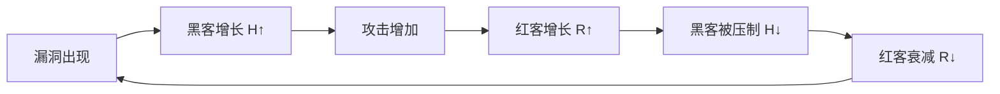

# “黑客+红客”生态学

如果网络空间只有防御者，安全水平真的会一直提升吗？如果没有攻击者的持续试探，防御体系又该如何进化？

## 它是什么

“黑客+红客”生态学将网络安全视为一个==动态演化的生态系统==。其中：

- **黑客**（Black Hat）：代表破坏性力量，不断寻找并利用系统漏洞。
- **红客**（Red Hat / Defender）：代表建设性防护力量，负责修补漏洞、抵御攻击。

二者并非简单的“你死我活”，而是类似自然界中“捕食者—猎物”的共生关系。在《安全通论》框架下，双方构成一对相互制约、协同进化的生态种群。

> [!IMPORTANT]
> 核心结论：没有黑客的攻击压力，红客的防御能力就会退化；没有红客的防御屏障，系统将被彻底摧毁。==攻防双方共同维持着网络空间的安全生态平衡。==

## 为什么需要

传统安全观追求“绝对安全”，试图消灭一切威胁。但从生态学角度看，==消灭黑客意味着红客失去进化动力==，系统反而会在面对未知新型威胁时瞬间崩溃。引入生态学视角，是为了承认安全的相对性与动态性，用演化思维替代静态堆砌。

## 怎么做：Lotka-Volterra 模型

课件借用种群动力学中的 Lotka-Volterra 方程来描述这一过程。设 $H(t)$ 为黑客规模，$R(t)$ 为红客规模：

$$
\frac{dH}{dt} = \alpha H - \beta H R
$$

$$
\frac{dR}{dt} = \delta H R - \gamma R
$$

- $\alpha$：黑客自然增长率（漏洞自发产生）。
- $\beta$：红客对黑客的抑制率（防御打击效果）。
- $\delta$：黑客刺激红客的增长率（攻击促使防御升级）。
- $\gamma$：红客自然衰减率（无攻击时防御投入减少）。

> [!TIP]
> 记忆口诀：“敌增我增，敌减我减”。黑客多则逼迫红客升级，红客强则压制黑客规模，形成周期性震荡平衡。

## 算对了的例子

假设某网络生态参数为 $\alpha=2,\; \beta=1,\; \delta=1,\; \gamma=2$。求该系统的生态平衡点 $(H^*, R^*)$。

**解**：令 $\frac{dH}{dt}=0$ 且 $\frac{dR}{dt}=0$：

由 $\alpha H - \beta H R = 0$，提取非零解得 $R^* = \frac{\alpha}{\beta} = \frac{2}{1} = 2$。

由 $\delta H R - \gamma R = 0$，提取非零解得 $H^* = \frac{\gamma}{\delta} = \frac{2}{1} = 2$。

故平衡点为 ==$(H^*, R^*) = (2, 2)$==。此时黑客与红客规模保持动态稳定。

> [!WARNING]
> 易错坑：求解平衡点时直接约掉 $H$ 或 $R$ 而漏掉平凡解 $(0,0)$。生态学中 $(0,0)$ 代表系统死亡，非零平衡点才是有意义的稳态。

## 和相近概念的区别

| 维度 | “黑客+红客”生态学 | 传统攻防对抗 |
| :--- | :--- | :--- |
| **目标** | 维持动态生态平衡 | 单方面消灭对手 |
| **视角** | 宏观种群演化 | 微观单次战役 |
| **结果** | 螺旋上升、协同进化 | 零和博弈 |

> [!CAUTION]
> 高危误区：不要将“生态学上的共存”误解为“纵容黑客犯罪”。这里的“黑客”是抽象的生态位压力源，而非鼓励违法行为。
