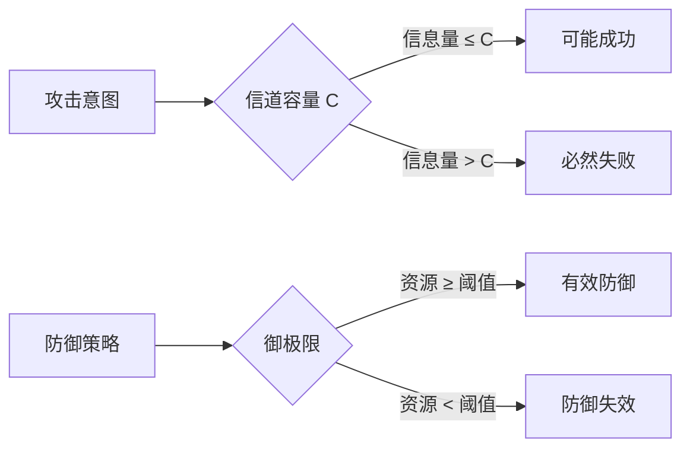

# 单挑盲对抗下黑客攻击能力的极限

## 什么是单挑盲对抗下的攻击极限

在红客与黑客的“单挑盲对抗”中，双方均无法完全掌握对方策略与系统状态。此时，黑客成功入侵一次并非单纯的概率事件，而是受限于一个理论天花板。这个天花板就是==信道容量定理==所界定的信息传输上限。

> [!IMPORTANT]
> 核心结论：黑客单次攻击成功的最大概率，等价于该对抗信道的信道容量 $C$。若攻击意图携带的信息量超过 $C$，则必然失败。

为什么用信道容量衡量攻击能力？因为盲对抗本质是一个含噪通信过程：黑客发送“攻击指令”，防御方产生“干扰噪声”。只有当攻击信号能被正确“解码”（即突破防线）时，才算成功。根据香农定理，无误码传输的速率上限即为 $C$，对应到安全领域就是==攻击成功的理论极限==。

## 如何计算与理解御极限

既然攻有极限，防是否也有对应边界？这就引出了“御极限”的概念。

> [!NOTE]
> 御极限是指在给定攻击强度下，防御方能够保证系统不被攻破的==最小资源消耗或最大容忍阈值==。它与攻击极限互为对偶关系。

我们可以通过下表区分这对核心概念：

| 维度 | 攻击极限 | 御极限 |
| :--- | :--- | :--- |
| 定义依据 | 信道容量 $C$ | 博弈均衡点 |
| 物理含义 | 成功入侵的概率上界 | 有效防御的成本/性能下界 |
| 决定因素 | 带宽、信噪比 | 策略空间、资源约束 |
| 超限后果 | 攻击必败 | 防御失效或崩溃 |

[!TIP]
> 记忆口诀：攻看容量防看衡，盲对抗中定输赢；超限必败是铁律，对偶关系要记清。

## 真题解析与常见误区

回顾考题“黑客成功一次和信道容量定理的关系”，答题关键在于建立映射：将“攻击成功”视为“信息可靠传输”，将“防御干扰”视为“信道噪声”。8分题需答出：==攻击成功率上界等于信道容量==，且该极限由对抗环境的信噪比决定，与具体攻击手段无关。

> [!WARNING]
> 易错坑：切勿将“攻击极限”等同于“实际攻击成功率”。极限是理论最大值，实际成功率受策略优劣影响，永远 $\leq C$。

另一个高频考点“御极限是什么”，10分题必须包含三层含义：① 定义（防御有效的临界点）；② 与攻击极限的对偶性；③ 在博弈模型中的均衡意义。仅回答“防御的上限”会被扣分。

> [!CAUTION]
> 高危误区：认为提升防御资源就能无限提高御极限。实际上，御极限受系统架构固有脆弱性制约，存在不可逾越的物理边界，盲目堆砌资源反而可能导致边际效益递减甚至系统过载。

算对例子的关键：若已知对抗信道带宽 $B=1\text{MHz}$，信噪比 $S/N=7$，则攻击极限 $C = B\log_2(1+S/N) = 3\text{Mbps}$。这意味着黑客每秒最多只能以3兆比特的“有效攻击信息量”突破防线，超出部分无论多精巧都将淹没在噪声中。此数值即为该场景下不可突破的攻击能力天花板。
