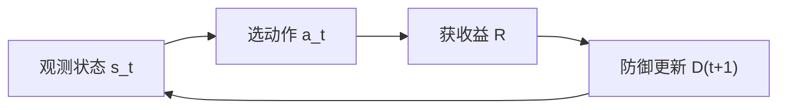

# 黑客的最佳攻击战术

## 它是什么

在《安全通论》的攻防对抗模型里，黑客面对的是一个**动态变化的防御系统**：防火墙规则会更新、漏洞会被修补、蜜罐会伪装服务。所谓 ==黑客的最佳动态攻击战术==，就是：在每一轮攻防交互中，黑客依据当前观测到的防御状态，选择使长期收益最大的攻击动作序列。

课件里把它放在“第 3 章 黑客”的核心位置，是因为它不只问“怎么入侵”，而是问：**当防守方也会学习、也会变策略时，黑客该怎么打？**

## 为什么需要

先想一个问题：如果防守方永远不动，黑客只需要扫一次端口、打一次漏洞就够了，为什么还要“最佳战术”？答案是——真实系统里，防御策略 $D(t)$ 随时间变化，攻击收益函数 $R(a_t, D(t))$ 也随时间变化。黑客必须把攻击看成**多阶段博弈**，而不是一次性动作。

## 怎么做

典型建模方式是：把攻防过程离散为时刻 $t=0,1,2,\dots$，黑客在每步观测防御状态 $s_t$，选动作 $a_t$，获得收益并进入下一状态。最佳战术由动态规划 / 马尔可夫决策过程给出：

$$
V^*(s)=\max_{a}\Big\{R(s,a)+\gamma\sum_{s'}P(s'\mid s,a)V^*(s')\Big\}
$$

其中 $\gamma$ 是折扣因子。==核心结论：最佳战术是“状态依赖”的策略，不是固定套路==。

## 和相近概念的区别

| 概念 | 关注点 | 是否动态 |
|---|---|---|
| 静态渗透测试 | 单次找漏洞 | 否 |
| 最佳动态攻击战术 | 多轮博弈与策略调整 | 是 |
| 暴力破解 | 穷举空间 | 通常静态 |

## 常见的坑

> [!WARNING]
> 别把“最佳战术”写成某一种具体工具或漏洞利用方式；它是**策略层面的最优决策规则**。

> [!TIP]
> 答题时抓住两点：==状态依赖== + ==长期收益最大==，就拿到大部分分。

## 一个算对了的例子

考题：“什么是黑客最佳动态攻击战术？（8 分）”
可答：
> 在攻防动态博弈中，黑客根据每一时刻观测到的防御状态 $s_t$，按照使折扣累积收益 $\sum \gamma^t R(s_t,a_t)$ 最大的规则选择攻击动作 $a_t$，所形成的状态依赖策略，称为黑客的最佳动态攻击战术。它不是单步入侵方法，而是适应防御变化的多阶段最优策略。

这样写既用了课件术语（攻防对抗、动态、收益、策略），又覆盖了 8 分要点。
