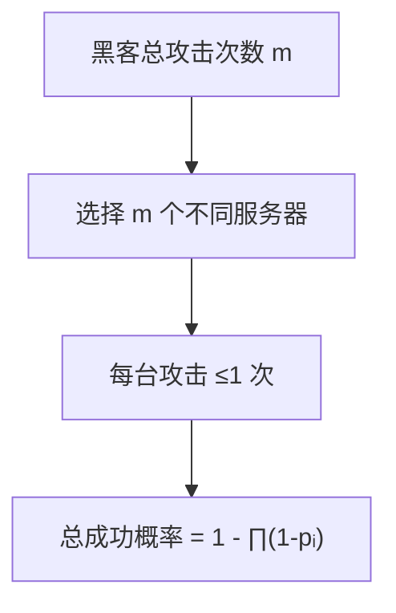

# 黑客的最佳攻击战略
在安全攻防中，黑客常常要问自己一个很实际的问题：假设目标系统有多台服务器，而攻击同一台服务器被发现的概率会随着攻击次数而上升，那我到底该把有限的攻击资源（比如 3 次攻击机会）怎么分配，才能让**总成功概率最大**？

这就是黑客的最佳攻击战略要解决的核心问题。

### 从一道题引出模型

先看一个南邮考题里常见的设定：

> 黑客随机独立攻击了某机构的 3 台服务器，攻击成功的概率分别是 0.9、0.5、0.5，且**同一服务器被多次攻击会被发现，导致后续攻击无效**。那么黑客能成功攻破这个机构的最大概率是多少？

这里隐含的关键是：如果只打最强的服务器，一次没成后面就暴露了；如果把次数错开，不同服务器之间就不会互相干扰。所以需要一种**最优分配攻击次数**的策略。

可以把问题抽象成：

- 有 $n$ 台服务器，攻破第 $i$ 台的**单次成功率**是 $p_i$。
- 同一服务器可以被重复攻击，但一旦**重复攻击，该服务器全部攻击视为失败**（因为被检测到了）。
- 黑客有总共 $m$ 次攻击机会，且 $m \le n_0$（真正要打的目标数）。

在这种约束下，==黑客的最佳攻击战略就是：选择 $m$ 个不同的服务器各自攻击 1 次==。

### 为什么这是最优的

核心逻辑其实并不复杂，可以一步步推：

1. 如果对同一服务器攻击多次，第 2 次及以后的攻击都会导致被发现，从而让前面成功的攻击也作废。换句话说，重复攻击只会把**已经到手的成功再丢掉**。
2. 只攻击 1 次，就算失败也还能保留其他服务器的成功可能。
3. 因此，每一台服务器**最多攻击 1 次**，总共挑 $m$ 台来打，这样攻破机构的总概率，就等于“挑出的这 $m$ 台中至少有一台被攻破的概率”。

转化一下就变成：总成功概率 = 1 −（所有被攻服务器的单次失败概率的乘积）。

### 算对了的例子与成功率变化

回到本节开头的例题：3 台服务器成功率分别是 **0.9、0.5、0.5**，攻击次数 $m = 3$。

- 攻打全部 3 台，每台各 1 次：
  
$$
P_{\text{成功}} = 1 - (1-0.9)(1-0.5)(1-0.5) = 1 - 0.1 \times 0.5 \times 0.5 = 0.975
$$

假设黑客只攻击 2 次（$m = 2$），则需要选出“最强”的 2 台，比如 0.9 和 0.5 那两台：

- 总成功率 = $1 - (1-0.9)(1-0.5) = 1 - 0.1 \times 0.5 = 0.95$

可以看到，多了一次攻击（从 2 增到 3），成功率从 0.95 提升到了 0.975。

> [!IMPORTANT]
> 黑客的最佳攻击战略就是把有限的 $m$ 次攻击，**全部分配给不同服务器**，且优先选成功率最高的 $m$ 台，每台只打一次。

### 常见踩坑与相近概念辨析

学生经常在这一点上犯糊涂，下面把最常见的几个坑列出来：

> [!WARNING]
> **误区一：以为重复攻击能提高单台成功率**
> 题目里明确“重复攻击会被发现导致无效”，所以重复不是补刀，是自杀。

> [!CAUTION]
> **误区二：攻击对象不按成功率排序**
> 如果 $m < n$，一定要优先攻击成功概率最高的 $m$ 台，否则即使“不多打”，也达不到最大总概率。

> [!NOTE]
> **与“红客防守战略”的区别**
> 红客防守的核心是检测异常访问并锁定被反复试探的服务器，而黑客攻击战略正是**规避这一检测**的手段。两者一个防重复，一个躲重复，本质上是一体两面。

### 小结

- **攻击原则**：每台服务器最多打 1 次。
- **选择原则**：从高到低挑选 $m$ 台不同服务器。
- **计算总成功率**：$P = 1 - \prod_{i=1}^{m} (1-p_i)$。

只要抓住这三条，考场上遇到任何变体数据，都可以直接套用。
