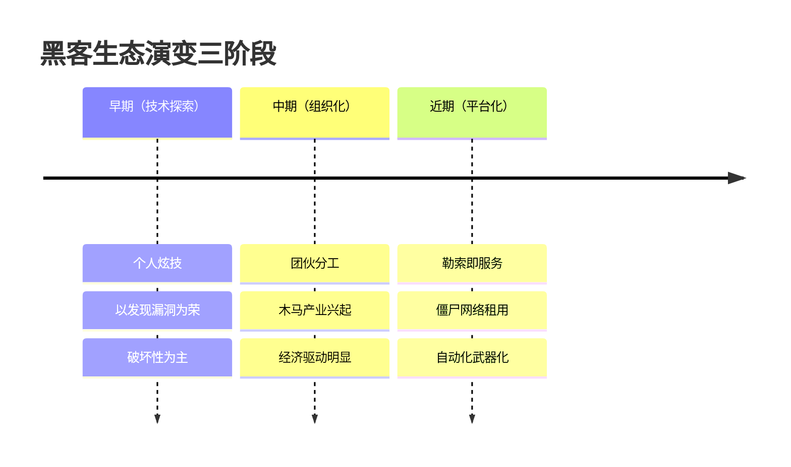

# 黑客生态的演变规律

# 黑客生态的演变规律

## 为什么需要理解黑客生态的演变

如果把单个黑客攻击比作病毒，那黑客生态就像一个有组织、有分工、会演化的“地下商业系统”。初学者常犯的错误是：只盯着某个漏洞或某次攻击，却看不到背后**攻击者群体自身的组织结构和技术路线的变迁**。理解演变规律，才能从“被动打补丁”转向“预判对手下一步会干什么”。

## 黑客生态演变的三个阶段

黑客生态并非一成不变，它随着互联网的商业化进程不断演进。大致分为三个典型阶段：

### 第一阶段：技术探索与个人炫技
早期黑客多为好奇驱动，以攻破高难度系统为荣耀。攻击目的偏向破坏和声张，经济利益并不明显。

### 第二阶段：组织化与产业链形成
互联网普及后，==攻击的根本驱动力从“名誉”转向“经济利益”==。木马开发、漏洞挖掘、洗钱、流量倒卖逐渐形成分工明确的黑色产业链。

### 第三阶段：平台化与武器扩散（当前）
如今，攻击门槛急剧降低。暗网中出现了“恶意软件即服务”（Malware as a Service），不懂编程的人也能购买僵尸网络（Botnet）服务发起攻击。这是安全防御面临的最严峻挑战。

> [!IMPORTANT]
> 黑客生态演变的核心趋势：**从单打独斗 → 分工协作 → 自动化武器售卖**。攻击能力呈指数级普惠化。

## 关键案例：僵尸网络如何体现演变规律

以考过的“僵尸病毒（Botnet）攻击能力”为例，它完美体现了第三阶段“==平台化与资源池化==”的特点。

- **规模效应**：控制了数百万台“肉鸡”，形成分布式资源池。
- **协同性**：所有节点能在瞬间同时向一个目标发起 DDoS（分布式拒绝服务）流量冲击。
- **隐蔽性与动态性**：不再依赖固定 IP，而是使用 DGA（域名生成算法）或 P2P 通信。C&C（命令与控制）服务器地址每天动态变化，跟踪极难。
- **持续性**：多数僵尸程序有“复活”和持久化机制，重装系统后才能彻底清除。

这体现出演变规律中的关键一点：==攻击能力已经通过平台化，被封装成可以稳定运行的“武器系统”==，不再依赖攻击者自身水平。

## 僵尸网络攻击能力的量化思考

为了帮助理解，我们做一个简化计算题：某攻击者控制了 10 万台终端，每台上行带宽 1 Mbps，指令推送到全部节点仅需 3 秒。

- **攻击总带宽**：$10 万 \times 1\text{ Mbps} = 100\text{ Gbps}$
- **真实可用攻击流量**：考虑到网络损耗，按 2% 控制开销折损，有效攻击流量约为 $100\text{ Gbps} \times 0.98 = 98\text{ Gbps}$

98 Gbps 的 DDoS 流量已足以瘫痪绝大多数中小型数据中心的上行链路。这就是规模效应带来的“暴力美学”。

## 相近概念辨析：APT 与普通僵尸网络

| 对比维度 | 普通僵尸网络 | APT（高级持续性威胁） |
| :--- | :--- | :--- |
| **攻击目的** | 多是破坏、勒索、DDoS 牟利 | 长期潜伏、数据窃取、政治/经济间谍 |
| **攻击手法** | 自动化、广撒网 | 高度定制、社会工程学、零日漏洞 |
| **组织形态** | 松散租用、平台化 | 严密组织、国家或财团背景 |

> [!WARNING]
> 常见误区：认为所有大规模攻击都是 APT。实际上，使用僵尸网络发起 DDoS 往往是“买凶杀人”，与需要长期潜伏、精密策划的 APT 完全不同。区分二者，需要看**时间窗口**和**攻击持续性**。

## 如何应对演变的生态

了解规律后，防御思路也要变：
1.  **从单点防御到纵深防御**：不能只靠防火墙。
2.  **从特征检测到行为分析**：僵尸网络 C&C 通信往往伪装成正常流量，需分析流量行为异常。
3.  **从被动响应到威胁狩猎**：主动在内部网络寻找隐藏的“肉鸡”节点，而非等警报响起。
