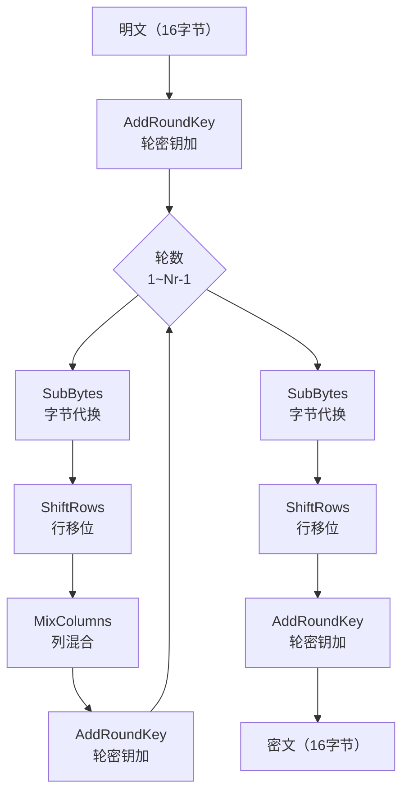

# 高级加密标准AES（算法参数、加密过程及示意图）

## 高级加密标准 AES

你可能会问：DES 用了几十年，为什么还需要 AES？因为 DES 的 56 位密钥太短，1997 年就被暴力破解了。于是美国 NIST 公开征集新一代加密标准，最终 Rijndael 算法胜出，成为今天的 AES。

AES 是一种==分组对称密码==——加密和解密用同一把密钥，每次处理固定长度的数据块。

### 算法参数

AES 支持三种密钥长度，这是它与 DES 最直观的区别：

| 参数项 | AES-128 | AES-192 | AES-256 |
|---|---|---|---|
| 密钥长度（bit） | 128 | 192 | 256 |
| 分组长度（bit） | 128 | 128 | 128 |
| 轮数 $N_r$ | 10 | 12 | 14 |

> [!IMPORTANT]
> AES 的分组长度固定为 128 位（16 字节），只有密钥长度可变。密钥越长，轮数越多，安全性越高，但速度越慢。

状态矩阵按列填充：16 个字节排成 $4 \times 4$ 矩阵，记为 $s_{0,0}$ 到 $s_{3,3}$。

### 加密过程概览

AES 不是简单的一轮操作，而是多轮迭代。每轮（除最后一轮外）包含四个变换：

> [!WARNING]
> 最后一轮**没有** `MixColumns`（列混合）步骤。这是一个常见的考题陷阱——问到某轮包含哪几步时，务必确认是不是最终轮。

### 四个变换详解

**SubBytes（字节代换）**：每个字节独立地查 S 盒替换。S 盒是 $16 \times 16$ 的固定查找表，提供非线性变换——这是 AES 安全性的核心。

**ShiftRows（行移位）**：状态矩阵的第 $i$ 行循环左移 $i$ 个字节（$i = 0, 1, 2, 3$）。作用是把一个列里的字节扩散到不同列。

**MixColumns（列混合）**：对每一列做矩阵乘法，在 $GF(2^8)$ 上乘一个固定多项式 $c(x) = 03x^3 + 01x^2 + 01x + 02$。这一步实现列间混淆。

**AddRoundKey（轮密钥加）**：状态矩阵与轮密钥逐字节异或。==轮密钥由初始密钥通过密钥扩展算法生成，共需 $N_r+1$ 个轮密钥==。

> [!TIP]
> 记忆口诀：「**代换 - 移位 - 混合 - 异或**」，最后一轮去掉「混合」。

### 密钥扩展

初始密钥扩展成 $4(N_r+1)$ 个 32 位字。当 $i$ 是密钥字数 $N_k$ 的倍数时，触发特殊处理：RotWord（字循环左移 1 字节）→ SubWord（S 盒替换）→ 异或轮常量 Rcon。

> [!NOTE]
> 「轮常量」Rcon 是一个固定数组，Rcon[$j$] = $(RC[j], 00, 00, 00)$，其中 $RC[1]=01$，$RC[j]=02 \cdot RC[j-1]$ 在 $GF(2^8)$ 上的乘法。

### 与 DES 的关键区别

| | DES | AES |
|---|---|---|
| 分组大小 | 64 bit | 128 bit |
| 密钥长度 | 56 bit | 128/192/256 bit |
| 结构 | Feistel 网络 | SPN（代换-置换网络） |
| S 盒原理 | 精心设计的固定表 | 代数结构 $GF(2^8)$ 上的逆映射 |
| 安全强度 | 已可暴力破解 | 目前安全 |

### 算例演示

问题：在 AES-128 的某一轮中，`SubBytes` 变换前的状态矩阵字节 $s_{0,0} = 0x6B$，求经过 `SubBytes` 后的值。

解法：查 S 盒。$0x6B$ 的高 4 位是 6（行），低 4 位是 B（列），在 S 盒中查第 6 行、第 B 列，得 $0x7F$。

> [!IMPORTANT]
> 课件 S 盒里第 6 行第 B 列对应的是 $0x7F$。如果题目给的是 `InvSubBytes`，则查逆 S 盒，使用同样的行列定位法。

### 常见误区

> [!CAUTION]
> **误区一**：AES 分组大小会随密钥长度变化。  
> 正解：分组始终 128 位，只有密钥长度可变。
>
> **误区二**：最后一轮也有 MixColumns。  
> 正解：最终轮不含 MixColumns，这是解密时必须对称处理的地方。
>
> **误区三**：S 盒是随机生成的。  
> 正解：S 盒基于 $GF(2^8)$ 上的乘法逆元加仿射变换，有严格的代数结构。
