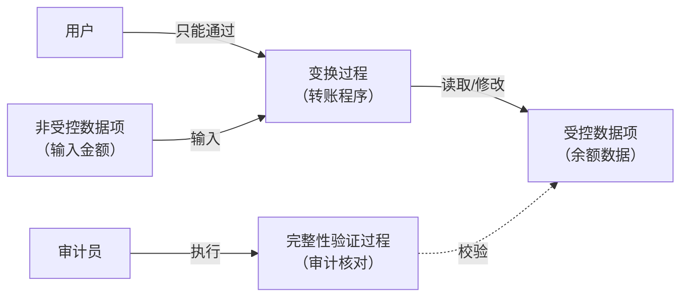

# 商用安全策略与Clark-Wilson模型

## 商用安全策略与Clark-Wilson模型

### 为什么要区分商用与军用安全策略？

先思考一个简单的问题：银行转账和情报传递，最怕什么不一样？

在军用环境（Bell-LaPadula模型）里，核心是**不泄密**——一个低级权限的士兵不应该读到上级的作战计划，所以严格控制“读”的方向。

但在商业交易中，我们更害怕的是**数据被胡乱篡改**。比如，你通过网银转账100元，结果数据库里的余额没有被正确地减少100元，或者转账记录凭空消失了。因此，==商业安全策略的核心是保证交易的完整性，而非单纯的保密性。==

[!IMPORTANT]
> Clark-Wilson模型的核心目标：**防止未经授权的用户篡改数据，并保证所有对数据的修改都是合规的“正规交易”。**

### 什么是Clark-Wilson模型？

Clark-Wilson模型不纠结于文件级的“读、写、执行”权限，而是定义了更高层的商业逻辑访问控制。它的核心思想是：

1.  数据对象（如银行余额）不能被任意用户直接操作。
2.  用户只能通过特定的**程序**（即“交易过程”）来修改数据。
3.  这些程序必须经过认证，保证其内部逻辑是合法的。

模型区分了两类核心概念：

| 概念 | 定义 | 示例 |
| :--- | :--- | :--- |
| **受控数据项 (CDI)** | 必须保持完整性的数据，是模型保护的对象。 | 账号余额、订单状态 |
| **非受控数据项 (UDI)** | 不受完整性控制的数据，可以从外部输入。 | 用户输入的转账金额 |
| **完整性验证过程 (IVP)** | 检查CDI状态是否一致、是否符合完整性约束的程序。 | 审计程序，核对总账是否平衡 |
| **变换过程 (TP)** | 唯一能修改CDI的程序，代表一个“正规交易”。 | `转账(转出账号, 转入账号, 金额)` |

### Clark-Wilson模型的九条核心规则

为了实现完整的商用安全策略，模型定义了9条规则（通常记为3+6，前3条定义核心安全机制，后6条是支撑和验证规则）：

#### 保证“正规交易”的三条基本规则 (C1-C3)

**C1: 认证规则** — 所有IVP必须能保证，当它们运行时，所有CDI都处于有效状态。
**C2: 强制路径规则** — TP是唯一能修改CDI的操作。用户不能绕过TP。
**C3: 执行规则** — 只有经过==明确授权==的用户，才能执行特定的TP。这天然实现了典型的商业规则：

[!TIP]
> **职责分离**：转账操作可以分解为“提交转账单”和“审核批准”，这两个TP必须授予**不同**的用户，从而防止一个人完成整个非法交易。

#### 支撑验证的六条辅助规则 (E1-E4, C4-C5)

这六条规则共同构成了审计跟踪和权限管理的闭环：

1.  **E1: 授权列表**
    *   系统必须维护一个“用户-可执行TP”的授权列表。
2.  **E2: 用户身份识别**
    *   用户在执行任何TP前，系统必须验证其身份。
3.  **E3: 最小特权**
    *   用户只应被授予完成其工作所必需的最小TP集。
4.  **E4: 日志审计**
    *   所有试图执行TP的操作（无论成功与否）都必须记录在**只追加**的审计日志中。
5.  **C4: 职责分离的执行**
    *   系统必须在代码层面强制落实职责分离，不能仅依赖管理员自觉。
6.  **C5: 输入校验**
    *   任何从UDI流入的数据，在被TP用于修改CDI前，必须经过验证（如格式、金额范围）。

[!WARNING]
> **常见误区**：Clark-Wilson模型不等于Bell-LaPadula模型的升级版。
> BLP关注**保密性**（防上读、写下），而CW关注**完整性**（防非法篡改）。它们是看待安全的两个正交视角。

### 与RBAC模型的联系

你可能觉得“将用户与特定的TP绑定”很像角色。确实如此，==D.Ferraiolo和D.Kuhn在1992年就指出，Clark-Wilson模型是RBAC模型的一个具体应用实例。== RBAC通过定义“角色”来聚合操作权限，天然就能实现“只有出纳员角色才能执行记账TP”这样的规则，从而满足商用安全策略。

### 一个算对了的例子：职责分离下的转账操作

**场景**：某银行系统要求大额转账必须由“经办”发起，"主管"审批。

**操作流程**：
1.  **用户识别(E2)**：经办员`Alice`，主管`Bob`登录并通过身份认证。
2.  **正规交易(E1, C2)**：
    *   `Alice`执行TP1: `提交转账申请(from, to, amount)`。
    *   `Bob`执行TP2: `审批并执行转账(申请号)`。
3.  **强制职责分离(C4)**：系统检查授权列表，发现`Alice`只有TP1权限，`Bob`只有TP2权限。系统强制确保`Alice`绝无执行TP2的可能。
4.  **输入校验(C5)**：`Alice`输入的`amount`是一个UDI数据。TP1内部会校验：`amount>0` 且 `from账户余额 >= amount`。若不满足，TP1失败。
5.  **审计追踪(E4)**：`Alice`的提交操作和`Bob`的审批操作全部记录进日志，记录属性包括：时间、用户、操作、以及`接收自Alice输入的金额值`。
6.  **完整性验证(IVP, C1)**：每晚，审计程序运行，统计当天所有成功的转账操作，核对`总支出 = 总流入`。若不等，则说明某个TP逻辑或CDI状态被破坏。

通过这套组合规则，系统可靠地保证了资金安全。
