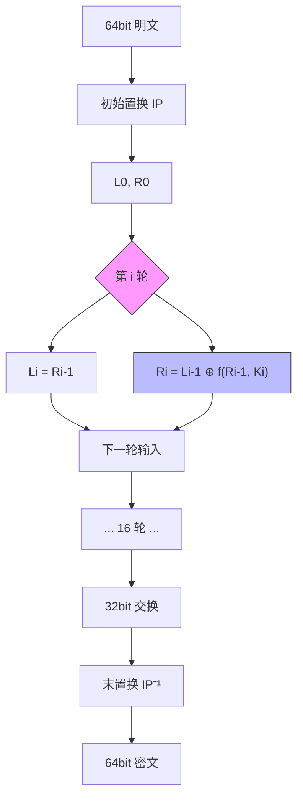

# 数据加密标准DES（算法概述、每轮处理过程、解密过程、三重DES算法及分析）

# 数据加密标准 DES

DES（Data Encryption Standard）是典型的==对称密钥加密算法==，即加密密钥 $K_E$ 与解密密钥 $K_D$ 相同。尽管其 56 位密钥长度已不再安全，但理解 DES 是掌握现代分组密码设计思想（如 Feistel 结构）的基石。

## 算法概述与结构

DES 处理 64 比特明文块，输出 64 比特密文。其核心采用 **Feistel 网络**结构，包含初始置换（IP）、16 轮迭代运算、以及末置换（$IP^{-1}$）。

> [!IMPORTANT]
> Feistel 结构的最大优势在于：**加解密过程完全相同**，仅需反转子密钥使用顺序，极大简化了硬件实现。

## 每轮处理过程

每轮的核心是轮函数 $f(R_{i-1}, K_i)$：
1. **扩展置换 (E)**：将 32 位 $R_{i-1}$ 扩展为 48 位。
2. **密钥加**：与 48 位子密钥 $K_i$ 异或。
3. **S 盒替换**：48 位分为 8 组，每组 6 位通过 S 盒压缩为 4 位（非线性核心，提供混淆）。
4. **P 置换**：32 位结果进行位置重排（提供扩散）。

最终更新规则为：
$$ L_i = R_{i-1} $$
$$ R_i = L_{i-1} \oplus f(R_{i-1}, K_i) $$

## 解密过程分析

DES 解密并非重新设计算法，而是==逆序使用子密钥==。若加密子密钥序列为 $K_1, K_2, ..., K_{16}$，则解密序列为 $K_{16}, K_{15}, ..., K_1$。

> [!TIP]
> 为什么能直接解密？
> 观察最后一轮输出：$L_{16} = R_{15}, R_{16} = L_{15} \oplus f(R_{15}, K_{16})$。
> 解密第一轮输入 $L'_{0}=R_{16}, R'_{0}=L_{16}$。
> 计算 $R'_{1} = L'_{0} \oplus f(R'_{0}, K_{16}) = (L_{15} \oplus f(R_{15}, K_{16})) \oplus f(R_{15}, K_{16}) = L_{15}$。
> 异或运算的可逆性消除了 $f$ 函数的影响，从而恢复上一轮状态。

## 三重 DES (3DES)

由于 DES 密钥过短易受暴力破解，3DES 通过多次加密增强安全性。

| 模式 | 密钥数量 | 有效密钥长度 | 说明 |
| :--- | :---: | :---: | :--- |
| DES-EEE3 | 3 | 168 bit | 加密-加密-加密，最安全 |
| DES-EDE3 | 3 | 168 bit | **加密-解密-加密**，兼容单 DES |
| DES-EDE2 | 2 | 112 bit | $K_1=K_3$，常用折中方案 |

> [!WARNING]
> 3DES-EDE 模式中，中间的“解密”步骤并非为了还原数据，而是为了使当 $K_1=K_2=K_3$ 时，3DES 退化为单 DES，从而实现向后兼容。

## 常见误区与示例

**误区**：认为 S 盒是线性变换。
**正解**：S 盒是 DES 中唯一的==非线性部件==，是抵抗线性密码分析的关键。

**示例推演**：
假设某轮输入 $L_{i-1}=A, R_{i-1}=B$，子密钥 $K_i=K$。
加密输出：$L_i=B, R_i=A \oplus f(B, K)$。
解密时，输入 $L'_0=R_i, R'_0=L_i$，使用密钥 $K$：
$L'_1 = R'_0 = B$ （恢复 $L_{i-1}$ 的前身，即原 $R_{i-1}$）
$R'_1 = L'_0 \oplus f(R'_0, K) = (A \oplus f(B, K)) \oplus f(B, K) = A$ （恢复原 $L_{i-1}$）
可见，数据成功回退一轮。
