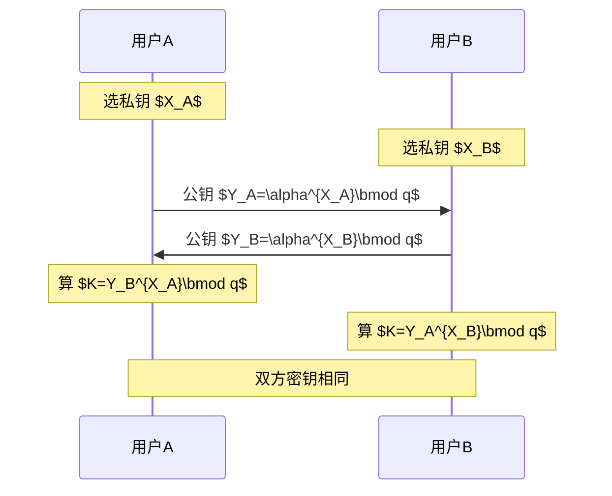

# Diffie-Hellman密钥生成算法（基本过程、加解密过程、举例与安全性分析）

## 为什么需要 Diffie-Hellman

想一想：在公共电信网上，通信双方从未见过面，如何用传统对称加密（如 DES）安全地商量出一个只有他俩知道的密钥？直接把密钥明文发过去，等于把锁和钥匙一起寄给窃听者。

Diffie-Hellman 密钥生成算法（1976 年由 W. Diffie 和 M. Hellman 提出）正是为解决这一**密钥协商**问题而生：双方公开交换一些信息，却能让窃听者无法推算出最终共享密钥。

> [!IMPORTANT]
> 本算法**不是公钥加密算法**，不能直接用来加解密数据，它只是基于公钥思想的**密钥协商算法**，生成的共享密钥供传统对称加密使用。

## 基本过程

设 $q$ 是一个素数，$\alpha$ 是 $(1,q)$ 范围内的一个素数（通常取模 $q$ 的原根），双方各自选取保密随机数。

具体步骤：

1. **选参数**：公开素数 $q$ 与 $\alpha$（$1<\alpha<q$）。
2. **选私钥**：A 选 $X_A$（$1\le X_A\le q-2$），B 选 $X_B$。
3. **算公钥**：
$$Y_A=\alpha^{X_A}\bmod q,\qquad Y_B=\alpha^{X_B}\bmod q$$
4. **交换公钥**：$Y_A,Y_B$ 在公开信道上发送。
5. **算共享密钥**：
$$K_A=Y_B^{X_A}\bmod q,\qquad K_B=Y_A^{X_B}\bmod q$$

由模幂运算性质，$K_A=K_B=K$，即双方得到相同密钥。

## 算例（取自复习题）

设 $q=79$，$\alpha=67$，$X_A=37$，$X_B=23$。

**公钥计算**：
$$Y_A=67^{37}\bmod 79=33,\qquad Y_B=67^{23}\bmod 79=40$$

**共享密钥计算**：
$$K_A=Y_B^{X_A}\bmod 79=40^{37}\bmod 79=62$$
$$K_B=Y_A^{X_B}\bmod 79=33^{23}\bmod 79=62$$

双方独立算得 $K=62$，可将其作为 DES 等传统算法的会话密钥。

> [!TIP]
> 手算大指数模幂用**平方-乘算法**（反复平方后取模再相乘），不要先算完整幂次再取模，否则数字会爆炸。

## 加解密过程与安全性分析

Diffie-Hellman 本身**不提供加解密操作**。协商出 $K$ 后，双方用 $K$ 作密钥，采用传统对称加密算法（如 AES、DES）加密实际数据。

其安全性基于**离散对数难题**：已知 $Y=\alpha^X\bmod q$，反推 $X$ 在计算上不可行。攻击者截获 $q,\alpha,Y_A,Y_B$，要求出 $K$ 必须解离散对数，当 $q$ 足够大（如 1024 位以上）时实际不可行。

> [!WARNING]
> 常见易错点：
> - 混淆公钥与私钥：$X_A,X_B$ 保密，$Y_A,Y_B$ 公开。
> - 误以为能直接加密：本算法只协商密钥，加密需另选对称算法。
> - 中间人攻击：攻击者可分别与 A、B 建立独立密钥。实际应用需配合**数字签名或证书**认证对方身份。

> [!NOTE]
> 与 RSA 对比：RSA 是完整的公钥加密体系（可加密、可签名），基于大整数分解难题；Diffie-Hellman 仅用于密钥协商，基于离散对数难题。二者常配合使用：用 Diffie-Hellman 协商会话密钥，用 RSA 签名防中间人。
