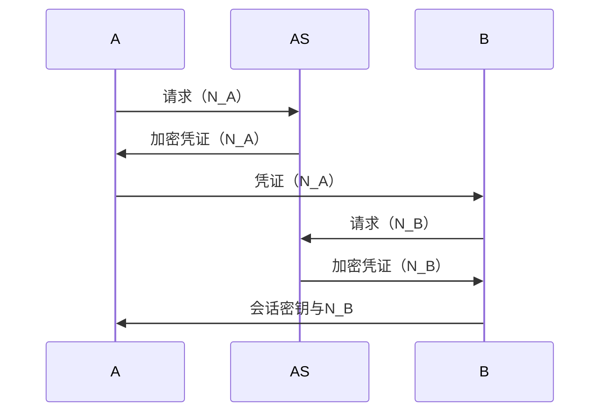
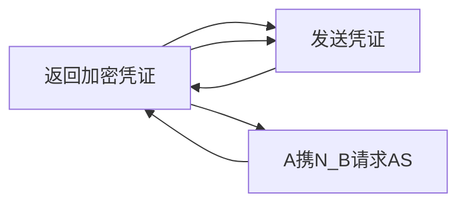

# Needham-Schroeder身份验证协议（交互过程、问题讨论、基于时间戳与一次性数的改进方案）

## 协议是什么

Needham-Schroeder（N-S）身份验证协议用于在**不安全网络**中，让通信双方 $A$、$B$ 确认对方身份，并建立后续通信所需的会话密钥。协议引入双方共同信任的身份验证服务器 $AS$：

- $A$ 与 $AS$ 共享密钥 $K_{AS,A}$；
- $B$ 与 $AS$ 共享密钥 $K_{AS,B}$；
- $A$ 与 $B$ 可通过 $AS$ 协商会话密钥 $K_{AB}$。

> [!IMPORTANT]
> N-S 协议不是依靠共享密钥直接证明身份，而是借助 $AS$ 转发加密凭证，使用户身份和会话密钥具有可验证性。

## 为什么需要验证码

仅收到一个报文，并不能证明发送者就是报文所声称的人，因为攻击者可以伪造报文。因此，身份验证需要让接收方检查一个**只有合法用户才能生成、且可由服务器验证的信息**，如加密凭证、一次性数或时间戳。

> [!TIP]
> 记忆：身份验证要回答“==你是谁==”，会话密钥要回答“==以后用什么秘密通信==”。

## 交互过程

经典 N-S 协议包含 5 个报文。以下令 $N_A$ 为 $A$ 生成的随机数，$K_{AB}$ 为协商出的会话密钥。

具体过程如下：

1. $A$ 向 $AS$ 发送自己的身份和随机数 $N_A$。
2. $AS$ 使用 $K_{AS,A}$ 加密 $N_A$，将凭证返回给 $A$。
3. $A$ 收到后解密，得到 $N_A$，并将该凭证发送给 $B$。
4. $B$ 收到凭证后，向 $AS$ 请求认证。$AS$ 使用 $K_{AS,B}$ 加密 $N_B$ 返回。
5. $B$ 解密得到 $N_B$，再把用 $K_{AB}$ 加密的 $N_B$ 发送给 $A$。$A$ 解密后确认 $N_B$，并验证 $N_A$ 未被冒用。

这样，$A$ 获得 $K_{AB}$，$B$ 也获得同一密钥，且双方分别验证了对方的随机数。

## 改进方案

### 基于时间戳

时间戳方案在凭证中加入发送时间，使过期凭证不能重复使用。它不要求精确的全球时钟，但要求各主机时钟误差不超过可接受范围。

### 基于一次性数

一次性数方案让 $A$ 先向 $B$ 获取一个新的随机数 $N_B$，再将该数交给 $AS$ 生成凭证。该方案不依赖全球时钟，安全性通常优于时间戳方案，但增加了 $A$ 与 $B$ 之间的两次交互。

## 问题与易错点

| 问题 | 原因 | 改进 |
|---|---|---|
| 重放攻击 | 旧凭证仍可被再次发送 | 一次性数或时间戳 |
| 旧会话密钥泄露 | 早期 N-S 协议未充分保证会话新鲜性 | 采用改进协议 |
| 加密算法被攻破 | 协议安全性依赖底层加密 | 更换安全算法 |
| 共享密钥泄露 | 可伪造认证凭证 | 保护 $K_{AS,A}$、$K_{AS,B}$ |

> [!WARNING]
> “加密了”不等于“身份一定真实”。若攻击者掌握 $K_{AS,A}$，就可能冒充 $A$ 生成合法凭证。

## 算对示例

若 $A$ 收到并解密 $B$ 发来的消息，得到：

$$
\text{解密}(K_{AB},C)=N_B
$$

且该 $N_B$ 与自己此前从 $B$ 获得并提交给 $AS$ 的数一致，则说明两点：发送者能够使用 $K_{AB}$，且消息对应本次交互，不是随意重放的旧消息。于是 $A$ 可以确认 $B$ 的身份，并接受 $K_{AB}$ 作为本次会话密钥。
