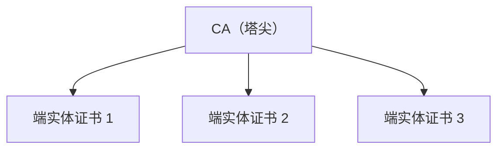
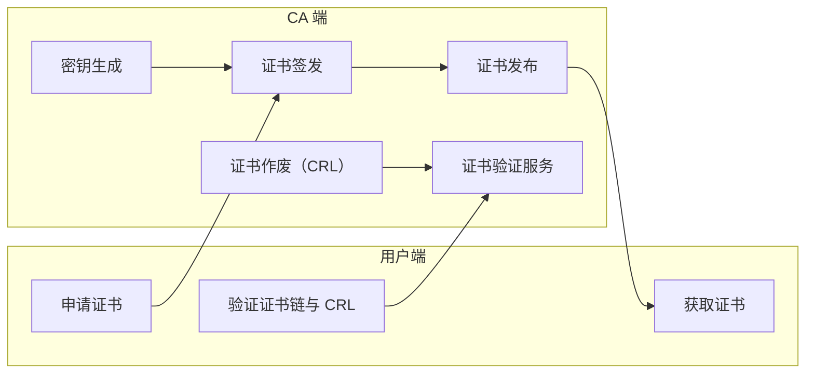

# 公钥基础设施PKI与X.509建议（必要性、结构、证书定义与逻辑格式、实现模型与设计建议）

## 为什么需要 PKI

身份验证的前提是：验证者必须拿到==真实公钥==。如果攻击者在中间替换了公钥，后续的签名验证、加密通信全部建立在假公钥之上，真实性验证就失效了。

问题很自然：公钥只是一串数字，你怎么确定某个公钥确实属于声称的那个人？

> [!IMPORTANT]
> PKI 要解决的核心问题：在不可信网络中，让验证者能够安全地获取并信任某个实体的公钥。

需要一个受信任的第三方来为“公钥—实体身份”的绑定关系做担保，这就是认证权威中心 CA（Certification Authority）。由 CA 签名发布的、绑定公钥与实体标识的数据结构，称为==证书==。

## PKI 的结构

PKI 通常采用==信任金字塔（Pyramid of Trust, POT）==结构。最简 POT 只有两层：

CA 位于塔尖，由其签发的一组端实体（End Entity, EE）证书位于塔底。这一个 CA 及其签发的证书集合构成==一个信任域==。

> [!WARNING]
> 一个最基本的两层 POT 只覆盖单个信任域。如果用户需要验证另一个信任域中的证书，单域 PKI 就无能为力了。

跨信任域时，通过==多层 POT== 把多个信任域连接起来：上层 CA 为下层 CA 签发证书，形成证书链，验证者只要信任某一个根 CA，就能沿链逐级验证到底层端实体证书。

## 证书与 X.509 建议

证书的通用定义：==将公钥与某实体标识绑定、并由使用方信任的 CA 签名的一种数据结构==。

ITU-T 发布的 X.509 建议是国际上标准的证书格式，2000 年 3 月版是目前通行文本。X.509 证书具有以下特征：

- 任何拥有某 CA 公钥的用户，都能从该 CA 签发的证书中提取证书持有者的公钥。
- CA 签名一组信息形成证书，包括用户名 $A$、公钥 $PK_A$、用户唯一标识符 $U_A$ 等。

证书常用逻辑字段：

| 字段 | 含义 |
|---|---|
| 版本号 | X.509 版本（v1/v2/v3） |
| 序列号 | CA 为该证书分配的唯一编号 |
| 签名算法标识 | CA 签名所用算法 |
| 颁发者名称 | 签发该证书的 CA 标识 |
| 有效期 | 起止时间 |
| 主体名称 | 证书持有者标识 |
| 主体公钥信息 | 公钥算法与公钥值 |
| 扩展 | 密钥用途、策略信息等 |
| CA 签名 | 对上述全部字段的签名 |

## PKI 的实现模型

实现模型通常包括：CA（密钥管理、签发、发布、作废、验证）、RA（注册审核）、证书库、CRL（证书作废列表）等。

## PKI 设计建议

- ==本地标识==：证书主体名称应使用对本应用有意义的本地标识，而不必强求全局统一命名。
- ==证书作废==：必须提供证书作废机制（如 CRL），并在每次验证时检查作废状态。仅有有效期是不够的——密钥可能在到期前泄露。
- ==面向特定应用==：根据应用的具体安全需求裁剪扩展字段与验证策略，不必生搬通用 PKI 的全部功能。

## 常见坑

> [!CAUTION]
> **不要以为“拿到证书”就等于“拿到可信公钥”**。必须验证：证书链是否可信任、签名是否正确、有效期是否覆盖当前时间、证书是否已被作废。跳过后两项，过期证书和被作废证书仍能通过签名看似“有效”。

> [!NOTE]
> 证书与公钥不是一回事：公钥是证书中的一个字段；证书是 CA 对“公钥—身份”绑定的签名担保。直接从证书中提取公钥的前提是==你已经信任该 CA 的公钥==。

## 一个例子

用户 B 收到了用户 A 声称的公钥 $PK_A'$，以及 A 的证书 $Cert_A$。验证步骤：

1. B 已持有信任的 CA 公钥 $PK_{CA}$。
2. B 用 $PK_{CA}$ 验证 $Cert_A$ 上的 CA 签名，通过。
3. 检查证书有效期：当前时间在有效期内。
4. 查询 CRL：证书序列号不在作废列表中。
5. 从 $Cert_A$ 中提取公钥 $PK_A$，比对 $PK_A = PK_A'$。

五步全部通过，B 才能将 $PK_A$ 作为 A 的真实公钥用于后续签名验证或加密对话。
