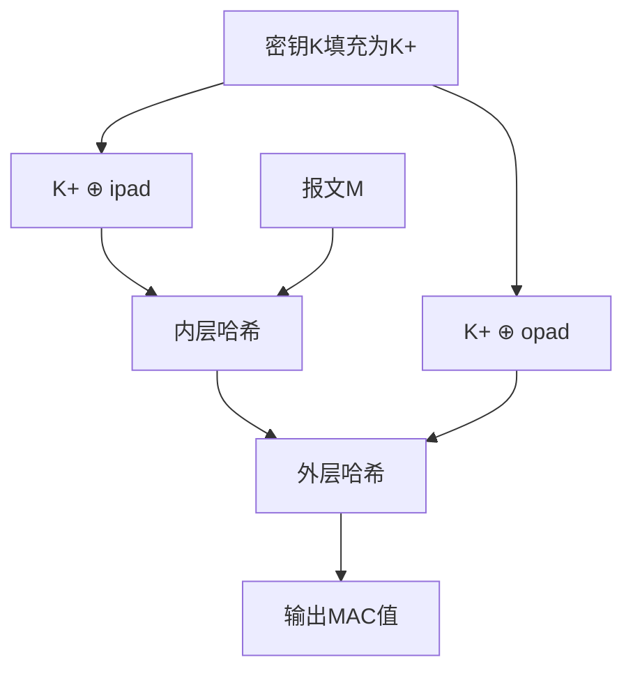

# 安全哈希算法SHA-1执行过程与哈希报文验证码算法HMAC

---
title: 安全哈希算法SHA-1执行过程与哈希报文验证码算法HMAC
requires: [信息安全技术/哈希函数, 计算机网络/数据链路层]
---

如果只把消息做哈希，攻击者截获后篡改内容并重新计算哈希值，接收方还能发现吗？显然不能。因此我们需要一种机制，让只有掌握“秘密”的人才能生成正确的验证标签。

## SHA-1 执行过程

SHA-1 将任意长输入映射为 ==160 bit（20 字节）== 的固定摘要。

1. **填充**：末尾补 `1`，再补 `0`，使长度 $\equiv 448 \pmod{512}$。
2. **附加长度**：追加 64 bit 原始消息长度。
3. **初始化缓冲区**：设 5 个 32 bit 寄存器 $(H_0, H_1, H_2, H_3, H_4)$。
4. **分组压缩**：每 512 bit 为一组，经 4 轮、每轮 20 步运算更新寄存器。
5. **输出**：最终级联 $H_0 \| H_1 \| H_2 \| H_3 \| H_4$。

> [!WARNING]
> SHA-1 已被证明存在碰撞攻击漏洞，实际工程中应迁移至 SHA-256 或更高版本。

## 哈希报文验证码算法 HMAC

课件明确指出：==哈希报文验证码算法 HMAC 是互联网中常用的一种无加密报文验证方法==。它不加密报文本身，而是在明文后附加一个由共享密钥和哈希函数共同生成的 MAC 值，用于验证真实性与完整性。

### 为什么需要 HMAC？

直接拼接 $H(K \| M)$ 易受**长度扩展攻击**。HMAC 通过内外双层密钥结构消除该隐患。

$$\text{HMAC}(K, M) = H\big((K^+ \oplus \text{opad}) \| H((K^+ \oplus \text{ipad}) \| M)\big)$$

其中 $K^+$ 为填充至分组长度的密钥，$\text{ipad}=\text{0x36}$，$\text{opad}=\text{0x5C}$。

### 计算示例

设使用 SHA-1（分组 64 字节），密钥 $K=\text{"key"}$（3 字节），报文 $M=\text{"msg"}$。

1. $K^+$：`"key"` 后补 61 个 `0x00`，共 64 字节。
2. 内层：$S_i = K^+ \oplus \text{ipad}$，计算 $h_{in} = \text{SHA-1}(S_i \| \text{"msg"})$，得 20 字节。
3. 外层：$S_o = K^+ \oplus \text{opad}$，计算 $\text{SHA-1}(S_o \| h_{in})$。
4. 最终输出 160 bit MAC 值。

> [!TIP]
> 记忆口诀：**“内 ipad 外 opad，先算里面再套外面”**。i 对应 inner（0x36），o 对应 outer（0x5C）。

## 概念辨析

| 对比维度 | 普通哈希 $H(M)$ | HMAC | 加密 MAC（如 CBC-MAC） |
| :--- | :--- | :--- | :--- |
| **是否需要密钥** | 否 | 是 | 是 |
| **是否加密报文** | 否 | ==否（无加密）== | 视模式而定 |
| **防篡改能力** | 弱（可重算） | 强（需密钥） | 强 |
| **底层依赖** | 哈希函数 | 哈希函数 + 密钥 | 分组密码 |

> [!IMPORTANT]
> HMAC 属于**无加密报文验证方法**，仅提供真实性与完整性校验，不提供机密性。若需保密，必须额外叠加加密算法。

> [!CAUTION]
> 常见误区：认为 HMAC 会加密报文。实际上发送方发送的是**明文 + MAC**，窃听者能看到原文，但无法伪造合法 MAC。
