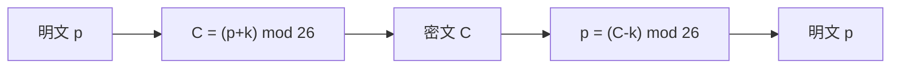

# 传统数据加密历史方法（凯撒密码、通用凯撒加密法、围栏加密、矩阵加密）

## 传统数据加密历史方法

在进入现代密码学之前，人们已经发明了多种手工加密方法。这些方法虽然简单，却能帮助我们理解密码学的两个基本操作：==替换==（Substitution）和==换位==（Transposition）。凯撒密码属于替换，围栏加密与矩阵加密属于换位。

### 凯撒密码：最早的替换加密

传说凯撒大帝用移位 3 位的字母表来加密军事情报：明文中的每个字母用字母表中向后数 3 个的字母代替。

如果令 a = 0, b = 1, …, z = 25，明文字母为 $p$，密文字母为 $C$，则凯撒密码的加密算法为：

$$
C = (p + 3) \bmod 26
$$

解密算法为：

$$
p = (C - 3) \bmod 26
$$

例如明文 `attack`，加密后得到 `dwwdfn`。

> [!NOTE]
> 这里的模运算 $\bmod 26$ 是为了处理溢出：比如 `z`(25) 加 3 得到 28，$\bmod 26$ 后回到 2，对应 `c`。

### 通用凯撒加密法：引入密钥

凯撒密码固定移位 3 位，太容易被猜到。通用凯撒加密法把移位数从固定的 3 扩展为任意整数 $k$（$0 < k < 26$），这个 $k$ 就是==密钥==。

加密算法：

$$
C = (p + k) \bmod 26
$$

解密算法：

$$
p = (C - k) \bmod 26
$$

密钥空间大小是多少？$k$ 只能取 1～25，共 25 种可能（$k=0$ 相当于不加密，没有意义）。这意味着==穷举攻击只需尝试 25 次==就能破译，安全性极弱。

> [!IMPORTANT]
> 通用凯撒密码的密钥长度是 25 种可能取值，而非“密钥长度 25 位”。考题中问“如何计算密钥长度”时，指的是密钥空间的大小为 25。

### 围栏加密：按行写、按列读

围栏加密不再替换字母，而是==打乱字母的排列顺序==，属于换位加密。

做法：把明文按“围栏”的深度（比如 2 行）交替写入两行，然后逐行读出。

以明文 `meetmeatnoon`、深度 2 为例：

| 第 1 行 | m | e | m | a | n | o |
|---------|---|---|---|---|---|---|
| 第 2 行 | e | t | e | t | o | n |

逐行读出得到密文：`meman oeteton`（去掉空格为 `memanoeteton`）。

> [!WARNING]
> 围栏加密不改变字母本身，只改变位置。因此密文中字母出现的频率与明文完全一致，容易受到频率分析攻击。围栏深度太浅（如 2）时，破译几乎不需要尝试多少次。

### 矩阵加密：块加密的雏形

矩阵加密也是换位加密，做法是：

1. 将明文逐行填入一个 $n \times m$ 的矩阵；
2. 按照预先定义的列序列，按列读出字母。

例如用 $3 \times 4$ 矩阵加密明文 `meet you at six`（去掉空格为 `meetyouatsix`，共 12 个字符，正好填满 3 行 4 列）：

**填空矩阵（逐行写）：**

| 行 \ 列 | 1 | 2 | 3 | 4 |
|---------|---|---|---|---|
| 第 1 行 | m | e | e | t |
| 第 2 行 | y | o | u | a |
| 第 3 行 | t | s | i | x |

密钥 `3142` 表示按列的顺序为：第 3 列 → 第 1 列 → 第 4 列 → 第 2 列。

**按列读出：**

- 第 3 列：`e u i`
- 第 1 列：`m y t`
- 第 4 列：`t a x`
- 第 2 列：`e o s`

密文为：`euim yttax eos`（去掉空格 `euim yttaxeos`）。

> [!TIP]
> 矩阵加密的密钥是==列读出顺序==，如 `3142`。解密时先把密文按列顺序填回矩阵，再逐行读出明文。

### 块加密的两个关键问题

矩阵加密方法属于==块加密==的雏形——它以固定大小的块（这里是 $3 \times 4 = 12$ 个字符）为单位处理数据。这引出两个所有块加密方法都必须解决的问题：

1. **明文长度不是块大小的整数倍时怎么办？** ——需要填充（Padding）。
2. **相同的明文块加密后是否产生相同的密文块？** ——这关系到安全性，现代块加密用工作模式（如 CBC、CTR）来解决。

> [!NOTE]
> 替换加密改变字母的“身份”，换位加密改变字母的“位置”。凯撒密码属于前者，围栏和矩阵加密属于后者。二者可以组合使用，现代密码正是反复交替使用替换与换位操作来达到“混淆”与“扩散”的目的。

### 对比总结

| 方法 | 类型 | 密钥 | 破译难度 |
|------|------|------|----------|
| 凯撒密码 | 替换 | 固定 3 | 极低（1 次尝试） |
| 通用凯撒 | 替换 | k（1～25） | 低（25 次尝试） |
| 围栏加密 | 换位 | 深度 n | 低（尝试几个深度） |
| 矩阵加密 | 换位（块） | 列顺序 | 中（列数阶乘） |
