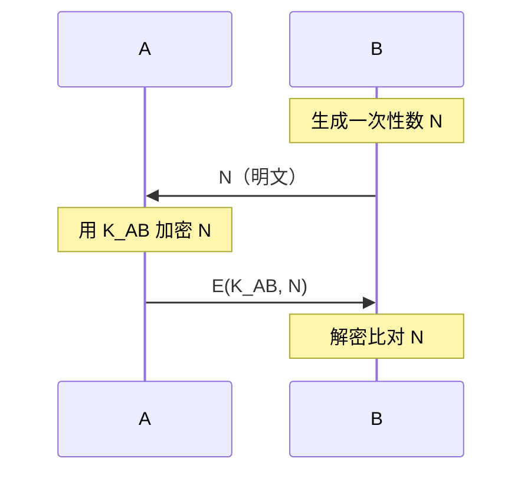
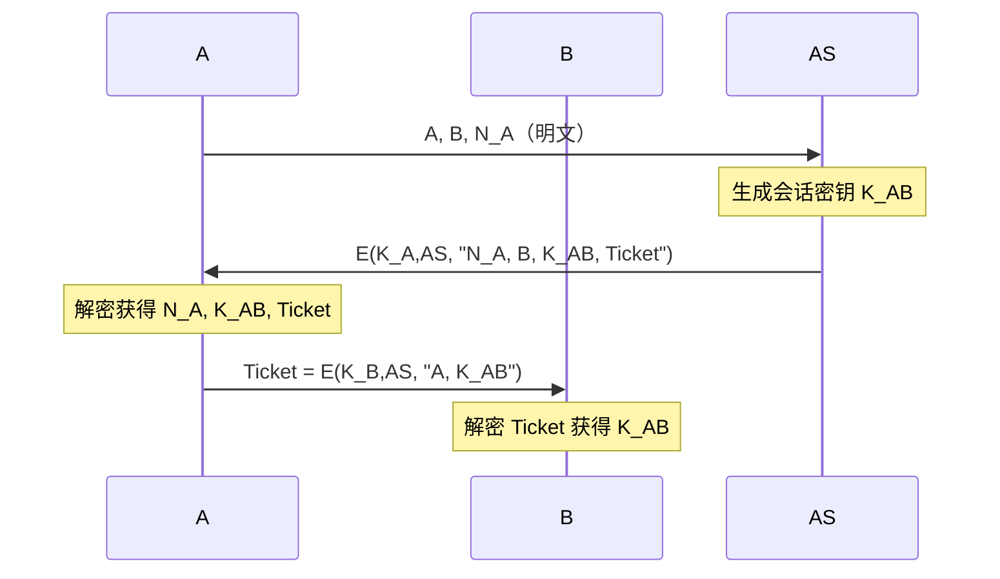
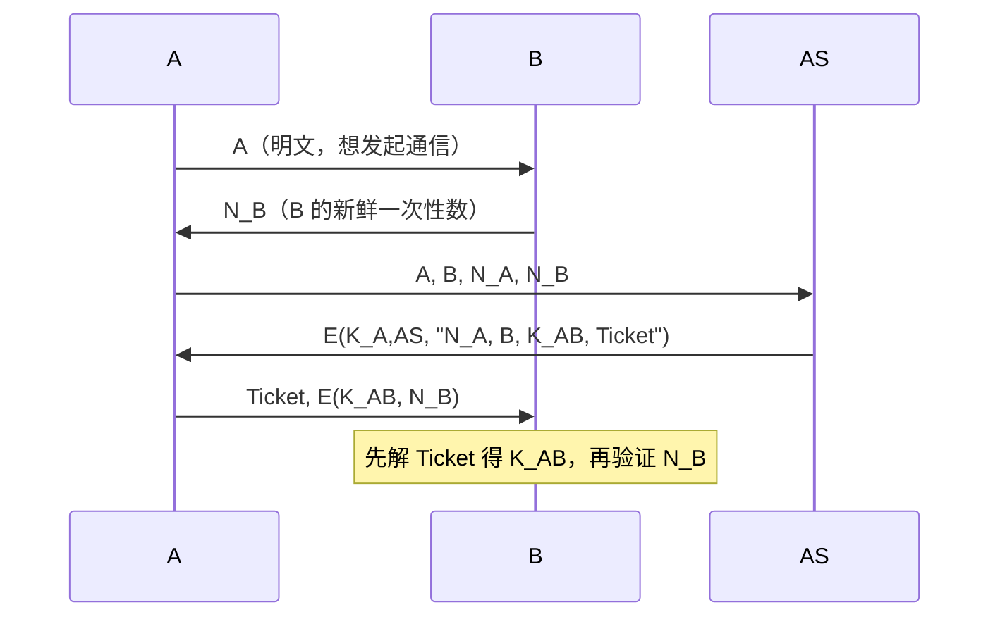

# 传统密码体系身份验证协议（基于一次性数、三方参与的身份验证协议）

## 传统密码体系身份验证协议

在计算机网络中，身份验证要回答的问题是“==如何让对方相信我就是我所声称的那个身份==”。当两个此前已经共享过密钥的实体需要相互确认身份时，传统密码体系（对称密码）提供了一条直接而经典的思路。

一个最朴素的想法是：A 直接用共享密钥 $K_{A,B}$ 加密自己的身份标识发给 B，B 解密成功就认为对方是 A。这个协议确实“能跑”，但它有一个致命缺陷——==重放攻击==。攻击者只要截获 A 发送的密文，之后原样重发给 B，B 就会再次相信“A 来了”。

> [!TIP]
> 判断一个身份验证协议是否安全，先问：**截获的报文能不能被原样重放？** 如果答案是“能”，则协议不满足新鲜性。

### 为什么需要一次性数

问题的根源在于 B 无法区分“A 刚刚发来的报文”和“A 很久以前发来的报文”。要解决这一点，B 需要一种手段来检验报文的“新鲜性”。最常见的机制就是==一次性数（Nonce）==：一个只在本次协议交互中使用一次的随机数。

一次性数的精妙之处在于：它由验证方 B 现场生成，每次不同，且 B 自己记得刚发出去的值。这样，即使攻击者重放旧报文，其中包含的一次性数也必然与 B 本次发出的一次性数不匹配，重放立刻暴露。

### 两方身份验证协议

引入一次性数后，A 向 B 验证身份的两方协议如下：

B 首先生成一个随机一次性数 $N$，明文发给 A。A 收到后，用共享密钥 $K_{A,B}$ 加密 $N$ 并返回。B 用自己的副本解密，若得到的值恰好等于刚发出的 $N$，则确认对方确实持有 $K_{A,B}$，从而确认对方身份。

> [!IMPORTANT]
> 这个协议的安全性建立在两个假设之上：① 只有 A 和 B 知道 $K_{A,B}$；② 对称加密算法本身是安全的。A 能正确加密一次性数，等价于证明了“我拥有 $K_{A,B}$”。

### 为什么需要三方参与

上述两方协议隐含了一个前提：A 和 B **已经**共享了密钥 $K_{A,B}$。但在一个大规模网络中，任意两个用户不可能都提前两两共享过密钥。如果网络中有 $n$ 个用户，每对用户都要预置一个共享密钥，就需要 $C_n^2 = \frac{n(n-1)}{2}$ 个密钥，这个数量随 $n$ 平方增长，完全不可扩展。

解决方案是引入一个==可信第三方——身份验证服务器（Authentication Server, AS）==。AS 与每个注册用户分别共享一个长期密钥：AS 与 A 共享 $K_{A,AS}$，AS 与 B 共享 $K_{B,AS}$。任意 A、B 之间不再需要预共享密钥，改由 AS 在协议运行过程中为它们临时生成一个会话密钥。

> [!NOTE]
> 区分两个层次：$K_{A,AS}$、$K_{B,AS}$ 是**长期密钥**，注册时预置；$K_{A,B}$ 是**会话密钥**，每次协议运行时由 AS 临时生成，用完即弃。分层设计正是为了将密钥分发问题从 $O(n^2)$ 降为 $O(n)$。

### 三方身份验证协议

假设 A 和 B 都已在 AS 注册。A 想向 B 验证身份，但 A、B 之间没有共享密钥。协议流程如下：

AS 收到 A 的请求后，生成一次性会话密钥 $K_{A,B}$，并构造一个 **票据（Ticket）**：用 B 与 AS 共享的密钥 $K_{B,AS}$ 加密的 $\{A,\ K_{A,B}\}$。A 拿到票据后无法解密（因为它不知道 $K_{B,AS}$），但可以原样转发给 B。B 解密票据后得知“AS 确认对方是 A，且本次会话密钥为 $K_{A,B}$”。

> [!WARNING]
> 票据的设计要点：AS 用 **B 的密钥**加密票据，而不是用 A 的密钥。这样 B 解密票据时能够确信内容来自 **AS**（因为只有 AS 知道 $K_{B,AS}$），而不是 A 伪造的。

### 一个算对了的例子

设 A 的身份标识为 `A`，B 的身份标识为 `B`，AS 生成的一次性数为 $N_A = 347$，会话密钥 $K_{A,B} = d3f8$。假设各加密函数值如下（仅为示意）：

| 步骤 | 报文内容 | 含义 |
|------|----------|------|
| ① A→AS | `A, B, 347` | A 请求与 B 通信，附一次性数 |
| ② AS→A | $E(K_{A,AS},\ 347 \,\|\, B \,\|\, d3f8 \,\|\, Ticket)$ | A 解密得 $N_A=347$ 与 $K_{A,B}=d3f8$ |
| ③ A→B | $Ticket = E(K_{B,AS},\ A \,\|\, d3f8)$ | B 解密得“对方是 A，会话密钥 $d3f8$” |

A 在步骤②中解密得到 $N_A = 347$，与自己在步骤①中发出的一次性数一致，因此 A 确认 AS 是真实的（而非重放旧响应）。B 在步骤③中成功用 $K_{B,AS}$ 解出票据，确认会话密钥 $K_{A,B} = d3f8$ 来自 AS 的背书，从而信任 A 的身份。

### Needham–Schroeder 的隐患与基于一次性数的改进

上述三方协议本质上是 ==Needham–Schroeder 身份验证协议==的核心思想。但最初版本存在一个著名漏洞：如果攻击者将来某天获得了旧的会话密钥 $K_{A,B}$（例如通过暴力破解或其他渠道泄露），就可以重放旧票据，再次冒充 A 与 B 建立“新”会话——因为 B 无法判断票据中携带的会话密钥是新鲜的还是已过期的。

Needham 和 Schroeder 本人不赞同用时间戳来补救（时间戳要求全网时钟同步，在分布式环境下脆弱），而是提出了==基于一次性数的改进方案==，核心变化是在 A 与 B 之间额外增加一轮交互，让 **B 先发出一个自己的新鲜一次性数**：

关键改进在最后一步：A 不仅转发票据，还用刚获得的会话密钥 $K_{A,B}$ 加密 B 此前刚发出的一次性数 $N_B$ 一并发送。B 解密票据获得 $K_{A,B}$ 后，再用它解密 $E(K_{A,B}, N_B)$，比对是否等于自己刚发出的 $N_B$。这样，即便攻击者重放的是一个**旧的、已被攻破的** $K_{A,B}$ 对应的旧票据，攻击者也知道旧密钥并能够加密 $N_B$，但**当 B 验证时发现旧的会话密钥仍能通过**——这正是改进方案的微妙之处：真正阻止重放的是 **B 无法区分新旧密钥** 这一问题的进一步组合防御。改进方案的核心逻辑是：若攻击者不知当前 $K_{A,B}$，则无法正确加密 $N_B$；若攻击者知道旧 $K_{A,B}$ 并重放旧票据，则 B 随后用它加密的 $N_B$ 也能被攻击者解密，这仍然是一个问题——因此安全学界后来又引入了**时间戳 + 一次性数混合**或 **Kerberos 式有限有效期票据** 来进一步收紧。

> [!CAUTION]
> 容易混淆的是：两方协议中的一次性数由 **验证方 B** 发给 **声称方 A**，作用是阻止**外部攻击者**重放；而基于一次性数的改进方案中新增的 $N_B$ 由 B 发给 A，再由 A 用**新会话密钥**加密返回，作用是让 B 确认 **A 确实拿到了本次新建的会话密钥**，从而区分新旧密钥。

### 与传统公钥体系协议的区别

| 维度 | 传统密码体系（对称） | 公钥密码体系（非对称） |
|------|----------------------|------------------------|
| 身份证明手段 | 正确加密/解密共享密钥下的数据 | 正确用私钥做数字签名 |
| 核心依据 | 只有真实方知道 $K_{A,B}$ | 只有真实方持有 $VK_A$ |
| 密钥分发 | 依赖可信第三方 AS 逐对分发 | 仅需权威发布公钥 $PK_A$ |
| 典型协议 | Needham–Schroeder（对称版） | 基于证书的身份验证协议 |

两者的**验证逻辑是相通的**：都是“做一个只有真实当事方才做得出的事情”。区别只在于“这件事”在对称体系下是**正确持有密钥**，在公钥体系下是**正确使用私钥**。

> [!NOTE]
> 无论对称还是非对称体系，核心安全边界都一样：**加密算法或密钥一旦被攻破，身份验证协议立刻失效**。课件中特别指出 Needham–Schroeder 的这一局限，正是提醒我们：协议的安全性最终收敛于底层密码学原语的安全性。
