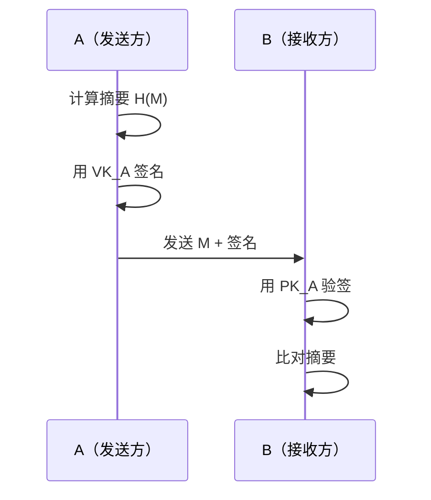

# 公钥数据加密体系与密钥管理

公钥数据加密体系（又称非对称密码体系）==用一对数学关联的密钥（公钥 PK 与私钥 VK）完成加密/解密或签名/验签==，发送方与接收方不再共享同一把密钥，因而天然适合开放网络。它的三大典型用途：**保密通信**（用对方公钥加密）、**数字签名**（用自己私钥对报文摘要签名）、**密钥协商**（Diffie-Hellman）。

> [!NOTE]
> 课程里特别强调：Diffie-Hellman 只是基于公钥体系思想的 ==密钥协商算法==，它==生成的密钥并不是公钥体系里的公钥/私钥==，而是供传统（对称）密码体系使用的会话密钥 $K_s$。

## 完整性：为什么私钥签名能防止篡改

想一个问题：如果 A 想给 B 发一段报文，又不希望中途被改，单用加密够吗？不够——攻击者可以整段替换。于是 A 先对报文 $M$ 求摘要 $H(M)$，再用 ==自己的私钥 $VK_A$== 加密摘要得到签名 $S$，随原文一起发；B 用 $PK_A$ 解出摘要，与自己重算的 $H(M)$ 比对。摘要不对就说明被改过。因为私钥只有 A 掌握，攻击者无法伪造出可用 $PK_A$ 验证通过的签名，于是 ==数据完整传递== 得到保证。

## 密钥管理：公钥不能"随便公开"

公钥体系的规则是"知公钥推不出私钥"，那公钥是不是随便挂在个人主页上就行？==不行==。公钥==在某种程度上对应了某人的身份==，必须由 ==权威机构（CA）公开而权威地发布==。

> [!CAUTION]
> 若攻击者发布某用户的**虚假公钥**，他就可以假冒该用户与他人做"保密"通信，==悄悄窃取通信对方的保密数据==。这正是密钥管理（PKI/CA）存在的意义：解决**公钥与身份的绑定**问题，而不是解决"公钥能否被推算出私钥"。

## 与对称密码体系的对比

| 维度 | 对称密码体系 | 公钥数据加密体系 |
|---|---|---|
| 密钥数量 | 通信双方共享一把 | 每人一对 PK/VK |
| 密钥分发 | 需安全通道分发 | PK 可公开（须经 CA） |
| 速度 | 快 | 慢 |
| 典型用途 | 大量数据加密 | 签名、密钥协商、小数据加密 |

> [!TIP]
> 实务上的常见组合：**用 Diffie-Hellman 或 RSA 协商/分发会话密钥 $K_s$，再用 $K_s$ 跑对称加密**——发挥两者长处。

## 一个完整的例子

A 向 B 传递报文 $M$：

1. A 计算摘要 $H(M)$，用 $VK_A$ 加密得签名 $S = E_{VK_A}(H(M))$；
2. A 发送 $(M, S)$；
3. B 用 $PK_A$ 验签得 $H'(M)$，自行计算 $H(M)$；
4. 若 $H'(M) = H(M)$，则 $M$ ==完整且确为 A 所发==。

> [!WARNING]
> 常见坑：把"用对方公钥加密"和"用自己私钥签名"混为一谈。前者提供**保密性**，后者提供**完整性+不可否认性**；Diffie-Hellman 产出的 $K_s$ 属于==传统密码体系==用的密钥，别答成"公钥"。
