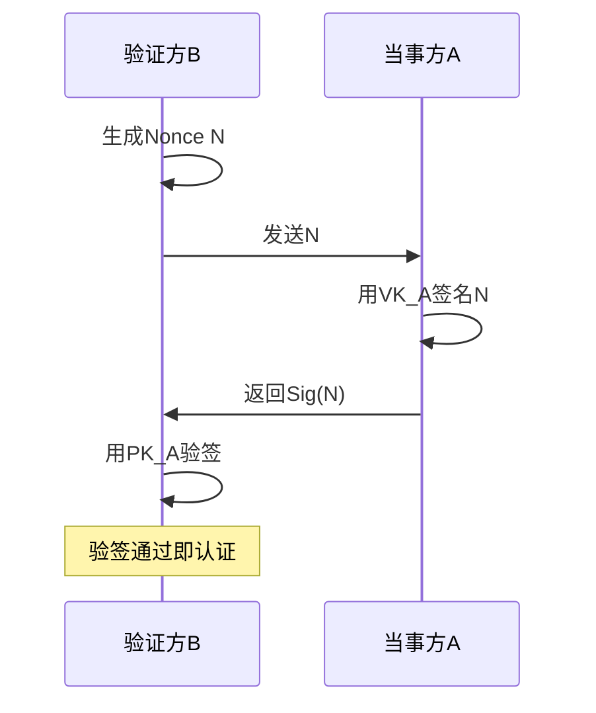
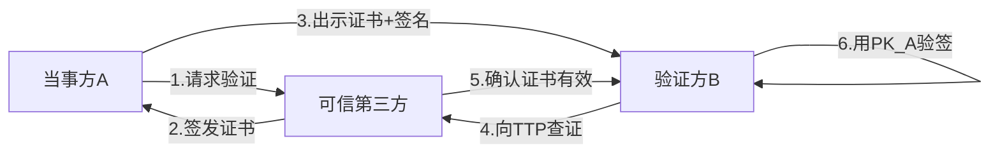

# 公钥密码体系身份验证协议（两方与三方身份验证协议）

## 为什么公钥验证需要“一次性数”？

如果A仅用自己的私钥 $\mathrm{VK_A}$ 对固定消息签名发给B，攻击者截获后能否在下次直接重放？答案是可以。因此，==公钥身份验证必须引入一次性数（Nonce）来抵抗重放攻击==。只有当B收到包含新鲜Nonce的签名响应时，才能确信A当前在线且持有私钥。

## 两方身份验证协议怎么做？

该协议适用于验证方B已权威获得A的公钥 $\mathrm{PK_A}$ 的场景。核心流程是“挑战-响应”：

> [!IMPORTANT]
> 协议成立的前提是B持有的 $\mathrm{PK_A}$ 必须真实可信，通常由CA签发证书保证。若公钥被替换，整个验证体系崩塌。

具体步骤为：B生成随机数 $N$ 发送给A；A使用私钥 $\mathrm{VK_A}$ 对 $N$ 进行数字签名得到 $\mathrm{Sig_{VK_A}}(N)$ 并返回；B使用 $\mathrm{PK_A}$ 验证签名有效性。验证通过则确认A的身份及实时性。

## 三方协议解决了什么痛点？

在两方协议中，B需预先安全存储所有通信对象的公钥。当用户规模扩大时，密钥管理成本呈线性增长。三方协议引入可信第三方（TTP），将“公钥分发”与“身份验证”解耦，B只需信任TTP即可动态获取任意用户的合法公钥。

> [!NOTE]
> 三方协议并非简单增加一个节点，而是将“静态预置公钥”转变为“动态证书验证”。A向B证明身份时，同时提交由TTP签名的证书 $\mathrm{Cert_A}$ 和对Nonce的签名，B通过验证证书链获得 $\mathrm{PK_A}$ 后再验证身份签名。

## 两方与三方协议对比

| 维度 | 两方协议 | 三方协议 |
| :--- | :--- | :--- |
| 公钥来源 | B本地预置 | TTP动态签发 |
| 适用规模 | 小规模、固定对端 | 大规模、开放环境 |
| 信任根 | B自身 | 可信第三方 |
| 抗重放机制 | Nonce + 签名 | Nonce + 签名 + 证书时效 |

## 常见误区与正确示例

> [!WARNING]
> 切勿将“加密”等同于“身份验证”。用 $\mathrm{PK_A}$ 加密消息只能保证机密性，无法证明发送者是A。==身份验证必须依赖私钥签名==。

**正确验证示例**：设B生成Nonce $N = \texttt{0x7F3A}$，A的私钥 $\mathrm{VK_A}$ 对 $N$ 签名得 $\sigma = \mathrm{Sig_{VK_A}}(\texttt{0x7F3A})$。B收到 $\sigma$ 后，计算 $\mathrm{Verify_{PK_A}}(\sigma, \texttt{0x7F3A})$。若输出为真，且 $N$ 未被使用过，则A身份验证成功。若攻击者重放旧签名 $\sigma'$ 对应 $N' \neq N$，B因Nonce不匹配而拒绝，有效防御重放。

> [!TIP]
> 解题关键：看到“公钥验证”先找Nonce；看到“三方”先找证书验证环节。两者缺一不可。
