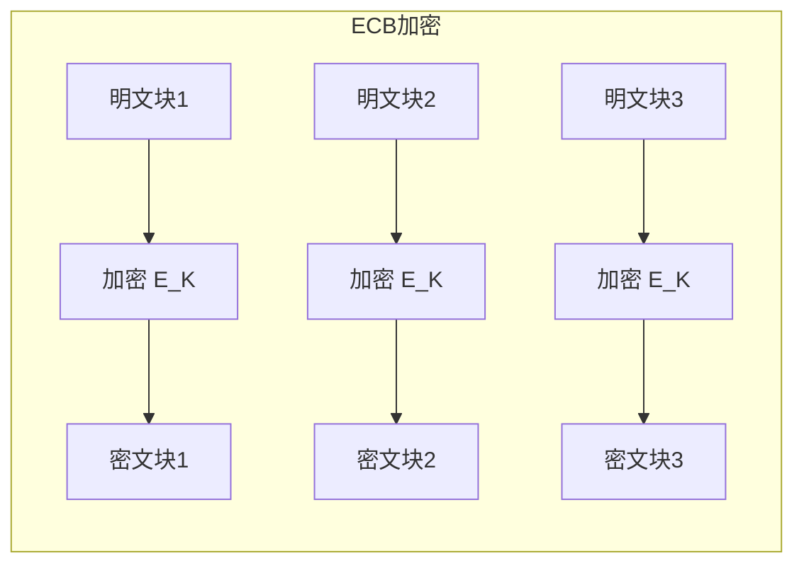
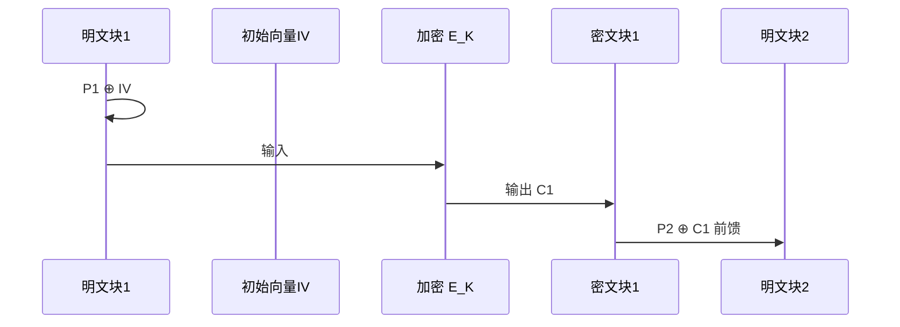

# 加密操作模式（分块填充、ECB、CBC、CFB、OFB模式及其分析）

## 加密操作模式

分组密码算法（如DES、AES）本身只能处理固定长度的单个数据块（例如128比特）。现实中的明文往往远长于这个长度，甚至可能不是块长的整数倍。==加密操作模式==就是解决“如何用固定块长的分组密码，安全地加密任意长度数据”这一问题的标准化方案。NIST标准化了四种基本模式：ECB、CBC、CFB和OFB。

### 分块填充

在讨论模式之前，需要先解决“数据长度不是块长整数倍”的问题。这项工作由**填充（Padding）**完成，它在加密前将明文补足至块长的整数倍。

- **为什么需要填充？** 分组密码的输入必须恰好为一个完整的块，最后一组不足时必须填补。
- **注意事项**：
  - 即使明文长度恰好是块长的整数倍，也**必须填充**一整块（如AES的PKCS#7填充在此时会追加16个`0x10`）。这避免了在解密时无法区分“原始数据恰好在这里结束”和“这里是被填充出来的”。
  - 流加密模式（CFB、OFB）天然不需要填充，因为它可以按比特或字节进行加密，不会产生浪费。

### 电子密码簿模式（ECB）

ECB是最直观的模式：直接将明文切分成块，每块用相同的密钥独立加密。

> [!WARNING]
> **核心安全缺陷**：对于固定的密钥，相同的明文块会产生相同的密文块。这会==暴露数据的固有模式==。

试想加密一幅位图图像，即使我们看不清内容，ECB加密后的结果依然能清晰地呈现出原始图像的轮廓。因此，ECB不应被用于加密长度超过一个块的数据，除非数据本身是完全随机的。

### 密文块链接模式（CBC）

CBC模式通过引入“链接”机制解决了ECB模式无法隐藏数据模式的问题。在加密前，先将当前==明文块与前一个密文块进行异或（XOR）==，再送入加密算法。

- **加密过程**：$C_i = E_K(P_i \oplus C_{i-1})$，其中 $C_0 = IV$
- **解密过程**：$P_i = D_K(C_i) \oplus C_{i-1}$，其中 $C_0 = IV$

- **初始向量（IV）**：它是一个公开的、无需保密的随机值，作用是让每次加密的“起点”不同，保证即使加密相同的明文，产生的密文也完全不同。IV可以明文传递。
- **链式依赖的代价**：加密过程因依赖前一个密文而无法并行；解密过程虽然可以并行（所需的前一个密文块已知），但若某个密文块出错，会导致本块和下一块解密失败。

### 密文反馈模式（CFB）

CFB可以将一个分组密码转换为**流密码**。它不直接加密明文，而是加密一个移位寄存器来产生==流密钥==，然后将流密钥与明文异或得到密文。

- **工作原理**（以 $j$ 比特为传输单元）：
  - 初始时，寄存器加载IV。
  - 对寄存器内容加密，取结果最左边的 $j$ 比特作为流密钥。
  - 将这 $j$ 比特流密钥与 $j$ 比特明文异或，产生 $j$ 比特密文。
  - 寄存器左移 $j$ 位，并将刚产生的 $j$ 比特**密文**反馈填入寄存器右端。
- **特点**：加密和解密都使用**加密**算法。适合需要实时处理、无需等待数据成块的场景（如终端通信）。

### 输出反馈模式（OFB）

OFB与CFB结构非常相似，唯一且关键的区别在于：**反馈的内容是加密算法的输出，而非密文**。

> [!IMPORTANT]
> CFB反馈的是密文，OFB反馈的是加密输出的伪随机序列。

这种“闭环”反馈机制使得流密钥的生成**完全独立于明文和密文**。因此，OFB可以预先计算流密钥，且在传输过程中，单个比特的密文错误**不会扩散**（即不会影响后续块的解密），这是一大优势。但必须注意，==IV绝不能重复使用==，否则会生成相同的流密钥，导致严重的安全问题。

### 四种模式的对比与辨析

> [!NOTE]
> **性能与并行的权衡**：ECB和CTR模式（本书未详述）支持加密解密双并行；CBC解密、OFB预计算可并行，加密不可；CFB加解密均不可并行。

| 特性 | ECB | CBC | CFB | OFB |
| :--- | :--- | :--- | :--- | :--- |
| **类型** | 块加密 | 块加密 | 流加密 | 流加密 |
| **并行加密** | 是 | 否 | 否 | 否（可预计算） |
| **错误扩散** | 限于本块 | 本块及下一块 | 影响约 b/j 个单元 | 不扩散 |
| **填充需求** | 需要 | 需要 | 不需要 | 不需要 |
| **安全建议** | 切勿使用 | 常用 | 特殊场景 | 需防IV重用 |

> [!TIP]
> **模式选择的简明指南**
> - 加密普通文件或数据包，首选 **CBC** 或其现代的改进模式。
> - 处理实时流式数据（如加密语音），对错误扩散敏感的场景，考虑 **OFB** 或 **CTR** 这类流模式。
> - **绝对不要** 在正式产品中使用 **ECB** 加密有结构的数据。

### 典型例题

**题目**：在CFB模式中，若在传输过程中某j比特密文块发生比特错误，会导致多少明文块解密出错？（设 j=8，分组长度 b=64 比特）

**解析**：
1.  CFB的加密过程是：寄存器 → 加密 → 取j比特 → 与明文异或生成密文；再将**错的那个密文**反馈移入寄存器。
2.  当接收方拿到那个有错位的j比特密文时，它会立即导致当前j比特明文解密错误（1次错误）。
3.  随后，这个错误的密文块被移入接收方的64比特移位寄存器。由于我们每次只取输出的8比特来异或，这个“坏”的寄存器需要经过 `64 / 8 = 8` 次移位（即加密8个后续单元）才能被完全移出。
4.  因此，这个1比特错误将导致**当前及后续共9个单元的解密错误**。在这段时间之后，寄存器被完全刷新，系统重新同步，解密恢复正常。
