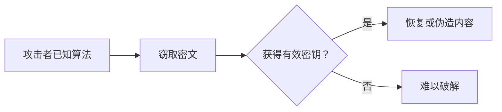

# 加密系统的安全性定义与加密算法公开原则

## 什么是加密系统的安全性

加密系统的安全性，是指攻击者即使知道明文、密文以及所使用的算法，也应难以恢复明文、伪造合法密文或篡改有效密文。安全性不是指“别人看不到密文”，而是指在公开条件下仍不能获得不应获得的信息。

设明文为 $M$，密钥为 $K$，加密算法为 $E$，解密算法为 $D$，则密码系统应满足：

$$
D(E(M,K),K)=M
$$

其中，$K$ 决定同一明文会产生什么密文；攻击者若不能获得 $K$ 或绕过算法，就不能求出 $M$。

> [!IMPORTANT]
> ==安全性依赖密钥保密，而不是算法保密。==安全性通常用攻击者所需计算量来衡量，而不是简单地声称“绝对安全”。

## 为什么需要它

没有加密时，网络中的数据可能直接泄露、冒充或被篡改。加密主要解决以下问题：

| 目标 | 含义 | 常见技术 |
|---|---|---|
| 保密性 | 防止内容被窃听 | 对称加密、非对称加密 |
| 完整性 | 发现数据是否被修改 | 消息认证码、数字签名 |
| 身份认证 | 确认通信者身份 | 证书、数字签名 |
| 不可否认性 | 证明消息确实由某方发出 | 数字签名 |

注意：==加密本身通常不自动保证完整性、认证和不可否认性==。例如，对称加密后的密文被攻击者翻转一位，解密可能只得到乱码，接收方未必能及时发现。

## 加密算法为什么可以公开

现代密码学遵循 **Kerckhoffs 原则**：密码系统的安全性应当只依赖于密钥的保密性，而不应依赖于算法保密。

公开算法带来明显好处：

1. 便于不同厂商实现互操作；
2. 便于安全专家审查漏洞；
3. 便于软件、硬件广泛部署；
4. 避免“算法泄露”直接导致系统失效。

因此，攻击者通常可假设其知道 $E$、$D$ 的结构和规则，真正的秘密是 $K$。实际使用的标准算法如 AES、RSA、ECC 等均公开，这是正常且必要的安全设计。

## 安全性如何评估

常见安全性概念包括：

- **计算安全性**：以当前技术条件，破解所需时间或成本不可接受；
- **无条件安全性**：即使拥有无限计算能力也不能破解；
- **信息论安全性**：密文与明文之间不存在可用于推断明文的信息。

密码算法还应满足正确性，即对合法输入能够正确加解密。但“能够解密”并不等于“容易被破解”：算法的安全性是对所有高效攻击而言的。

## 相近概念的区别

| 概念 | 核心问题 | 是否要求密钥 |
|---|---|---|
| 编码 | 如何表示数据 | 通常不要求 |
| 加密 | 防止未授权者获得内容 | 要求 |
| 哈希 | 生成固定长度摘要 | 不要求密钥 |
| 消息认证码 | 验证完整性与共享身份 | 要求 |
| 数字签名 | 验证身份、完整性与不可否认性 | 私钥签名、公钥验证 |

编码不是加密；哈希通常也不能直接解密；加密与签名解决的是不同安全问题。

> [!TIP]
> 记忆：算法公开，密钥保密；加密防“看不见”，签名和认证防“不能信”。

## 常见坑

> [!WARNING]
> 不要把“密文很长或看起来很乱”当作安全性证明，也不要把“算法公开”理解成“密钥公开”。此外，重复密钥、错误实现和弱随机数都会让强算法失效。

> [!CAUTION]
> AES 用于加密，RSA 或 ECC 可用于加密或签名，但“RSA 加密”和“RSA 签名”的底层机制与安全目标不同，不能混用。

## 算对了的例子

某系统采用 AES-128，攻击者知道明文格式、密文和 AES 算法，但不知道 128 位密钥。若采用穷举，平均需要尝试约 $2^{127}$ 个密钥，远超现实计算能力，因此系统具有很强的计算安全性。

但是，如果程序把密钥硬编码在公开源代码中，即使 AES 算法再强，攻击者也能直接得到密钥。此时安全性被破坏的不是算法，而是==密钥管理==。
