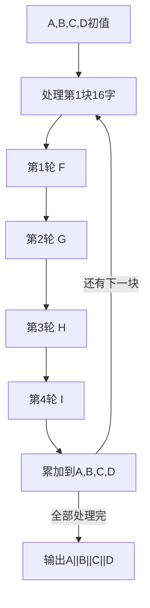

# 密码哈希函数特征与报文摘要算法MD5（填充、长度填写、寄存器初始化、循环处理与输出分析）

## 密码哈希函数与报文摘要算法 MD5

### 哈希函数要解决什么问题

在网络通信中，消息在传输途中可能被篡改。接收方如何确认收到的报文与发送方发出的一致？直接比较整篇报文不现实，于是人们想到：能不能为报文生成一段**固定长度的“指纹”**，只要报文发生任何变化，指纹就完全不同？

这个“指纹”就是==报文摘要==，生成它的算法叫**密码哈希函数**。它必须满足几个关键特征：

- **单向性**：给定摘要值 $h$，无法反推出原始报文；
- **弱抗碰撞性**：给定报文 $m$，找不到另一个 $m' \neq m$ 使 $H(m') = H(m)$；
- **强抗碰撞性**：无法找到任意两个不同报文 $m$、$m'$，使 $H(m) = H(m')$。

> [!IMPORTANT]
> 哈希函数不加密数据，它只为数据生成“完整性指纹”。加密解决的是**机密性**，哈希解决的是**完整性**，二者不能互相替代。

---

### 为什么是 MD5

互联网中广泛使用的密码哈希函数之一是 **MD5（Message Digest Algorithm 5）**，它由 Ron Rivest 设计，开源、计算快，输出固定 ==128 比特（16 字节）== 的摘要值。

MD5 类似分组密码：每次只处理一个 **512 比特** 的数据块。输入报文长度不固定，因此必须先做填充，再逐块压缩，最后输出摘要。

---

## MD5 的处理步骤

### 报文填充

设原始报文长度为 $l$ 比特，填充 $k$ 个比特，并预留 64 比特长度字段，最后总长必须为 512 的倍数：

$$l + k + 64 = 512 \times n \quad (n \in \mathbb{Z}^+)$$

因此 $k$ 由下式确定：

$$k \equiv 448 - l \pmod{512}$$

> [!WARNING]
> 无论原始报文长度是否已经是 512 的倍数，**都必须填充**。$k$ 的取值范围是 $1 \sim 512$。

填充格式为：第一个填充比特固定为 `1`，其余填充比特全为 `0`。填充完成后附加 64 比特的长度字段，记录原始报文的**比特长度** $l$。

> [!NOTE]
> SHA-1 的填充方式与 MD5 完全一致，替换算法时不需要修改预处理逻辑。

### 寄存器初始化

MD5 内部维护 4 个 32 位寄存器，组成 128 位状态：

| 寄存器 | 初始值（十六进制） |
|:---:|:---:|
| A | `0x67452301` |
| B | `0xEFCDAB89` |
| C | `0x98BADCFE` |
| D | `0x10325476` |

> [!TIP]
> 记忆口诀：A、B、C、D 的初值是 **“01234567、89ABCDEF、FEDCBA98、76543210 的低字节序”**。考场上核对初值即可，不必深究来源。

### 循环处理报文块

每块 512 比特按 32 比特划分为 16 个字 $M_0 \sim M_{15}$。MD5 共进行 **4 轮**、每轮 **16 步** 非线性运算，从 A、B、C、D 当前值出发，通过四轮函数更新寄存器：

| 轮次 | 非线性函数 | 定义 |
|:---:|:---:|:---|
| 1 | $F$ | $F(x,y,z) = (x \land y) \lor (\lnot x \land z)$ |
| 2 | $G$ | $G(x,y,z) = (x \land z) \lor (y \land \lnot z)$ |
| 3 | $H$ | $H(x,y,z) = x \oplus y \oplus z$ |
| 4 | $I$ | $I(x,y,z) = y \oplus (x \lor \lnot z)$ |

每一步中，寄存器按固定顺序循环移位，并与当前报文子块、常数 $T_i$ 及非线性函数输出做模 $2^{32}$ 加法。

### 输出

处理完所有 512 比特块后，将 A、B、C、D 按**低字节序**拼接，即得 128 比特的 MD5 摘要。

---

## 算一个简化的例子

假设原始报文长度 $l = 128$ 比特，则：

$$k \equiv 448 - 128 = 320 \pmod{512}$$

填充后总长：

$$128 + 320 + 64 = 512$$

恰好一个块。填充序列为：1 个比特 `1`，319 个比特 `0`，随后追加 64 比特长度字段（值为 128，即 `0x0000000000000080`）。

---

## 常见坑与辨析

> [!CAUTION]
> 长度字段存的是**比特长度**，不是字节长度。若 $l$ 为字节数，须乘 8 再填入。

> [!WARNING]
> MD5 已被证明存在碰撞漏洞（王小云等），==不适合用于安全性要求高的场景==。目前更推荐 **SHA-1 升级版（SHA-256 等）**。

| 项目 | MD5 | SHA-1（升级版 SHA-256） |
|:---:|:---:|:---:|
| 摘要长度 | 128 bit | 160 bit（256 bit） |
| 分组长度 | 512 bit | 512 bit |
| 安全性 | 已不安全 | 较安全 |
| 填充方式 | `1` 后补 `0` + 64 位长度 | 与 MD5 相同 |

> [!IMPORTANT]
> 报文摘要算法解决的是**完整性验证**，不提供加密。若要同时验证完整性与身份来源，需使用 **HMAC**（基于哈希函数的消息认证码），它引入密钥并定义了内、外填充值 IPAD 与 OPAD。
