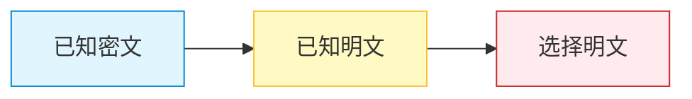

# 密码学基本概念、符号表示与密码破译技术（已知密文、已知明文、选择明文攻击）

## 密码学符号与安全模型基石

在深入具体加密算法前，必须先统一“语言”并明确“敌人”的能力边界。若不知道攻击者掌握什么信息，就无法定义何为安全。密码学的安全性并非绝对，而是==相对于某种风险模型而言的==。我们通常用以下符号构建分析框架：

-   $M$ / $P$：明文（Message / Plaintext）
-   $C$：密文（Ciphertext）
-   $K$：密钥（Key）
-   $E_K(M)$：加密函数，满足 $C = E_K(M)$
-   $D_K(C)$：解密函数，满足 $M = D_K(C)$

> [!IMPORTANT]
> 核心原则：现代密码学遵循 Kerckhoffs 原则，即==假设攻击者已知加密算法==，安全性仅依赖于密钥 $K$ 的保密性。因此，所有破译技术的目标本质上都是获取 $K$ 或等效的解密能力。

## 三类经典密码破译技术

如果攻击者截获了通信数据，他究竟掌握了多少筹码？根据掌握信息的递增程度，我们将攻击分为三个层级。思考一下：仅仅看到乱码，和能主动构造特定明文去试探系统，破解难度有何本质区别？

| 攻击类型 | 攻击者掌握的信息 | 攻击性质 | 防御要求 |
| :--- | :--- | :--- | :--- |
| 已知密文攻击 | 仅密文 $C$ | 最盲目、被动 | 基础门槛 |
| 已知明文攻击 | 大量 $(M, C)$ 对 | 被动系统识别 | ==必须防范== |
| 选择明文攻击 | 可自选 $M$ 获对应 $C$ | 主动系统识别 | 最好能防范 |

### 已知密文攻击

攻击者仅掌握若干密文 $C$，试图恢复明文 $M$ 或密钥 $K$。这是信息量最少、最为盲目的攻击形式。若一个算法连此攻击都无法抵御，则完全不可用。

### 已知明文攻击

攻击者掌握了由==相同算法和相同密钥==生成的若干 $(M, C)$ 对。这属于“被动系统识别”，攻击者虽不能控制输入，但能通过历史数据分析算法弱点。例如，标准文件头、固定协议握手包等都可能成为已知明文的来源。

### 选择明文攻击

攻击者可以==主动选择任意明文 $M$== 并获得对应的密文 $C$。这属于“主动系统识别”，威胁等级最高。攻击者可通过精心构造的特殊明文（如全零、特定模式）来探测算法内部结构。

> [!WARNING]
> 常见误区：认为“已知明文”就是“知道算法”。实际上，已知明文攻击的关键在于拥有==同一密钥下==的配对样本，而非知晓算法本身。算法公开是前提，配对数据才是攻击资源。

## 如何判定密码系统安全

一个安全的加密系统至少应满足什么条件？答案是：==必须能够抵御已知明文攻击==，理想情况下还应抵抗选择明文攻击。这意味着即使攻击者收集了大量历史通信对，甚至能进行有限次的加密查询，仍无法推导出密钥 $K$ 或预测新密文对应的明文。

> [!TIP]
> 解题口诀：密文最盲，明文被动，选明主动；安全底线防已知，高标需抗选择攻。评测任何加密算法时，务必先确认其设计目标对应哪类攻击模型，脱离模型谈安全毫无意义。
