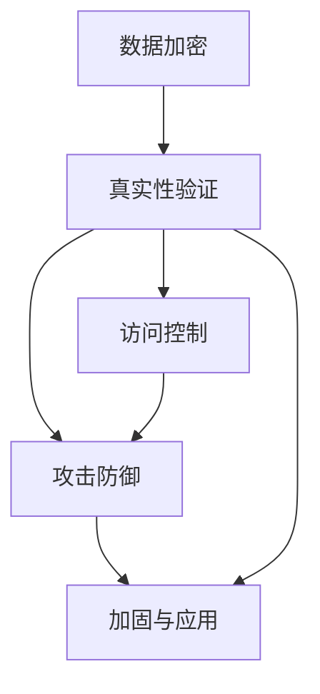

# 应对网络威胁的网络安全技术（真实性验证、访问控制、防火墙、防御、加固与应用）

## 应对网络威胁的网络安全技术

### 从“目标”倒推“技术”

网络安全要保护的是网络系统本身与网络应用系统，落到具体指标上就是三条：==保密性、完整性、可用性==。攻击者想破坏的也正是这三条——截获数据破坏保密性，篡改报文破坏完整性，发起拒绝服务或蠕虫攻击破坏可用性。

先问一个问题：如果任何人都能声称自己是合法用户，任何报文都可能在中途被改动，那么“允许谁做什么”的规则还有意义吗？

显然没有。所以网络安全技术之间存在严格的依赖次序：先确认“你是谁、数据有没有被改过”，才能谈“你能做什么”，最后才是在攻击发生时“如何发现和补救”。课程提纲里用一张层次表表达了这个关系：

| 层次 | 技术类别 |
|------|----------|
| 第 3 层 | 网络安全加固、网络安全应用 |
| 第 2 层 | ==真实性验证==、==访问控制==、==攻击防御== |
| 第 1 层 | 数据加密 |

数据加密不是单独一层“网络安全技术”，而是第 2 层所有技术的基础工具。例如身份验证协议要依赖加密的挑战—应答机制，报文真实性验证要用消息认证码或数字签名。

### 三大基本技术分别解决什么

**真实性验证**回答两个问题：通信对方是不是他声称的那个实体？（==身份真实性验证==）收到的报文是不是发送者发出的原始内容？（==报文真实性验证==）前者应对假冒通信方，后者应对数据篡改和重放。它对应课程所说的“真”——甄别假冒，确保真实。

**访问控制**建立在身份真实的前提上：根据预先设定的策略，授予访问者符合其身份的访问范围和操作类型。它对应“善”——剔除恶意，确保善意。访问控制必须记录审计日志，否则出了问题无从追溯。

**攻击防御**包含预防、检测、补救三个环节。预防靠前两项技术，检测是监督和反馈环节，补救是对检测结果进行恢复和修补。它对应“美”——夯实防御，确保完美。

> [!IMPORTANT]
> 三者的依赖关系不可颠倒：==没有真实性验证，访问控制就建立在虚假身份上==；没有访问控制，攻击防御就缺失了预防环节。三者共同支撑上层的安全加固与安全应用。

### 防火墙：访问控制的典型落地

防火墙不是“防一切攻击的墙”，它的本质是==网络层的访问控制机制==。在不同的协议层次，防火墙实现不同的控制粒度：

| 层次 | 控制方式 | 控制对象 |
|------|----------|----------|
| 网络层 | 分组过滤 | 源/目的 IP 地址 |
| 传输层 | 端口允许/禁止 | TCP/UDP 端口号 |
| 应用层 | 代理服务器 | 域名、服务器名、协议类型 |

> [!WARNING]
> 常见误区：以为防火墙能防止所有攻击。实际上防火墙管不了==通过合法端口注入的应用层攻击==（如 SQL 注入），也管不了内网用户主动外联的恶意流量。它只是访问控制，不是完整的安全体系。

### 网络安全加固与应用

现有互联网协议最初并未内置安全能力，这是网络攻击层出不穷的根源。网络安全加固就是在现有协议上==扩展内置的安全能力==：IPSec 是对 IP 协议的安全加固，SSL/TLS 是对 TCP 服务的安全加固。

网络安全应用则是将核心技术在具体场景中落地——电子邮件安全应用、万维网安全应用（如安全登录、网站攻击防御）、区块链安全应用，以及在软件开发全生命周期中融入安全实践。

### 一个算得通的例子

假设某机构需要在防火墙规则中控制内网用户对外部 Web 服务的访问。策略要求：仅允许内网客户端访问外部 HTTP/HTTPS，禁止其他一切外联。

规则设计如下（简化表示）：

| 序号 | 源地址 | 目的地址 | 协议 | 目的端口 | 动作 |
|------|--------|----------|------|----------|------|
| 1 | 内网段 | 任意 | TCP | 80 | 允许 |
| 2 | 内网段 | 任意 | TCP | 443 | 允许 |
| 3 | 任意 | 任意 | 任意 | 任意 | 拒绝 |

第 3 条是==默认拒绝规则==，这是防火墙配置的关键：访问控制策略必须是“白名单”思维，先否
