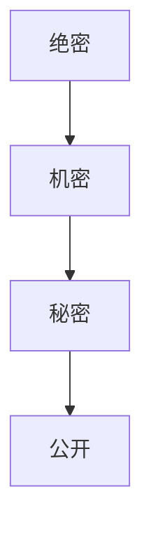

# 强制访问控制策略与军用安全策略Bell-LaPadula模型（优点及举例）

## 它是什么

想象一下：如果一个间谍已经“合法”登录进了军队内网，还能随手把绝密文件降级成公开文件发出去——这还怎么防？

在“第4章 访问控制技术及应用”里，自主访问控制（DAC）让资源所有者自己定权限（比如 Linux 里的 `chmod`）。但如果系统里有恶意程序（木马），它能直接改权限把机密泄露出去。所以对于军队、政府这类高安全要求场景，必须用 ==强制访问控制 MAC==：系统**强制**给主体（用户/进程）和客体（文件/数据）打上 ==安全标签==，用户不能自己改。

军用安全策略的典型代表，就是 **Bell-LaPadula 模型（BLP）**。它只关心一件事：**保密性**（防止信息从高流向低）。

## 怎么做：BLP 的两条铁律

BLP 给每个主体和客体分配一个密级，比如公开 < 秘密 < 机密 < 绝密。

> [!IMPORTANT]
> BLP 的两条核心控制规则：
> - **简单安全规则（不下读）**：主体只能读**不高于**自己密级的客体。
> - **\*-规则 / 星号规则（不上写）**：主体只能向**不低于**自己密级的客体写。

用数学表达就是：
- 读：$级别(主体) \ge 级别(客体)$
- 写：$级别(主体) \le 级别(客体)$

| 操作 | 条件 | 方向 | 记忆 |
|---|---|---|---|
| 读 | 主体 $\ge$ 客体 | 只能向下看 | ==不下读== |
| 写 | 主体 $\le$ 客体 | 只能向上写 | ==不上写== |

## 为什么需要：一个算对了的例子

题目：某系统采用 BLP 模型，密级为“公开<秘密<机密<绝密”。若主体 $S$（秘密级）要访问客体：绝密文件 $A$、秘密文件 $B$、公开文件 $C$，请问分别能读、能写吗？

一步步看：
- 看 $A$（绝密）：$S$ 是秘密，秘密 $\ge$ 绝密？否 → ==不能读==；秘密 $\le$ 绝密？是 → 能写。
- 看 $B$（秘密）：同级，秘密 $\ge$ 秘密 成立 → 能读；秘密 $\le$ 秘密 成立 → 能写。
- 看 $C$（公开）：秘密 $\ge$ 公开 成立 → 能读；秘密 $\le$ 公开？否 → ==不能写==。

这就是“不下读、不上写”的严格应用——信息只能从低往高流（或同级流动），**绝不能从高泄到低**。

## 和相近概念的区别

DAC 是“我的文件我做主”，灵活但防不住内鬼和木马；MAC（含 BLP）是“系统说了算”，标签钉死，适合军用。BLP 管保密，所以只限制 ==读上不读下、写下不写上==；别和后面讲“完整性”的 Biba 模型搞反——Biba 是反过来防篡改的。

> [!WARNING]
> 常见坑：
> 1. 把“不下读”记成“不能写低”——写低恰恰被 \*-规则禁止，叫“不上写”，别混。
> 2. BLP **只保保密性**，不保证数据不被低完整性主体污染，那是别的模型的事。
> 3. “\*-规则”也叫星号规则、上写规则，课件里常简写作 \*属性或 \*-property，考试别认生。

> [!TIP]
> 口诀：**“下读上写，秘密不泄”**；画条密级轴，箭头从低指高，读写条件用不等式一套就出答案。
