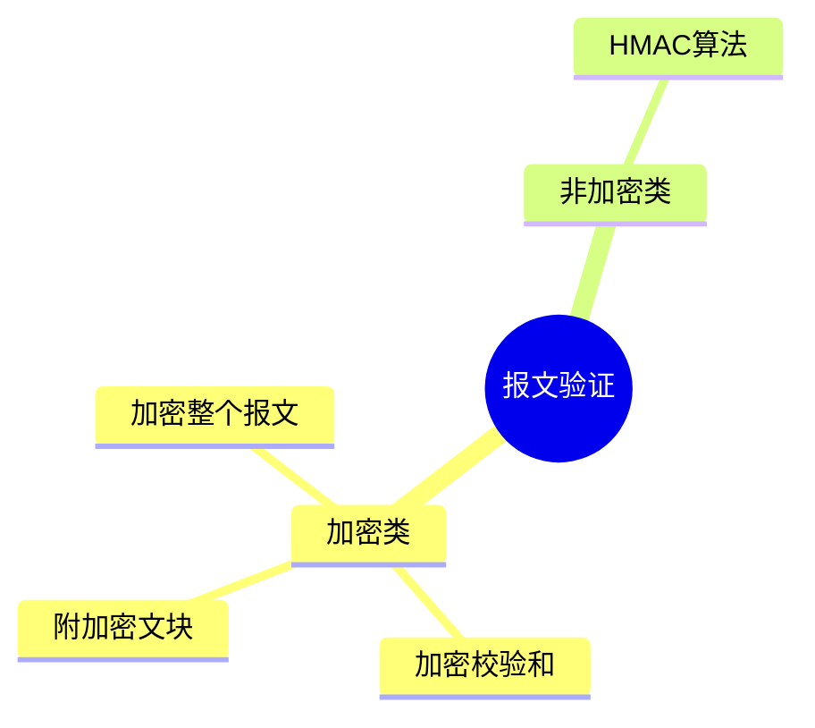

# 报文真实性验证方法（加密整个报文、加密校验和、附加密文块、非加密报文验证）

> [!IMPORTANT]
> 报文真实性验证的目的是==确认报文确实来自声称的发送方，且在传输过程中未被篡改==。

试想：如果攻击者截获报文并修改了内容，接收方如何察觉？仅靠数据本身的“校验和”能防住蓄意篡改吗？答案是不能，因为攻击者可以重新计算校验和一并替换。因此我们需要更可靠的验证方法。

## 报文特征与验证码

课件将验证过程拆分为两步技术：

- **提取报文特征技术**：生成==报文摘要==（如哈希值）。
- **验证报文真伪技术**：利用摘要生成==报文验证码==。

根据是否使用加密算法，报文验证方法分为两大类。

## 加密报文验证方法

### 加密整个报文

发送方用密钥 $K$ 对整个报文 $M$ 加密得到 $E_K(M)$。接收方若能成功解密且结果有意义，即认为报文真实。

- **优点**：安全性最高，同时提供机密性与真实性。
- **不足**：加解密开销大，影响网络性能。

### 加密校验和

一般报文具有用于检测差错的校验和。此方法不加密整个报文，==仅对报文的校验和进行加密==，将明文报文与加密后的校验和一同发送。

- **优点**：比全报文加密快。
- **不足**：若校验和算法较弱，仍可能被伪造。

### 附加密文块

在报文末尾附加一个由密钥生成的固定密文块。接收方验证该密文块是否正确。

> [!WARNING]
> 加密校验和与附加密文块揭示了报文验证的一个关键问题：==必须将验证信息与报文绑定，防止攻击者剥离或替换验证信息==。

## 非加密报文验证方法

互联网中常用的是**哈希报文验证码算法（HMAC）**。它利用哈希函数和共享密钥生成报文验证码，不需要加密算法。

$$HMAC(K, M) = H((K^+ \oplus opad) \| H((K^+ \oplus ipad) \| M))$$

> [!TIP]
> 记忆要点：HMAC 是“非加密”的，靠哈希 + 密钥实现验证。

- **优点**：提高验证效率，不对网络性能造成较大影响；不受加密算法专利保护的限制。
- **不足**：不提供报文机密性。

## 方法对比

| 方法 | 是否加密 | 性能开销 | 提供机密性 | 典型代表 |
| :--- | :---: | :---: | :---: | :--- |
| 加密整个报文 | 是 | 高 | 是 | 分组密码全加密 |
| 加密校验和 | 是 | 中 | 否 | 仅加密CRC等 |
| 附加密文块 | 是 | 低 | 否 | 尾部加固定块 |
| 非加密报文验证 | 否 | 极低 | 否 | HMAC |

> [!NOTE]
> **相近概念区别**：“加密”解决的是保密性问题（别人看不懂），“报文验证”解决的是真实性问题（确认没被改、确实是对方发的）。两者可结合，但目的不同。

## 算例演示

假设 Alice 向 Bob 发送报文 $M = \text{"hello"}$，双方共享密钥 $K$。采用 HMAC 方式：

1. Alice 计算验证码：$V = HMAC(K, \text{"hello"})$，发送 $(M, V)$。
2. 攻击者将报文改为 $\text{"hallo"}$，但无法伪造新验证码（无密钥 $K$）。
3. Bob 收到后重新计算 $V' = HMAC(K, \text{"hallo"})$。
4. 比较发现 $V' \neq V$，==判定报文被篡改，拒绝接收==。

> [!CAUTION]
> 常见坑：误以为“加密了整个报文就不需要单独做验证”。实际上若密文被截断或重放，仍需机制保障完整性与新鲜性。考试中务必分清“加密”与“验证”各自解决的问题。
