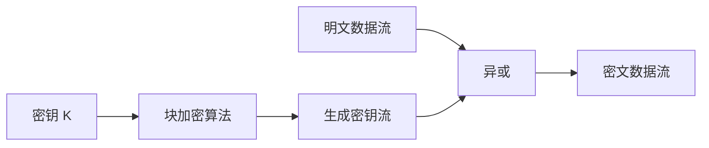

# 数据加密分类（流加密与块加密、对称密钥与不对称密钥加密）

数据加密可按两个维度分类：按明文处理方式，分为**流加密**与**块加密**；按加密、解密密钥是否相同，分为**对称密钥加密**与**不对称密钥加密**。这两个维度相互独立，例如 AES 是“对称密钥＋块加密”，RC4 是“对称密钥＋流加密”，RSA 则是不对称密钥加密。

## 流加密与块加密

==流加密==连续处理数据流中较小的数据单元，通常由密钥 $K$ 生成伪随机的**密钥流** $KS(K)$，再与明文逐比特异或：

$$C_i=P_i\oplus KS_i(K),\qquad P_i=C_i\oplus KS_i(K)$$

它速度快、时延小，适合话音流、视频流等场景。==块加密==则把明文划分为固定长度的数据块，对每个块进行一系列复杂运算，输出**相同长度**的密文块，可写为 $C=E_K(P)$，其中 $P,C$ 均为 $n$ 比特。DES、AES 都是典型块加密算法。

| 比较项 | 流加密 | 块加密 |
|---|---|---|
| 处理对象 | 较小的数据单元，常逐比特处理 | 固定长度的数据块 |
| 基本运算 | 密钥流与明文异或 | 对数据块进行复杂变换 |
| 输出特点 | 形成连续密文流 | 输出等长密文块 |
| 典型应用 | 实时数据流 | 文件、报文等数据块 |
| 典型算法 | RC4 | DES、AES |

> [!WARNING]
> 流加密中，==不同明文不能重复使用相同密钥流==。若 $C_1=P_1\oplus KS$、$C_2=P_2\oplus KS$，则 $C_1\oplus C_2=P_1\oplus P_2$，会泄露两条明文之间的关系。

## 能否用块加密替代流加密

可以，但要借助**加密操作模式**。CFB、OFB 能利用块加密算法生成密钥流，再与明文数据流异或，从而把块加密算法用于流式加密；它们不需要把末尾数据填充成完整分组。ECB、CBC 则属于块加密模式。

因此，考试回答“能否替代”时，不能只答“能”，还应说明：==通过 CFB、OFB 等模式可以实现==，并非直接把任意长度的数据交给一个固定分组的块算法。

## 对称密钥与不对称密钥

设加密密钥为 $K_E$，解密密钥为 $K_D$：

- **对称密钥加密**：$K_E=K_D$，通信双方使用同一密钥，加解密速度快，适合大量数据加密；难点是密钥分发与管理。
- **不对称密钥加密**：$K_E\ne K_D$，通常使用公钥和私钥。公钥可公开，私钥必须保密，主要用于数字签名、对称密钥协商等。

> [!IMPORTANT]
> 不对称密钥算法一般不能完全替代对称密钥算法。其运算开销通常较大，不适合直接加密大量数据；实际系统常采用==混合加密==：用不对称密钥算法完成身份认证或会话密钥协商，再用对称密钥算法加密业务数据。

## 一个判断例子

题目给出某算法：“块长度为 128 比特，密钥长度为 128 比特，加密和解密使用同一密钥。”应判断为**对称密钥的块加密算法**。理由是“固定 128 比特分组”说明块加密，“加解密密钥相同”说明对称密钥；密钥长度恰好也是 128 比特，并不是判断分类的依据。
