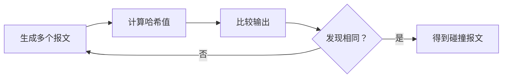

# 生日现象与生日攻击、安全哈希函数抗攻击性及数字签名

## 生日现象：为什么“两个人同生日”比想象中容易

先想一个直觉问题：一年按 $365$ 天算，房间里是不是要有 $180$ 多人，才容易出现两个人同一天生日？答案是否定的。生日现象关注的是**任意两个人**的生日相同，而不是某个人与指定日期相同。人数增加时，可比较的人员对数增长很快，因此只需约 $23$ 人，存在同一天生日的概率就超过 $50\%$。

> [!IMPORTANT]
> 生日现象是指在同一群体中，较容易出现两个对象具有相同属性的现象；在密码学中，它对应哈希函数的**碰撞**：两个不同报文得到相同哈希值。

## 从生日现象到生日攻击

设哈希值长度为 $n$ 比特，则共有 $2^n$ 种可能输出。若攻击者只针对某个指定报文寻找另一个同哈希值报文，通常需要约 $2^n$ 次尝试；但生日攻击不指定碰撞对象，只需找到任意两个不同报文 $m_1,m_2$，使

$$H(m_1)=H(m_2),\qquad m_1\ne m_2.$$

由于大量报文之间可以两两比较，攻击者约尝试 $2^{n/2}$ 个不同报文，就有 $50\%$ 以上的可能找到碰撞。因此，==抗生日攻击的强度约为哈希值长度的一半==，而不是全部 $n$ 比特。

生日攻击会破坏哈希函数用于报文真实性验证的基础：如果签名者先对正常报文 $m_1$ 的哈希值签名，攻击者又找到同哈希值的恶意报文 $m_2$，就可能把原签名套用到 $m_2$ 上。因此，数字签名不仅要求“签名难伪造”，还要求底层哈希函数==抗碰撞==。

## MD5、SHA-1与安全长度

| 算法或目标 | 哈希值长度 | 生日攻击量级 | 课件中的判断 |
|---|---:|---:|---|
| MD5 | $128$ 位 | 约 $2^{64}$ 次 | 防范能力较弱，存在安全隐患 |
| SHA-1 | $160$ 位 | 约 $2^{80}$ 次 | 按当时计算条件，较可能防范生日攻击 |
| 安全哈希函数的一般要求 | 输出足够长 | 碰撞搜索应不可行 | 同时满足抗碰撞等安全性质 |

> [!NOTE]
> 课件以当时的计算条件评价 SHA-1。实际工程中，SHA-1 和 MD5 都已被发现现实碰撞，均不应再用于新的数字签名或完整性保护；不能仅凭“$2^{80}$ 次很难”就认定 SHA-1 今天仍安全。

安全哈希函数还应区分三类性质：**抗原像攻击**是给定 $h$，难以找到 $m$ 使 $H(m)=h$；**抗第二原像攻击**是给定 $m_1$，难以找到不同的 $m_2$ 与其同哈希值；**抗碰撞攻击**是难以找到任意一对碰撞报文。生日攻击主要对应第三类，其通用搜索复杂度约为 $2^{n/2}$。

## 算对一道题

问：为什么 MD5 仍会遭受生日攻击？

答：MD5 输出报文摘要为 $128$ 比特，输出空间大小为 $2^{128}$。生日攻击只需寻找任意两个不同报文的碰撞，因此尝试约

$$2^{128/2}=2^{64}$$

个报文，就有较高概率找到碰撞，而不是必须尝试 $2^{128}$ 次。随着计算能力提高，$2^{64}$ 量级已不能提供充分安全余量，所以 MD5 难以防范生日攻击，不适合继续承担安全签名中的哈希功能。

> [!WARNING]
> 常见失分点有三个：把“约 $23$ 人”答成 $183$ 人；把生日攻击复杂度写成 $2^n$；把“找到任意碰撞”误写成“针对指定报文找同摘要报文”。答题时务必写出 $n$ 位摘要对应约 $2^{n/2}$ 次攻击量级。
