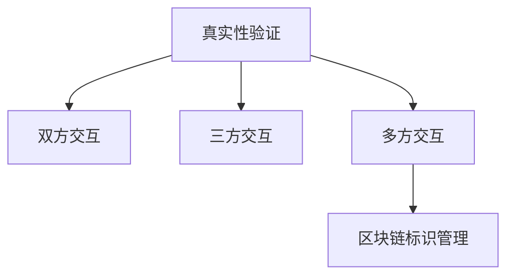
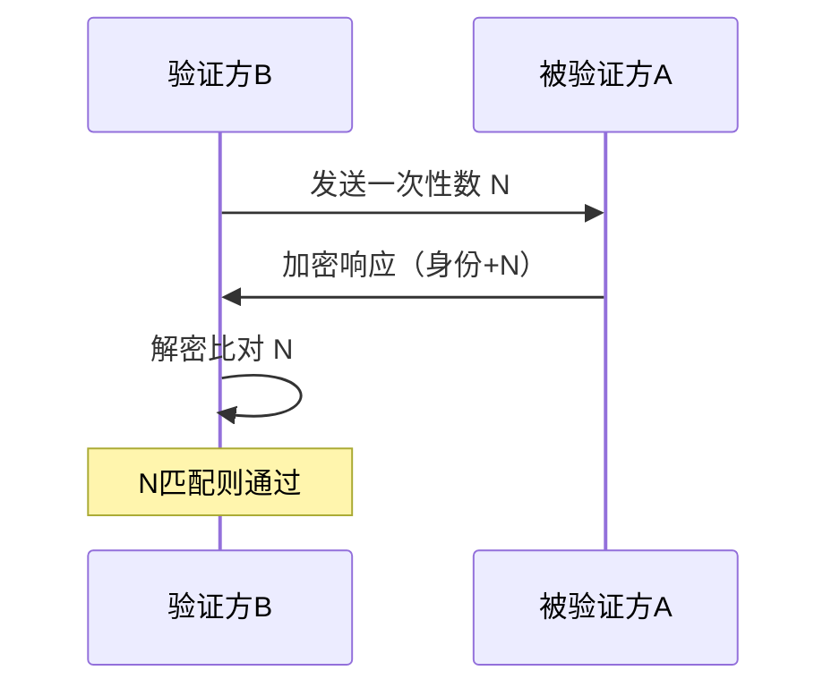

# 真实性验证的作用、必要性、发展历史及技术分类（基于知识、标志、特征及组合，交互方式）

## 真实性验证：作用与必要性

网络参与方之间唯一的交互方式是**报文交互**，而报文本身可以被伪造、重放。因此，真实性验证是==网络安全控制的第一步==：确认“对方真的是对方”，才能防范数据假冒、电子合同欺诈。反过来说，若无法验证真伪，后续一切加密、授权都失去了意义。

## 技术分类：三个因子

真实性验证的核心思路是找出“只有真身能提供的东西”。据此分为三类：

| 分类 | 依据 | 身份验证例子 | 报文验证例子 | 特点 |
| --- | --- | --- | --- | --- |
| 基于知识 | “知道什么” | 账户/密码登录 | 保密字、密钥验证 | 最易掌握，==也最容易被假冒== |
| 基于标志 | “拥有什么” | 员工卡门禁、智能卡、信用卡 | 采用加密标识的报文验证 | 依赖物品保管 |
| 基于特征 | “是什么” | 指纹、人脸等生物特征 | —— | 唯一性最强 |

三者可以**组合**使用（如密码+智能卡），互补短板。具有“人工智能”装置的身份验证也可借鉴此思路。

> [!TIP]
> 记忆口诀：**知道、拥有、是什么**——三者皆能证，组合更可靠。

## 交互方式

按参与方数目划分：

- **双方交互**：只涉及验证方与被验证方，通过验证协议单向或双向验证身份；
- **三方交互**：引入可信第三方协助（PKI 正是为此存在——==真实公钥是真实性验证的保障==）；
- **多方交互**：如区块链的标识管理技术。

## 示例：A 向 B 验证真实身份

问题：A 如何证明自己身份，且不让攻击者重放旧报文蒙混过关？关键是引入**一次性数 $N$**——标识报文“已用过”，防范重播攻击。

关键处理：
- **B**：生成随机一次性数 $N$ 发送给 A；收到响应后解密，比对 $N$ 是否与本次一致。
- **A**：用双方共享密钥（或 A 的私钥）加密自己的身份信息和 $N$，回送给 B。

由于 $N$ 每次更新，攻击者截获旧报文后重放，$N$ 对不上，验证失败。

> [!WARNING]
> 常见坑：只用“身份+口令”而不加一次性数，协议看似能验证身份，实则可被重播攻击直接攻破；答题时务必写出 $N$ 的引入及 B 的比对步骤。另外注意区分：**身份验证**针对“人/实体”，**报文验证**针对“消息是否被篡改伪造”，两类技术不要混淆。
