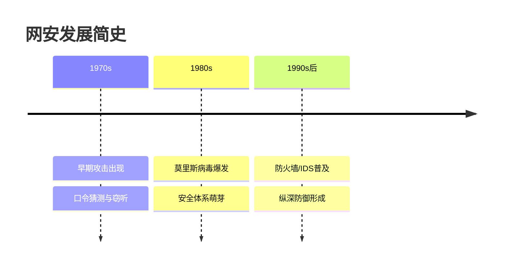
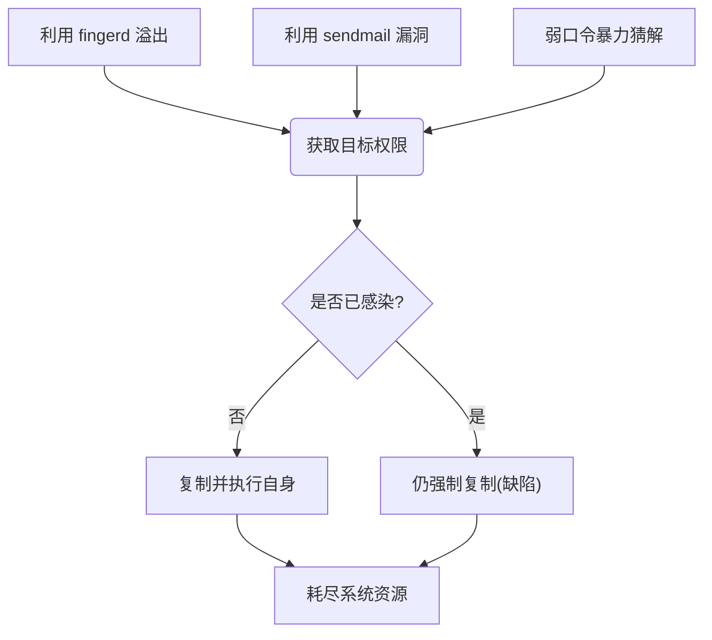

# 网络安全发展历史（早期攻击、技术诞生与莫里斯病毒）

网络安全技术是一类有关通信、计算机、网络技术领域的综合安全技术。在正式学习各种防御机制前，我们需要先回答一个问题：==为什么需要网络安全体系？== 答案很简单——持续的网络攻击事件催生并发展了它。没有攻击，就没有防御的动机。

## 早期攻击与技术诞生

早期的网络（如 ARPANET）设计初衷是“互信环境下的资源共享”，几乎没有考虑安全。当网络从封闭走向开放，攻击便随之而来。

> [!NOTE]
> 课件指出，网络安全的英文名称是 **cyber security**，也常被翻译为“信息安全”。在南邮这门课中，两者在宏观概述层面通常指代同一范畴，但严格来说“信息安全”外延更广（含物理载体等），而 cyber security 更聚焦网络空间。

## 莫里斯病毒与网络安全

如果让你写一段程序让全网计算机都运行你的代码，你会怎么做？1988年，康奈尔大学研究生 Robert Morris 给出了一个灾难性的示范——**莫里斯蠕虫（Morris Worm）**。

它是如何运作的？

莫里斯病毒的本意或许是“测量互联网规模”，但它利用了三个关键手段：`fingerd` 缓冲区溢出、`sendmail` 调试模式漏洞以及基于字典的弱口令破解。

> [!IMPORTANT]
> 核心考点：莫里斯病毒导致约 6000 台机器瘫痪，直接催生了全球第一个计算机应急响应组织 ==CERT==（Computer Emergency Response Team），==标志着网络安全从被动应对走向体系化发展==。

这里有一个致命的设计缺陷：为了防止被轻易清除，Morris 设定即使目标已感染，仍有 $\frac{1}{7}$ 的概率再次复制自身。这导致了什么后果？

假设一台机器已被感染 $n$ 次，每次驻留消耗内存 $M_0$，则总消耗为：

$$ M_{total} = n \times M_0 $$

由于无限制重复感染，$n$ 迅速增大，最终耗尽 CPU 和内存资源，使系统崩溃。这就是它从“测量工具”变成“破坏性病毒”的根本原因。

## 相近概念辨析与常见坑

考试中常将几个概念混淆，请通过下表区分：

| 概念 | 传播方式 | 是否需要宿主文件 | 典型代表 |
| :--- | :--- | :---: | :--- |
| **蠕虫 (Worm)** | 利用漏洞自动传播 | 否 | 莫里斯病毒 |
| **病毒 (Virus)** | 依附文件人工触发 | 是 | CIH 病毒 |
| **木马 (Trojan)** | 伪装正常软件诱骗 | 否 | 冰河木马 |

> [!WARNING]
> 易错坑：很多同学习惯称其为“莫里斯**病毒**”，但在分类学上它其实是“莫里斯**蠕虫**”。答题时若题目问“莫里斯病毒属于哪种恶意代码类型”，应回答 ==蠕虫==，因为它不需要宿主文件即可独立自我复制和网络传播。

> [!TIP]
> 记忆口诀：**“蠕虫自己爬，病毒靠人带，木马装好人”**。莫里斯病毒正是“自己爬”的典型，利用网络服务漏洞自主扩散。

回顾这段历史，网络安全的发展逻辑非常清晰：早期网络的信任模型被打破 $\rightarrow$ 攻击事件频发（以莫里斯蠕虫为分水岭） $\rightarrow$ 催生应急响应机制与综合安全技术体系。理解了这条脉络，后续章节中的访问控制、密码学应用等技术就不再是孤立的知识点，而是应对特定历史威胁的必然产物。
